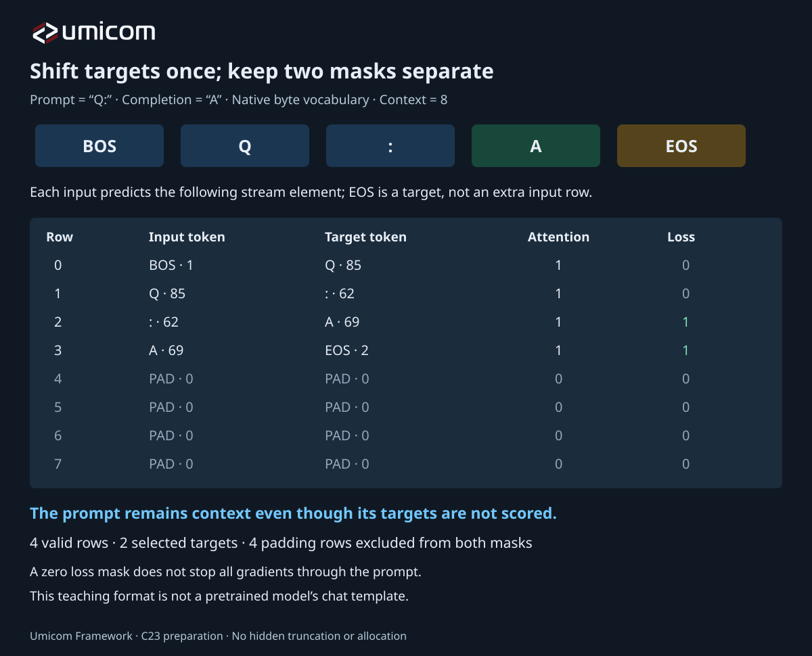

<!--
Umicom Bits2Banking
File: content/lessons/05-ai/preparing-llm-training-data/27-prepare-a-byte-pair-without-shifting-twice.md

PURPOSE:
Prepare a byte pair without shifting twice

AUTHOR AND ORGANISATION:
Sammy Hegab
Umicom Foundation

LICENCE:
MIT
-->

# Prepare a byte pair without shifting twice

[Course contents](index.md)

## The missing step between a record and a training call

A JSON object can store a prompt and an answer, but a model does not learn directly from dictionary keys. The text must become numbers in the model’s vocabulary, and the training call must know which prediction each number is supposed to teach. This lesson builds that bridge for Umicom’s small native byte-token decoder. You will follow one original example from two short byte arrays to input IDs, target IDs, attention and loss selections, then run a tiny training experiment. This is a teaching model created from scratch, not fine-tuning of a downloaded assistant.

## 1. Separate the storage format from the learning objective

| Thing | What it does | What it does not establish |
| --- | --- | --- |
| JSON or JSONL record | Stores named text fields and provenance | Does not choose a tokenizer or update weights |
| Dictionary/key-value object | Associates field names with values in a program | Is not required as the model’s numeric input format |
| Token IDs | Represent text using a specific vocabulary | Are not automatically portable between models |
| Vector database | Stores/searches representations for retrieval | Does not train a language model merely by holding vectors |
| Training objective | Defines which predictions are scored and optimized | Does not prove the data is correct or held-out quality improves |

## 2. Start with an intentionally tiny record

This is one record in the earlier Framework teaching schema. source_id records where the example came from; it is not included in the text stream here. prompt is the context supplied before the answer. completion is the desired continuation. JSONL would put one complete JSON object on each physical line. Parsing the JSON decodes its string escapes first; the resulting text bytes are what a tokenizer reads. The runnable example uses the same Q: and A as explicit C arrays so that this lesson can isolate token alignment without adding file-import effects.

~~~json
{"source_id":"toy-question-01","prompt":"Q:","completion":"A"}
~~~

## 3. Learn this tokenizer’s exact vocabulary

A vocabulary is the set of symbols a model can predict. Umicom’s educational byte tokenizer reserves IDs 0, 1, 2 and 3 for PAD, BOS, EOS and UNK. PAD fills unused rows, BOS marks the beginning, EOS marks the end, and UNK is reserved rather than used to replace arbitrary bytes. Every byte from 0 through 255 maps to byte + 4, so the vocabulary contains 260 entries. This is a byte mapping, not a word tokenizer or a Unicode-character tokenizer. A multi-byte UTF-8 character contributes several byte tokens. Embedded zero bytes are still data when an explicit length includes them.

## 4. Write the stream before shifting anything

The adapter adds BOS and EOS explicitly. Q has ASCII byte value 81 and therefore token ID 85; colon has byte value 58 and ID 62; A has byte value 65 and ID 69. No separator is inserted between prompt and completion. If a task needs a newline or a label, include those bytes in the prompt deliberately and count their space. Do not assume this format matches a pretrained model. Such a model can require a particular tokenizer, role syntax, special IDs and chat template supplied with its training configuration.

~~~text
Text prompt bytes:       Q  :
Text completion bytes:   A
Full stream:             BOS  Q   :   A   EOS
Token IDs:                 1 85  62  69     2
~~~

## 5. Make next-token targets

At each valid input row, the decoder predicts the following stream token. Inputs are BOS, Q, colon and A. Targets are Q, colon, A and EOS. There are four prediction rows because a stream of five elements has four adjacent pairs. The new Framework helper has already shifted targets once. Shifting them again would incorrectly teach a token two positions ahead, or move EOS and padding into the wrong places. The final EOS is a target; this format does not add a fifth input row whose target is unknown.

## 6. Keep context visibility and scoring separate

Attention selection controls which input rows participate as real context in the padded decoder. All four real input rows are visible subject to causal ordering: later tokens cannot be seen from earlier positions. Loss selection controls which prediction rows contribute directly to the training objective. Here we score the answer A and the end marker EOS, so the selected bytes are 0, 0, 1, 1. The prompt stays visible, even where its own targets are not scored. Prompt embeddings can still receive gradients through the selected later predictions; a zero loss-selection byte is not a promise of zero gradient everywhere associated with that input.

## 7. Account for context and padding

Context length is the number of input rows the decoder expects for each example. Choose eight for this lab. The four real rows are followed by four PAD rows. Padding inputs and targets contain zero, and both masks contain zero there. The native adapter also initializes unused array slots beyond the chosen context, but those extra slots do not belong to the example. Pass context_length, not the full storage-array size, when your model context is smaller than the maximum. Padding can occupy tensor storage even when excluded from attention and loss; it is not a guarantee that memory costs disappear.

## 8. Use the native adapter

sizeof counts the bytes in these exact arrays. They do not contain an implicit string terminator because they use explicit element lists. If you instead write a C string literal such as "Q:", its array also contains a terminating zero, so sizeof would include one extra byte unless you deliberately subtract it or use an appropriate checked length. The function reads exactly the supplied spans and keeps no input pointers. On success sample owns the copied IDs and masks. Its arrays can be reused for repeated synchronous calls while the sample remains alive.

~~~c
const uint8_t prompt[] = {'Q', ':'};
const uint8_t completion[] = {'A'};
UmiAiTrainingBytePairSequence sample;
UmiStatus status = UmiAiTrainingBytePairPrepare(
    prompt, sizeof prompt, completion, sizeof completion, 8U, &sample);
if (status != UMI_STATUS_OK) {
    /* Report or handle the refusal before using sample. */
}
~~~

## 9. Calculate the limit before truncating

The current native decoder permits at most 32 context rows. A prepared example needs promptBytes + completionBytes + 1 rows, where the extra row predicts EOS. Completion must be nonempty; prompt may be empty. A 30-byte prompt and one-byte completion need exactly 32 rows. A 31-byte prompt plus one-byte completion needs 33 and is refused. The function checks lengths by subtraction before adding them, so enormous size_t values cannot wrap into an apparently small accepted total. No automatic truncation occurs. Truncating an answer or its stop marker silently would change what the example teaches.

## 10. Distinguish data refusal from corrupt output

A missing required pointer, an empty completion or a context outside 1 through 32 is INVALID_ARGUMENT. A validly shaped request that cannot fit the context is CAPACITY_EXCEEDED. Every refusal leaves the entire previous output unchanged. That lets a caller inspect an error without accidentally training on a half-written example. It does not make invalid C pointers safe: callers still supply live spans of the promised lengths, stable throughout the call and disjoint from the output. The helper uses fixed stack storage and performs no allocation, file access, network access or model execution.

## 11. Prepare your small learning build

Use the earlier C, CMake and MSYS2 setup lessons first. The following commands start at the Bits2Banking repository root and assume a matching Framework checkout beside it under Umicom-Applications. Adjust the explicit source path if your layout differs. This learning build reuses selected production Framework sources. It is not proof that an installed SDK package or desktop application has been qualified. Run each command separately and stop on an error.

~~~powershell
$env:Path = "C:\msys64\ucrt64\bin;$env:Path"
cmake -S labs/framework/masked-language-loss -B build/byte-pair-learning -G Ninja -DCMAKE_C_COMPILER=C:/msys64/ucrt64/bin/gcc.exe -DUMICOM_FRAMEWORK_SOURCE=C:/umicom/Umicom-Applications/framework
cmake --build build/byte-pair-learning --target umicom-byte-pair-training --parallel 2
ctest --test-dir build/byte-pair-learning -R "^lesson.training.byte-pair$" --output-on-failure
~~~

## 12. Inspect the expected rows

CTest normally hides a passing program’s output. Add -V to the test command to see the row table and losses. Read row 2 aloud: with colon at the current input position and earlier prompt context available, the target is A and this prediction is scored. Read row 3: with A now in the input, the target is EOS and this prediction is scored. The model uses teacher forcing: training supplies the desired prior token instead of feeding back a sampled answer at each row.

~~~text
Context rows: 8; valid rows: 4; selected targets: 2
row input target attention selected
0 1 85 1 0
1 85 62 1 0
2 62 69 1 1
3 69 2 1 1
4 0 0 0 0
5 0 0 0 0
6 0 0 0 0
7 0 0 0 0
~~~

## 13. Observe the actual update boundary

The C example creates a small decoder with vocabulary 260, context eight, four channels, eight hidden channels and two attention heads. It evaluates the selected objective, runs forty SGD updates at learning rate 0.03, then evaluates again. SGD means stochastic gradient descent; in this fixed one-example demonstration there is no random data sampling between steps. Each call returns the loss before its own parameter update. The program separately evaluates after the final update, so those two reported values have different meanings. It checks that the final selected loss is finite and lower than the initial loss, and that temporary graph storage is released after each step.

## 14. Explain what a falling loss does not prove

Repeating a single example encourages memorization. It does not establish language understanding, useful answers, generalization or reliable end-of-response behavior on other prompts. The small example is valuable because you can inspect every input and target and confirm that the existing optimizer changes the intended objective. Real evaluation needs reviewed held-out examples, source-group separation, reproducible tokenization and independent quality measures. Tape memory remaining stable after cleanup is a bounded storage observation, not a measurement of total operating-system memory or a diagnosis of unrelated Python/model crashes.

## 15. Keep model-specific preparation explicit

For a downloaded LLM, first inspect its tokenizer vocabulary and required template. Do not pass these byte IDs to it merely because both interfaces use integers. A pretrained tokenizer can split text into subword units with entirely different IDs. Prompt-only masking, EOS policy and right-padding support must also match the chosen trainer. A key-value record is a convenient storage schema, not a universal contract. Retrieval adds selected text to the context of an existing model; fine-tuning updates model parameters; this lab creates and trains a tiny new model. Keep those operations named separately in project documentation.

## 16. Troubleshoot with the row table

1. If the adapter refuses the pair, count the decoded prompt and completion bytes plus one EOS prediction row. Do not count only visible characters in multi-byte text.
2. If the first answer target is missing, inspect the row at promptBytes. Selection is based on the target position after shifting, not on whether the current input token belongs to the answer.
3. If prompt targets are also scored, verify that the selected mask is passed to the objective argument and the attention mask to the context argument. They are deliberately different arrays.
4. If padding changes the loss, check that both masks exclude padded rows and that target IDs remain valid even on excluded rows.
5. If a test passes but a different trainer fails, compare vocabulary, context length, target shifting and mask conventions before changing the model mathematics.

## Practice with a different completion

Keep prompt Q: but change completion to AB. The stream is BOS, Q, colon, A, B, EOS. Predict five valid rows and three selected targets before running the example. The selected targets are A, B and EOS, while prompt targets Q and colon remain excluded. Now make the prompt empty: the BOS row predicts the first completion byte and is selected. Explain why a nonempty completion still needs at least two rows. Finally, describe why a vector database is unnecessary for this particular training loop even though a different retrieval application might use one.

[Previous: Count selected predictions before calculating percentages](26-count-selected-predictions-before-percentages.md)

[Next: Find repeated pairs across training and evaluation](28-find-repeated-pairs-across-training-and-evaluation.md)
