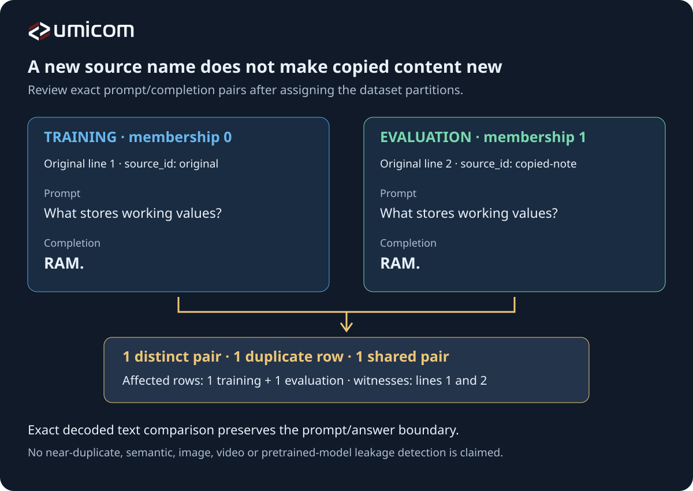

<!--
Umicom Bits2Banking
File: content/lessons/05-ai/preparing-llm-training-data/28-find-repeated-pairs-across-training-and-evaluation.md

PURPOSE:
Find repeated pairs across training and evaluation

AUTHOR AND ORGANISATION:
Sammy Hegab
Umicom Foundation

LICENCE:
MIT
-->

# Find repeated pairs across training and evaluation

[Course contents](index.md)

## Begin with the purpose of two datasets

A dataset is a collection of examples. In a prompt/completion dataset, the prompt is the input and the completion is the answer the model should learn to produce. Training changes the model’s numerical parameters using selected examples. Evaluation measures its behavior on examples held aside from that fitting step. If an evaluation answer is a copy of a training answer for the same prompt, a good score may reflect memorization rather than useful behavior on new material. This kind of accidental sharing is one form of data leakage.

## A simple copied example

Read the two records below. Each line is one JSON object, so the file is JSON Lines, or JSONL. The source_id values differ, but the question and answer do not. Suppose the first row is selected for training and the second for evaluation. The source names alone have not prevented the copied pair from crossing the boundary.

~~~json
{"source_id":"original","prompt":"What stores working values?","completion":"RAM."}
{"source_id":"copied-note","prompt":"What stores working values?","completion":"RAM."}
~~~

## Follow the original line numbers

The illustration keeps two kinds of identity separate. The source ID records provenance supplied by the author. The pair content is the decoded question and answer. The audit ignores source_id when comparing pairs, then reports original one-based line numbers so a person can find the records. Sorting private comparison data must not reorder the user’s file or make a witness point at the wrong row.

## Define the counts before calculating a percentage

| Term | Value for the two-row example | Meaning |
| --- | --- | --- |
| Rows | 2 | Both input records were validated. |
| Distinct pairs | 1 | There is only one unique question/answer pair. |
| Duplicate rows | 1 | One row repeats a pair already represented. |
| Shared pairs | 1 | That pair occurs in both dataset partitions. |
| Affected training rows | 1 | One training row belongs to a shared pair. |
| Affected evaluation rows | 1 | One evaluation row belongs to a shared pair. |
| Witness lines | 1 and 2 | The original training row and matching evaluation row. |

## Keep duplicate rows separate from shared pairs

Imagine repeating the same example three times on the training side and never using it for evaluation. There is one distinct pair and two duplicate rows, but zero shared pairs. Repetition may still distort training frequency, yet it is not cross-partition overlap. Now place two copies in evaluation as well. There is still only one distinct shared pair, but five affected rows: three in training and two in evaluation. Report both group and row counts; otherwise a small number of shared pairs can conceal a large part of the dataset.

## Membership is an assignment, not a property of the text

The existing Framework partitioner produces one membership byte for each row. A byte with value zero means training and a byte with value one means evaluation. The array must remain aligned with the exact source bytes and row order used to produce it. Its count is the number of assigned rows, not the allocated capacity. Reordering the file without reordering membership can silently audit the wrong split. Save the dataset version and reviewed assignment together before beginning a training experiment.

## Source grouping and content comparison complement each other

Source grouping keeps chunks from one caller-identified document together. That prevents different chunks from the same source from being randomly scattered across training and evaluation. Content comparison asks a different question: did any exact prompt/completion pair occur on both sides, even under different IDs? Use both. This audit does not infer that two source IDs belong to the same document, and the source-group splitter does not infer that two different documents copied the same text. Neither discovers all relationships automatically.

## Exact comparison has an exact boundary

| Input difference | Audit result | Reason |
| --- | --- | --- |
| Different source_id only | Pairs match | Provenance names are excluded from the pair key. |
| JSON escape p versus Unicode escape for p | Pairs match | The shared parser compares decoded text. |
| Uppercase P versus lowercase p | Pairs differ | No case folding is applied. |
| An extra space | Pairs differ | Whitespace in text is retained. |
| Composed versus decomposed accented text | Pairs differ | No Unicode normalization is applied. |
| Prompt ab / answer c versus prompt a / answer bc | Pairs differ | Field boundaries are preserved. |
| A paraphrase with the same meaning | Not identified as equal | This is not semantic similarity search. |

## Why no vector database is required for this check

A vector is a sequence of numbers. An embedding model turns text into vectors intended to represent aspects of its meaning, and a vector database can retrieve nearby vectors. That is useful for retrieval and can assist a separate near-duplicate review. It is unnecessary for byte-exact pair comparison. A JSON object is a key/value structure, but converting your documents into arbitrary dictionaries does not train a model. Here JSONL stores reviewed examples, membership selects dataset sides, and exact comparison detects a particular kind of repetition. Tokenization and parameter updates happen later through different operations.

## Use the native shared API

Include umicom/ai/training/jsonl_overlap.h and link the matching Umicom::ai component. In this snippet, jsonl is the two-record input and jsonlBytes is its exact byte length without a C string terminator. The value 2 is the membership count. The value 4096 is the allowed staging payload in bytes. NULL selects no cancellation token. The complete runnable source is the Framework examples/training_data example; the snippet alone does not define its input buffer.

~~~c
UmiAiTrainingJsonlOverlapSummary overlap;
UmiAiTrainingJsonlReport report;
const unsigned char membership[] = {0, 1};
UmiStatus status = UmiAiTrainingJsonlAuditOverlap(
    jsonl, jsonlBytes, membership, 2, 4096, NULL,
    &overlap, &report);
if (status == UMI_STATUS_OK) {
    /* Read overlap.sharedPairs and the original witness lines. */
}
~~~

## Success means completed inspection

UMI_STATUS_OK means the audit completed and published a new summary. It does not mean the dataset is suitable for training. A successful summary with sharedPairs equal to one is a useful problem report. A failed call leaves the previous summary unchanged. Always check status before reading it as a new result. The separate parser report describes progress and may say COMPLETE even if the later memory-budget check refused the audit. Distinguish a completed parse, a completed audit and approval to use the dataset.

## Follow the memory owner through each stage

This is a concrete example of memory-safe practice in C: explicit bounds, ownership, failure handling and publication. The language alone does not guarantee safety. A caller must still provide valid readable spans and separate writable outputs, keep them alive, and prevent concurrent mutation.

1. First scan all records through the existing JSONL parser. Validate the schema and measure decoded prompt/completion text, including their terminators.
2. Check that the row count matches membership and that text plus row descriptors fit the caller’s staging budget.
3. Allocate exactly those two private payloads. Do not reserve a maximum-sized text corpus merely because a maximum exists.
4. Scan again and copy the callback’s temporary text into the owned arena. A callback pointer is borrowed only until that callback returns.
5. Sort private descriptors and compare the two strings for each pair. Retain each row’s original line number and membership.
6. Publish complete counters after cancellation checks, then clear and free private text and descriptors.

## Understand the budget’s scope

The staging budget covers owned comparison text and row descriptors. It does not cover the caller’s input, membership and outputs, parser temporary allocations, stack storage, allocator bookkeeping, operating-system memory or a model’s weights. It is not a whole-process memory limit. The reader accepts at most 16 MiB of input and 4096 rows. Different pointer widths can change descriptor size, so the returned stagingBytes can differ across platforms. Sorting is bounded but is not interrupted in the middle of the library qsort call; cancellation is checked around that stage and during grouping.

## Build the installed SDK example step by step

The example’s CMake file selects the installed SDK, validates its environment and applies the shared branding helpers. A missing header or unresolved function is a matching-SDK problem. The source-focused test of the example does not by itself prove installed DLL lookup or every application integration.

~~~powershell
cmake -S . -B build -G Ninja -DUMICOM_SDK_ROOT="C:/path/to/installed-umicom-sdk"
cmake --build build --parallel 2
ctest --test-dir build --output-on-failure --no-tests=error
.\build\bin\umicom-sdk-training-data.exe
~~~

1. Select a matching installed Framework SDK containing the ai component and the new overlap header and implementation.
2. Open its complete examples/training_data folder, or a copy of that example. Do not place private Framework implementation files inside the consumer.
3. Replace the placeholder SDK prefix in the configure command with the actual absolute installed prefix.
4. Configure and build. Stop on a failed native command rather than running an older executable.
5. Run CTest and then the example. Expect the normal record demonstrations, a no-overlap observation for the four-row split, and a repeated-pair observation identifying lines 1 and 2.

## Recover from an audit refusal

| Observation | What to inspect |
| --- | --- |
| Invalid argument | Check nonnull outputs, a positive budget, membership values 0/1 and the exact row count. |
| Parse error | Inspect the reported original line; every record must use the supported schema. |
| Capacity exceeded | Check input/row limits and the staging budget. Do not assume a larger allocation is always appropriate. |
| Out of memory | Keep the old summary separate, release other owned work and retry only under an explicit resource plan. |
| Cancelled | Treat the call as incomplete; it has not published new audit counters. |
| Zero shared pairs | Continue source, semantic and held-out evaluation review; this check has limited scope. |

## Correct provenance and evaluation deliberately

When a witness is reported, inspect both original records and their provenance. Decide whether to remove a redundant example or keep a related family on one side. The audit itself never deletes a record, rewrites the file or silently changes membership. Record the reviewed correction and new dataset version, then rerun relevant data checks and evaluation. An evaluation set that is repeatedly used to tune decisions becomes part of model selection; retain a separate final test set when your workflow needs an independent final estimate.

## Practice without downloading a model

These exercises need only small original text records. They do not load a model, train weights, contact a provider or require an embedding database. Later lessons can build on the reviewed dataset with tokenizer-specific examples and measured training behavior.

1. Use the two-row example and predict every counter before running the SDK example.
2. Change only copied-note to another source name. Explain why the pair still matches.
3. Change RAM. to RAM with no full stop. Predict zero exact shared pairs and explain why the meaning may still be nearly identical.
4. Put both rows on the training side. Predict one duplicate row and zero shared pairs.
5. Try a staging budget below the observed requirement and verify that status indicates refusal rather than publishing a partial new summary.
6. Write down which risks remain: paraphrases, related chunks, copied images or video, privacy, rights and material already present in pretraining.

[Previous: Prepare a byte pair without shifting twice](27-prepare-a-byte-pair-without-shifting-twice.md)

[Next: Check context fit before training a byte model](29-check-context-fit-before-training-a-byte-model.md)
