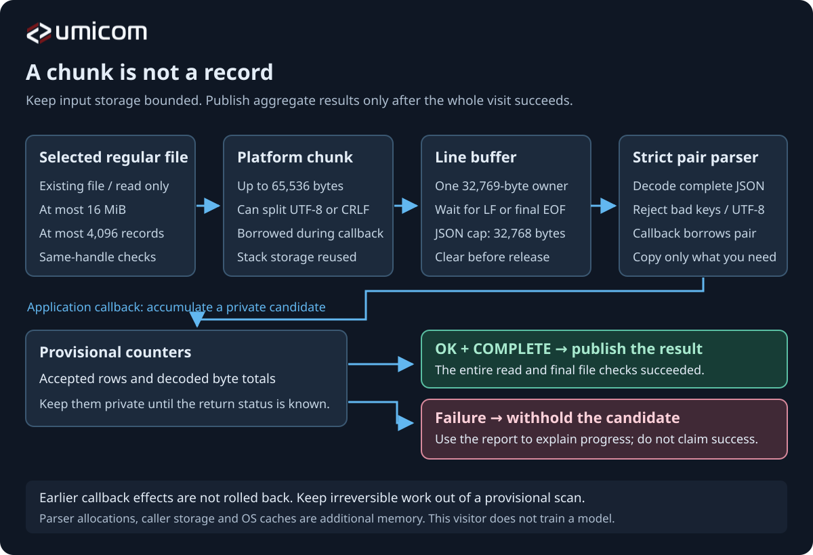

<!--
Umicom Bits2Banking
File: content/lessons/05-ai/preparing-llm-training-data/30-stream-records-without-retaining-the-whole-file.md

PURPOSE:
Stream records without retaining the whole file

AUTHOR AND ORGANISATION:
Sammy Hegab
Umicom Foundation

LICENCE:
MIT
-->

# Stream records without retaining the whole file

[Course contents](index.md)

## What you will learn

Imagine reading a long book one page at a time instead of putting a separate photocopy of every page on your desk. Streaming applies a similar idea to computer data. A program receives a piece, processes it and releases what it no longer needs. This lesson explains where that reduces memory, where memory is still required, and how to avoid reporting a partly read dataset as complete. No model or GPU is needed.

## Start with the words

| Word | Meaning in this lesson |
| --- | --- |
| File | Bytes stored under a selected path on disk. Disk storage is different from working memory. |
| RAM | Working memory used while a program runs. Reading a file may use RAM even though the file is on disk. |
| Chunk | A group of bytes supplied by one input callback. Chunk boundaries do not describe JSON objects. |
| Record | One complete source_id, prompt and completion object on one physical line. |
| Buffer | Memory reserved to hold bytes temporarily. A capacity is the maximum number it can hold. |
| Callback | Your function that the reader calls when a decoded record is ready. |
| Borrow | Permission to read an object for a limited lifetime without taking ownership of its storage. |
| Candidate result | Provisional counters or other work that you have not yet announced as a completed result. |

## Why chunks are not records

The Framework platform reader uses chunks of at most 65,536 bytes, or 64 KiB. The letters KiB mean 1,024 bytes per unit. A line can end in the middle of a chunk. A chunk can end between the two bytes of a UTF-8 character, between CR and LF in a Windows line ending, or halfway through a JSON escape such as \u00e9. You must not parse each chunk as if it were a complete JSON object. The streaming adapter collects bytes up to the physical LF, then asks the existing strict record parser to decode that complete line.

## The schema stays the same

Streaming changes how input arrives; it does not change the accepted data format. This teaching schema has exactly three string fields. source_id identifies the author-selected source group; prompt is the input text; completion is the expected answer. Source and completion must not be empty. A literal line break inside a JSON string is invalid; write the JSON escape \n if a decoded answer needs a newline. This schema is not automatically a pretrained model chat template.

~~~json
{"source_id":"a","prompt":"p","completion":"c"}
{"source_id":"a","prompt":"p","completion":"c"}
~~~

## Where the memory goes

| Owner | Storage used or retained |
| --- | --- |
| Streaming adapter | One 32,769-byte allocation for a physical line and possible final CR. |
| Platform file reader | One 65,536-byte stack buffer for the current I/O chunk. |
| Record parser | Bounded temporary JSON storage and a decoded pair. These are additional memory. |
| Your callback | Whatever you retain. Appending every pair to a growing list can recreate whole-corpus memory use. |
| Operating system | File caching and native handle resources; these are not all counted by the adapter. |
| Model trainer, if run separately | Weights, optimizer state, activations, gradients and batches. Streaming input does not remove those costs. |

## Limits remain intentional

This first API keeps the existing 16 MiB file cap and 4,096-record cap. A line may contain at most 32,768 JSON bytes, excluding its LF or CRLF delimiter. Each decoded prompt or completion is at most 4,096 UTF-8 bytes; a source ID is at most 128. One extra CR at the line-buffer boundary is accepted only as a delimiter candidate. A second CR beyond the JSON cap is rejected. These are explicit teaching-service limits, not estimates of your computer memory and not universal limits for JSONL.

## Prepare a working directory

1. Use a matching installed Umicom Framework SDK that includes jsonl_stream.h, its implementation in Umicom::ai and the Platform component. The package version alone does not prove that this addition is present.
2. Copy the complete examples/training_data directory from the SDK into a new learning directory you control. Keep its main.c, context.c, stream.c, CMakeLists.txt and README.md together. Do not merge it over an unrelated project.
3. Open PowerShell in the copied directory. Confirm your UCRT64 compiler and CMake are available using Get-Command gcc, cmake, ninja. Use a toolchain compatible with the SDK.
4. Create a separate records.jsonl using the exact two JSON lines above. The next command writes UTF-8 without a byte-order mark and deliberately selects LF line endings.
5. Replace the sample SDK prefix in the configuration command with the actual installed prefix. Run commands separately, stopping when one fails.

## Create the tiny dataset

~~~powershell
$learningFile = Join-Path (Get-Location) "records.jsonl"
$records = @'
{"source_id":"a","prompt":"p","completion":"c"}
{"source_id":"a","prompt":"p","completion":"c"}
'@
$records = $records.Replace("`r`n", "`n") + "`n"
[System.IO.File]::WriteAllText($learningFile, $records, [System.Text.UTF8Encoding]::new($false))
~~~

## Build and inspect

~~~powershell
$env:Path = "C:\msys64\ucrt64\bin;$env:Path"
cmake -S . -B build -G Ninja -DUMICOM_SDK_ROOT=C:/SDK/Umicom
cmake --build build --target umicom-sdk-training-stream --parallel 2
& .\build\bin\umicom-sdk-training-stream.exe $learningFile
~~~

## Read the result

The expected lines are rows: 2, prompt bytes: 2 and completion bytes: 2. Each prompt and completion contains one ASCII byte. The braces and JSON field names are not part of those decoded-text totals. The executable returns exit code zero only after the entire visit succeeds. In PowerShell, inspect $LASTEXITCODE immediately after the native command; another native command can replace it. This operation does not train a model, create a vector index or send your file to a service.

## Follow the C ownership

~~~c
Counts candidate = {0};
UmiAiTrainingJsonlReport report;
UmiStatus status = UmiAiTrainingJsonlVisitFile(
    absolutePath, NULL, CountPair, &candidate, &report);
if (status != UMI_STATUS_OK) {
    /* Do not publish candidate as a complete dataset summary. */
    return 1;
}
/* The complete example now prints its aggregate candidate. */
~~~

## What each argument does

absolutePath names the selected existing file. NULL means this example has no cancellation token. CountPair is the callback function, and &candidate passes the address of its provisional counters. &report supplies separate progress storage. The callback receives a borrowed pair: its strings are valid until the callback returns. Copy a field into your own bounded storage if you need it later; saving the pair pointer is not a copy. The complete, compilable source is stream.c in the SDK example; the short fragment above explains its central call.

## Make a late failure visible

1. Save a copy of your two-line teaching file. Change only its second line to {}. That is JSON syntax, but it lacks the three required schema fields.
2. Run the same stream executable again. It should return failure, identify failed line 2 and report one accepted row.
3. Check that the successful rows/prompt bytes/completion bytes output is absent. The first callback already changed the private candidate, but the application did not publish it.
4. Restore the original second line and rerun. Confirm the two-row aggregate again.
5. Think about a callback that sends an email, updates a database or trains weights immediately. Those earlier effects would still exist after the second row failed. For a transaction, use an appropriate staging/commit design; a streaming reader cannot undo arbitrary effects.

## Progress is different from success

| Report information | How to read it |
| --- | --- |
| acceptedRows | Callbacks that returned OK before the current failure or completion. |
| consumedBytes | Input bytes through the last accepted line, including its delimiter; not total bytes fetched ahead. |
| RECORD with failedLine | A row could not be admitted, parsed or processed because of cancellation before its callback. |
| VISITOR with failedLine | Your callback refused that row. Previous accepted callbacks still happened. |
| INPUT with failedLine zero | File admission, read, identity or close failed; pre-I/O and final cancellation also use this stage. Accepted progress may be nonzero. |
| OK and COMPLETE | The whole selected visit succeeded, including the file owner checks. This does not prove dataset quality or training readiness. |

## Cancellation and interactive applications

Synchronous means the call does its work before returning to its caller. A GUI should put blocking file inspection on a worker thread so its window can still respond. The token is checked before I/O, between chunks and records, and before final success. It cannot interrupt a native read that is already blocked or a callback that has not returned. Keep the token and callback context alive until the operation returns. Updating a GTK widget directly from an arbitrary worker is a separate thread-ownership error; route the result through the UI owner.

## Exact fixtures matter

A test that says a CR sits at byte 65,535 must actually place it there. Some text writers expand LF to CRLF on Windows. That moves every later byte and can make a passing test miss the intended boundary. The focused Framework fixture encodes the intended bytes as hexadecimal text, writes the decoded bytes through the native binary output service, and verifies their SHA-256 before testing the reader. A hash comparison proves equality with those intended fixture bytes; it does not prove the reader algorithm is correct.

## Recover from a refused input

| Symptom | Next step |
| --- | --- |
| Missing header or undefined function while linking | Select a matching complete SDK with the header and its compiled implementation. |
| Path refused | Pass an ordinary absolute path to a regular file; do not pass a relative path, directory, final link or device. |
| Blank line or BOM refused | Save JSONL as UTF-8 without BOM and remove empty physical lines. Do not remove meaningful whitespace inside strings. |
| Capacity exceeded | Check file, row, encoded-line and decoded-field limits separately. Review a deliberate partition instead of silently truncating records. |
| Memory seems high | Measure the complete process, callback retention and any separate model runtime. A line-buffer assertion is not a whole-process memory profile. |
| File identity changed | Treat the result as incomplete and retry from a controlled stable input. Metadata checks do not create an immutable filesystem snapshot. |

## Practice and check your understanding

1. Explain why a valid UTF-8 character split between two chunks must be assembled before decoding the complete record.
2. Change p to é using a UTF-8 editor. Expect two prompt bytes per record, not one; this is still not a pretrained model token count.
3. Describe why copying every pair into a list can defeat the memory advantage of streaming.
4. Explain why one accepted callback plus a later failure is not a completed one-record corpus.
5. Name three memory owners besides the line buffer. Suggested answers: platform chunk, JSON parser, callback storage, operating-system cache or a separately loaded model.

## What is available and what remains separate

Framework provides the native local streaming visitor, strict pair parsing, progress report and thin SDK consumer described here. Focused tests are different from installed-package or application qualification. Large model training, dataset deduplication, provider chat conversion, model-specific tokenization and production GUI workflows remain separate operations. C and Assembly can support controlled memory ownership; changing language alone does not prove the absence of leaks or crashes.

[Previous: Check context fit before training a byte model](29-check-context-fit-before-training-a-byte-model.md)

[Next: Review one snapshot before using a split](31-review-one-snapshot-before-using-a-split.md)
