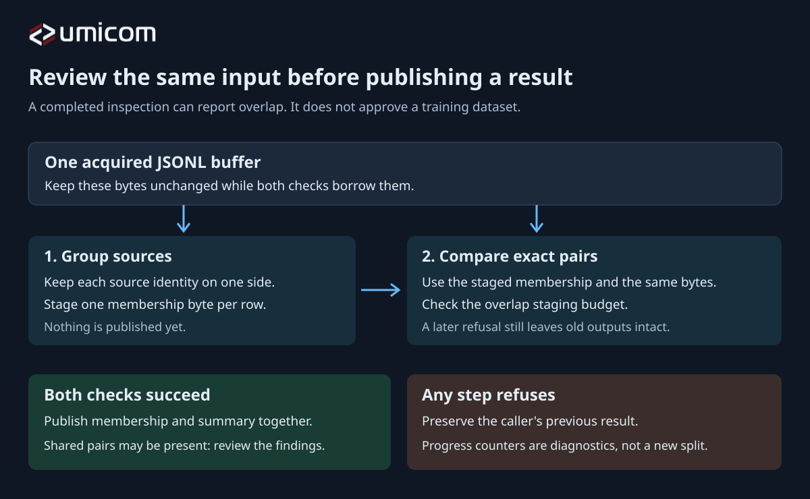

<!--
Umicom Bits2Banking
File: content/lessons/05-ai/preparing-llm-training-data/31-review-one-snapshot-before-using-a-split.md

PURPOSE:
Review one snapshot before using a split

AUTHOR AND ORGANISATION:
Sammy Hegab
Umicom Foundation

LICENCE:
MIT
-->

# Review one snapshot before using a split

[Course contents](index.md)

## What a review can tell you

A dataset is a collection of examples. A partition divides those examples into named parts, such as training and evaluation. Training examples may change a model's parameters. Evaluation examples help you assess the result without using them for that update. A review checks properties of the examples and the proposed division. It does not train a model, grant permission to use source material, or prove that an answer is correct.

## Begin with two different questions

| Check | Question it answers | Question it cannot answer |
| --- | --- | --- |
| Source grouping | Do records with the same source_id stay on the same side? | Are differently named sources copies or paraphrases? |
| Exact-pair overlap | Does the same decoded prompt and completion occur on both sides? | Are different words expressing nearly the same content? |
| Human review | Are source rights, labels and intended use acceptable? | Did the program execute all of its memory checks? |
| Model evaluation | How does a particular model behave on selected tasks? | Is every possible future answer correct? |

## Create two original teaching records

Use this small invented example rather than private documents. The source names differ, but the prompt and completion are identical. Each line is a JSON object: braces contain fields, quoted names identify those fields, and quoted values contain text. JSONL stores one such object per physical line. This is a simple teaching schema, not a universal format for every trainer.

## Save UTF-8 without a byte-order mark

~~~powershell
$datasetPath = Join-Path $PWD 'lesson-pairs.jsonl'
if (Test-Path -LiteralPath $datasetPath) { throw 'Choose a new file name before continuing.' }
$datasetText = @'
{"source_id":"original-note","prompt":"What stores working values?","completion":"RAM."}
{"source_id":"copied-note","prompt":"What stores working values?","completion":"RAM."}
'@
[System.IO.File]::WriteAllText($datasetPath, $datasetText, [System.Text.UTF8Encoding]::new($false))
~~~

## Read the save operation

1. $PWD means your current PowerShell directory. Join-Path combines it with a filename and produces an absolute local path.
2. Test-Path refuses to overwrite an existing file in this exercise. Stop if the guard throws; choose another teaching filename.
3. The here-string between @' and '@ holds the two JSON lines without PowerShell variable expansion.
4. UTF8Encoding($false) chooses UTF-8 without an initial byte-order mark. The native teaching parser does not accept a BOM.
5. WriteAllText writes the small original fixture. This explicit preparation step creates the file; the review command itself does not write it.

## Choose the review inputs

| Argument | Example | Meaning |
| --- | --- | --- |
| Absolute JSONL file | $datasetPath | One deliberately selected ordinary local file. |
| Evaluation groups | 1 | Keep one complete source group for evaluation and at least one for training. |
| Seed | 42 | An unsigned integer controlling reproducible group selection. |
| Staging bytes | 65536 | Maximum owned text and descriptor storage for the overlap audit only. |

## Run a native review

~~~powershell
umicom training-data review $datasetPath 1 42 65536
~~~

## If the command cannot be found

Use the actual built or installed native umicom executable from your verified Framework toolchain. Do not assume an old Applications build path still contains it. Check Get-Command umicom or Test-Path on the explicit executable path. A missing command is a tool-location problem; it is not evidence that the dataset was reviewed. The Framework build and qualification guide explains how the owner prepares that executable.

## Predict the result before reading it

1. There are two rows and two exact source identities.
2. One source group is assigned to each side, so there is one training row and one evaluation row.
3. There is only one distinct prompt/completion pair, repeated once.
4. That pair occurs on both sides. Expect Shared pairs: 1.
5. The witness lines are the original one-based row numbers. Their training/evaluation order depends on the seeded assignment; do not assume line one always means training.

## Expected aggregate observations

~~~text
Rows: 2 | Source groups: 2 | Training rows: 1 | Evaluation rows: 1
Distinct pairs: 1 | Duplicate rows: 1 | Shared pairs: 1
~~~

## Completion is not approval

Exit code zero means the operation finished its review. It can still report a shared pair. Exit code one means input or execution was refused; two means the command arguments were invalid. You must choose a policy for what findings are acceptable. For this fixture, investigate why two sources contain the same example before treating evaluation as independent. Do not silently remove a row or change its source name just to make a count look better.

## What one snapshot means

A snapshot here means the unchanged bytes held by one operation while its checks run. The file adapter acquires the bounded file once, then both the source splitter and pair auditor use that same buffer. It does not claim a filesystem transaction or return a permanent copy. Native file identity and size checks can catch some concurrent changes, but they do not prove that nobody can edit the file later.

## Why a later reopened file is different

A membership array contains one byte for each original row: zero for training, one for evaluation. If somebody reorders the file afterward, the old byte at position three describes the old third row. The selected-file review does not return a source digest or retained corpus. Do not apply its membership blindly to a later file. An export application should own an unchanged input snapshot and compose the memory review and selection services on those same bytes, then publish through an explicit file policy.

## Follow the failure boundary

| Step | Private work | Visible result |
| --- | --- | --- |
| Parse and group | Check records and compute candidate membership | No caller result is replaced. |
| Compare content | Audit exact pairs within the chosen staging budget | Candidate membership still stays private. |
| Check completion | Confirm both operations and cooperative cancellation checks succeeded | Publish membership and summary together. |
| Refusal at any earlier step | Clear and release owned temporary storage | Keep the caller's previous output unchanged; return diagnostic progress. |

## Try a deliberately insufficient budget

~~~powershell
umicom training-data review $datasetPath 1 42 1
~~~

## Interpret this refusal

One byte cannot hold the auditor's text and row descriptors for these examples. Expect a refusal and no successful row/overlap summary. Parsing may already have completed, so a progress stage named COMPLETE does not mean the whole review succeeded. The returned status is the operation result. For a successful review, reported staging bytes can differ across 32-bit and 64-bit builds because descriptors contain native-width fields.

## Do not mistake staging memory for total memory

The input file can occupy up to 16 MiB plus a terminating byte. The review also has a fixed 4096-byte membership candidate, splitter storage, parser allocations, stack and allocator overhead. The 65,536-byte option limits only the overlap auditor's owned text and descriptors. It is not a process-RAM cap. Use the separate streaming visitor when you only need record-by-record inspection; this composed review retains a bounded input snapshot because its services make multiple passes.

## What exact comparison leaves open

JSON escape spellings are decoded before comparison. Case, whitespace and Unicode normalization forms are not automatically normalized. A paraphrase may carry the same knowledge without matching bytes. A copied answer paired with a different prompt will not be the same pair. Time-sensitive financial data also needs a chronology policy. These checks do not prove rights, correct labels, a suitable tokenizer or good model quality.

## Training formats still have different jobs

A JSON object is a way to name fields. A dictionary is a program data structure. Token IDs are numbers consumed by a chosen model. Embedding vectors support similarity operations such as retrieval. A vector database indexes those vectors. None of those automatically substitutes for a reviewed training dataset. After review, the selected trainer still needs its exact tokenization, templates, masks, batching and objective. Follow the earlier lessons before converting documents or starting a fine-tune.

## Exercises

1. Create a separate copy in which the second completion says RAM stores temporary working values. Predict two distinct pairs and zero exact shared pairs; explain why this still does not prove independence.
2. Set both source_id values to the same name. With only one source group, a one-group evaluation split cannot leave a training group and must be refused.
3. Keep two source groups, add a second row to one group, and predict why one evaluation group may now contain two rows.
4. Explain why running the same seed after adding a new source need not preserve every old membership assignment.
5. Write a checklist separating source rights, exact duplicate review, temporal separation and model evaluation. Give each a separate evidence item.

## Use in Umicom applications

Studio, Media or another client can call the same Framework services from a worker and present the result after completion. They must keep borrowed input, options, outputs and cancellation state alive until the call returns. A cancellation request does not interrupt every native read or sorting instruction. This lesson documents a native service and command; it does not claim a new GUI, a completed training pipeline or a qualified installed SDK.

[Previous: Stream records without retaining the whole file](30-stream-records-without-retaining-the-whole-file.md)

[Next: Measure token loss with the right denominator](32-measure-token-loss-with-the-right-denominator.md)
