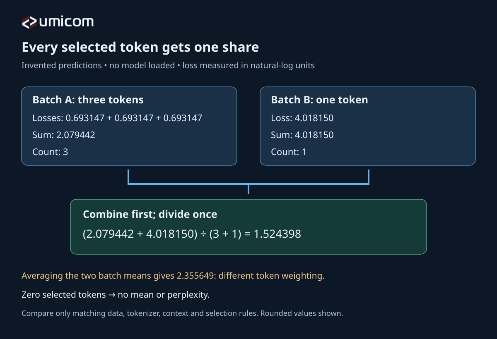

<!--
Umicom Bits2Banking
File: content/lessons/05-ai/preparing-llm-training-data/32-measure-token-loss-with-the-right-denominator.md

PURPOSE:
Measure token loss with the right denominator

AUTHOR AND ORGANISATION:
Sammy Hegab
Umicom Foundation

LICENCE:
MIT
-->

# Measure token loss with the right denominator

[Course contents](index.md)

## What does a prediction score tell us?

A language model predicts a next token, which is one item from its vocabulary. A token can be a whole word, part of a word, punctuation or another encoded unit. A vocabulary assigns an integer identifier to each item. For this small laboratory there are only two possible tokens, identified by 0 and 1. Four rows of invented scores stand in for four predictions. No downloaded model, document collection or training run is required.

1. Complete the earlier lesson on selected prediction counts. Accuracy asks whether the highest-ranked token matches a target; this lesson measures how much probability a prediction gives that target.
2. Open labs/framework/prediction-metrics/loss.c in Bits2Banking. Open prediction_metrics.h in Framework beside it. A declaration describes how to call a service; the .c file demonstrates a caller.
3. Treat the expected numerical results as a worked arithmetic example. They do not measure any real Umicom model.

## From logits to probability

A logit is a score before conversion to probability. A larger logit means a more favored token. Softmax exponentiates each score and divides by the sum of all exponentiated scores in that row. Probabilities are nonnegative and add to one, apart from rounding. A target is the token identifier supplied by the evaluation data. Here all four targets are token 0. This exercise assumes the target is appropriate; a low numerical loss cannot prove that the source labels are correct.

~~~text
scores [0, 0] -> probabilities [0.5, 0.5]
scores [0, 4] -> probabilities about [0.017986, 0.982014]

probability(target) = exp(score[target]) / sum(exp(each score))
~~~

## Loss is a penalty for assigning too little probability

Negative log likelihood is minus the logarithm of the probability assigned to the target. The natural logarithm uses the mathematical constant e as its base; its unit is called a nat. A probability of 1 has zero loss. A probability of 0.5 has loss about 0.693147. Assigning a very small probability to the target gives a large loss. Cross entropy on one-hot targets is this same quantity, usually averaged over the selected positions. One-hot means a target distribution that puts all its mass on one token.

| Prediction row | Scores for tokens 0, 1 | Target | Loss in nats |
| --- | --- | --- | --- |
| First | 0, 0 | 0 | 0.693147 |
| Second | 0, 0 | 0 | 0.693147 |
| Third | 0, 0 | 0 | 0.693147 |
| Fourth | 0, 4 | 0 | 4.018150 |

## Why the implementation does not exponentiate the raw scores

The exponential of a very large positive number cannot fit in an ordinary floating-point value. Framework finds the maximum score m, exponentiates differences from m, and evaluates (m - target_score) + log(sum(exp(score - m))). Every exponent input is zero or negative. Subtracting m does not change the probabilities. The parentheses also matter: at an enormous common score such as 1e20, adding a small logarithm to m and then subtracting the target can erase that small result through rounding. Subtracting the large equal values first preserves the log of the sum.

~~~text
m = maximum score in this row
s = sum of exp(score - m) across the vocabulary
row_loss = (m - score[target]) + log(s)

Equal scores always give uniform probabilities.
With three equal scores, loss should be log(3),
even when every score has a large common offset.
~~~

## Keep the sum and the number of selected tokens together

A batch is a group of examples processed together. Batches can have different lengths. Adding each batch mean and dividing by the number of batches gives each batch equal weight, even when one contains more tokens. For the token-weighted question, add loss sums, add selected-token counts, and divide once. The first batch below contains three easy uniform predictions; the second contains one badly scored target. A mean of their means overweights that last token.

~~~text
batch A: sum = 3 * log(2), count = 3
batch B: sum = log(1 + exp(4)), count = 1

correct mean = (sum_A + sum_B) / (count_A + count_B)
             = 1.524398 nats per token

mean of batch means = (sum_A / 3 + sum_B / 1) / 2
                    = 2.355649  [different weighting]
~~~

## Read the native result structure

The service returns three values: rows is the number of supplied rows, selectedRows is the number deliberately included, and negativeLogLikelihoodSum is the double-precision loss sum for those selected rows. A double is a floating-point C type with at least as much precision as float. The input logits use float; intermediate loss arithmetic uses double. The caller owns the input arrays and output structure. This service creates no training graph, changes no model weights and allocates no storage.

~~~c
UmiAiTrainingPredictionLossSummary result;
UmiStatus status = UmiAiTrainingPredictionLoss(
    logits, 4, 2, targets, NULL, 0, &result);
if (status != UMI_STATUS_OK) {
    /* Report the refusal; do not use an uninitialized result. */
}
/* NULL plus a zero selection count means include every row. */
~~~

## Selection changes the denominator deliberately

A selection array contains one byte per row: 1 includes that prediction and 0 excludes it. For supervised answer training, a training pipeline might evaluate answer positions and exclude prompt or padding positions. This function receives the decisions; it does not invent them. An all-zero array returns a valid sum of zero and a selected count of zero. There is no mean or perplexity in that case because division by zero is undefined. Empty evaluation is not perfect performance. Even excluded rows must have finite scores and valid target identifiers so hidden corrupt inputs cannot pass admission.

| Input requirement | Reason |
| --- | --- |
| Positive row and vocabulary counts; at most 16,384 score values | Bound the work and prevent size overflow |
| Each target is below the vocabulary size | A target must refer to an existing column |
| Every logit is finite | NaN and infinity do not describe an admitted score row |
| Selection is absent with count zero, or has exactly one 0/1 byte per row | Avoid ambiguous masks and truncated arrays |
| Accessible, stable and disjoint inputs and output | The caller must supply real storage for the stated lengths |

## Perplexity is a transformed mean, not a correctness percentage

Perplexity is exp(mean loss) when the same natural-log convention is used. For this fixture it is about 4.592378. It can exceed the vocabulary size if the target is repeatedly assigned very small probability, so it is not a count of available vocabulary items. Smaller perplexity indicates greater probability assigned to these targets under the same evaluation setup; it does not establish factual accuracy, safety or usefulness. Compare models only when the tokenizer, data, context and selection rules match. Different tokenizations divide the same text differently.

1. Check selectedRows is nonzero before dividing.
2. Keep the mean in log space as the primary numerical result.
3. Before exponentiating, compare the mean with log(DBL_MAX), where DBL_MAX is the largest finite double value. Check the exponentiation result is finite too.
4. If exponentiation cannot be represented, report perplexity as unavailable or beyond the numeric range. Do not replace it with zero.

## Configure, build and run the laboratory

PowerShell runs one command at a time. CMake writes a build description, Ninja compiles the C files, and CTest runs the example as a check. Use matching Framework and Bits2Banking source trees. Stop on a nonzero exit code and read the first diagnostic before continuing. These commands are for a Windows UCRT64 toolchain already installed in C:/msys64; adapt the compiler path only if your installation differs.

~~~powershell
Set-Location "C:\umicom\Umicom-Bits2Banking"
$env:Path = "C:\msys64\ucrt64\bin;$env:Path"
cmake -S labs/framework/prediction-metrics -B build/learning-prediction-metrics -G Ninja -DCMAKE_C_COMPILER=C:/msys64/ucrt64/bin/gcc.exe -DUMICOM_FRAMEWORK_SOURCE=C:/umicom/Umicom-Applications/framework
cmake --build build/learning-prediction-metrics
ctest --test-dir build/learning-prediction-metrics --output-on-failure
& ".\build\learning-prediction-metrics\umicom-prediction-loss.exe"
~~~

## Expected output and what it proves

This example compiles the shared Framework implementation in a narrow source composition. It is not an installed SDK or real-model qualification. The Windows icon and staged scalable artwork use Framework’s existing branding helper.

~~~text
Evaluated tokens: 4
Sum then divide: 1.524398 nats per token
Mean of batch means (wrong here): 2.355649
Fixture perplexity: 4.592378
No selected tokens: mean and perplexity are unavailable.
Invented logits only; no training graph, model or weight update.
~~~

## Investigate a refusal without losing the previous result

The API validates the full input before publishing a result. If it refuses the call, an already initialized output summary stays unchanged. This is useful for an interface showing the last valid evaluation: keep that value labeled with its original dataset identity, display the new error separately, and do not pretend the old result came from the refused request.

1. For a missing categorical_loss.h configure diagnostic, integrate the matching internal header and public/source files together. Do not bypass the source-admission guard.
2. For a target error, compare each target identifier with the vocabulary count, not with the row count.
3. For nonfinite logits, trace the upstream model arithmetic or input conversion. Clamping NaN to zero would hide the defect.
4. For a denominator mismatch, print the selected token counts for each batch before calculating a mean.
5. For a link error involving exp or log on a Unix-like toolchain, check the math library linkage. The laboratory CMake file links m where required.

## Practice and explain the result

Change the fixture only after recording the baseline output. Rebuild after each edit and write the prediction before running it.

1. Replace the fourth score row [0,4] with [4,0]. The target stays 0. Explain why its loss falls.
2. Select only the first three rows. Predict log(2) as the mean and 2 as perplexity.
3. Add 1024 to every score in each row. Predict unchanged probabilities and loss within floating-point tolerance.
4. Use an all-zero selection. Explain why an unavailable metric is more truthful than a pass badge.
5. Compare two different data splits only after checking overlap and source identities using the earlier review lesson. A numerically correct calculation does not remove training/evaluation leakage.

## Where this fits into model training

Preparing data, training and evaluating are different operations. A document format such as JSONL carries examples. A tokenizer turns text into token identifiers. A model produces scores. A loss measures those scores against targets. A training graph records operations so gradients can update weights; a read-only evaluator needs only the scores and targets. A vector database supports retrieval and is not a replacement for these training examples or an evaluation denominator. This laboratory teaches the evaluation step without claiming to train a language model.

[Previous: Review one snapshot before using a split](31-review-one-snapshot-before-using-a-split.md)

[Next: Aggregate evaluation with checked summaries](33-aggregate-evaluation-with-checked-summaries.md)
