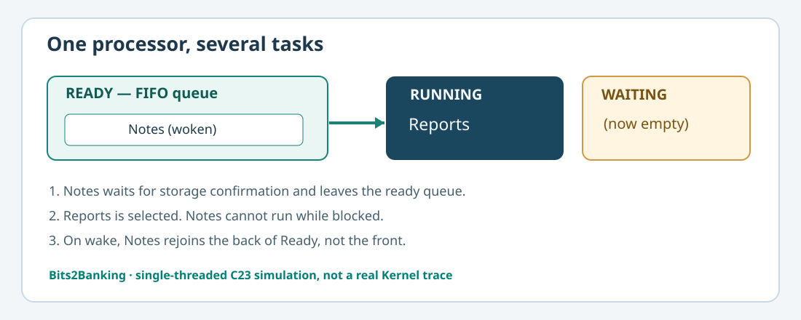

# 102. How an operating system chooses which task runs next

A processor executes one instruction stream on one hardware thread at a time. Several programmes can nevertheless appear to make progress together because the operating system gives each ready task an opportunity to run. Choosing the next task is **scheduling**.

This lesson begins with a Notes application and a reporting application. Notes has a document to save; Reports has a monthly summary to prepare. We will model a small ready queue in C23, follow each state transition and inspect the result. No special operating-system privileges are required.

## 1. What is a task?

A **programme** is code stored as a file. A **process** is an executing instance with its own resources. An operating-system **thread** is a stream of instructions within a process. We call each independently schedulable item a *task* in our small model. Actual kernels may schedule threads, rather than entire processes.

The following states are enough for our first experiment:

| State | Meaning |
|---|---|
| Ready | Could run when the processor is available |
| Running | Has been selected to run now |
| Waiting | Cannot proceed until an event occurs |
| Stopped | No longer eligible to run |

A waiting task must not be selected merely because it has not run recently.



## 2. Arrange the ready queue

Imagine this ready queue:

```text
Front of queue → Notes → Reports → End of queue
```

The scheduler picks Notes. Reports remains ready. If Notes decides to wait for a save completion, it leaves the ready queue rather than repeatedly checking the storage device.

```text
Running: Notes
Ready:   Reports
Waiting: none

Notes waits for save completion.

Running: none
Ready:   Reports
Waiting: Notes
```

The scheduler can now run Reports. When Notes' completion arrives, Notes rejoins the **end** of the ready queue. Reports therefore retains its place in line. This is the central idea of a **round-robin** scheduling policy: when a running task gives up its turn, it moves behind tasks already ready.

## 3. Open the C23 programme

The working source is in [`labs/native/round-robin-scheduler`](https://github.com/umicom-foundation/Bits2Banking/tree/main/labs/native/round-robin-scheduler). Open `round_robin.h`, then `round_robin.c`.

The public interface has separate operations for admitting, dispatching and yielding a task:

```c
BtbRoundRobin scheduler;
BtbRoundRobinInit(&scheduler);

BtbTaskHandle notes = 0U;
BtbTaskHandle reports = 0U;
BtbTaskHandle running = 0U;

BtbRoundRobinAdmit(&scheduler, &notes);
BtbRoundRobinAdmit(&scheduler, &reports);
BtbRoundRobinNext(&scheduler, &running);
```

A real application must check the return value after **every** operation. In the full demonstration, any unsuccessful operation produces a nonzero exit code. The abbreviated excerpt above exists to show the order of calls before we look at the complete source.

The scheduler stores the ready queue in a fixed array and uses a `head` index and `readyCount`. Adding a task to the back does not require moving all earlier entries. The index wraps around using the remainder operator (`%`), turning the fixed array into a **ring**.

## 4. Build and run on Windows

Open PowerShell and execute each command from the Bits2Banking checkout:

```powershell
Set-Location "C:\umicom\Umicom-Bits2Banking"
$env:Path = "C:\msys64\ucrt64\bin;$env:Path"

cmake -S ".\labs\native\round-robin-scheduler" `
    -B ".\output\learning-build\round-robin-scheduler" `
    -G Ninja `
    -DCMAKE_C_COMPILER="C:\msys64\ucrt64\bin\gcc.exe" `
    -DBUILD_TESTING=ON

cmake --build ".\output\learning-build\round-robin-scheduler" --parallel 2

ctest --test-dir ".\output\learning-build\round-robin-scheduler" --output-on-failure

& ".\output\learning-build\round-robin-scheduler\btb-round-robin.exe"
```

The two tests should pass. The programme prints:

```text
Notes is running.
Reports runs before the newly woken Notes task.
```

Those lines are not a timing benchmark: they describe the state changes in the model.

## 5. Why the return values matter

`BtbRoundRobinNext` returns `BTB_SCHED_EMPTY` when the queue has no ready tasks. That can mean **every** live task is waiting. It does not necessarily mean the system has shut down.

It returns `BTB_SCHED_BUSY` when another task is already running on our one modelled processor. Calls with an invalid or previously closed handle cannot silently take a different task's place.

The test named `bits2banking.scheduler.refusals` checks these cases. Run the test directly if you wish to observe its success message:

```powershell
& ".\output\learning-build\round-robin-scheduler\btb-round-robin-test.exe" refusals
```

## 6. Practise

First, find the call to `BtbRoundRobinWake` in `main.c`. Predict which task will run after the wake. Run the programme and compare the result. Second, explain why Notes does not go to the front of the ready queue. Third, open `test_round_robin.c` and find the test that refuses `Next` when a task is already running.

A correctly functioning scheduler protects the distinctions between **ready**, **running** and **waiting**. Next, we will learn what causes a waiting task to become ready again.

Continue with [Lesson 103 — Wait and wake without spinning](103-wait-and-wake-without-spinning.md).
