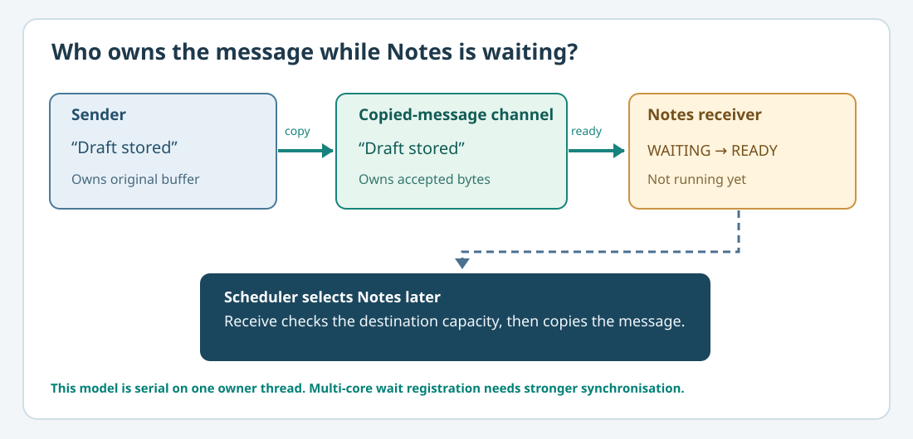

# 103. Wait for a message without wasting processor time

The Notes application needs a reply from a service. The reply has not arrived yet. Should the application keep asking the service thousands of times each second? Usually not. A better design lets the task **wait** until there is work it can perform.

## 1. Compare two approaches

**Busy-waiting** means checking the same condition repeatedly while continuing to execute instructions:

```c
/* Illustration only: do not put this busy loop into an application. */
while (MessageHasArrived() == 0) {
    /* The task keeps using processor time. */
}
```

This illustrative fragment deliberately has no definitions and is **not** part of the compiled laboratory. It shows why a thread can consume processor time while achieving nothing.

A **blocking** operation instead changes the task's state to Waiting. The scheduler gives the processor to another ready task. When the required event happens, the task becomes Ready again. It does not immediately interrupt whichever task is running.



## 2. Understand the queue owner

In [Lesson 98](98-build-a-copied-message-channel.md), `BtbChannelSend` copies message bytes into a bounded queue. The queue owns those bytes after a successful send. It can therefore preserve the message even if the sender changes or releases its original buffer.

In [Lesson 102](102-understand-round-robin-scheduling.md), the scheduler owns a task's Ready/Running/Waiting state. These are **different responsibilities**. A service needs a small adapter to connect them; it should not invent a second message queue or a second scheduler.

This lesson's new source lives in [`labs/native/blocking-ipc-lifetimes`](https://github.com/umicom-foundation/Bits2Banking/tree/main/labs/native/blocking-ipc-lifetimes). Its CMake project compiles the earlier `bounded-channel/channel.c` and `round-robin-scheduler/round_robin.c` directly. `session.c` implements only the coordination logic.

## 3. Follow an empty receive

The receiver is running, but its channel is empty. The service performs two steps:

1. Check whether the channel already contains a message.
2. If it is empty, register the receiver as Waiting with a specific wait key.

`BtbSessionWaitForMessage` returns `BTB_SESSION_WOULD_BLOCK`. The scheduler now excludes that task from the ready queue. The service has retained the task's **identity**, but it has not retained a pointer to the caller's receive buffer.

In the demonstration the waiting key is `7`. It is an educational identifier connecting the wait to a later wake, not an authorisation secret or a Kernel-issued capability.

## 4. Send, wake, then receive

A sender supplies a Notes message through `BtbSessionSend`. This invokes the existing `BtbChannelSend`, which copies the complete message into the queue. The service then checks the queue through `BtbSessionPoll`.

```c
if (BtbSessionPoll(&session) == BTB_SESSION_READY) {
    /* The task may be dispatched later by the ready queue. */
}
```

A successful poll moves the waiting task to Ready, **not** straight into Running. A subsequent `BtbRoundRobinNext` selects the task. Only after it is Running does the service call `BtbSessionReceive` to copy the message into a caller-owned output buffer.

In the complete tests, the caller intentionally supplies an output buffer that is too small. The receive is refused and the message remains queued. Supplying an adequate buffer later succeeds. This is called **failure-atomic delivery**: a rejected attempt does not partially consume the message.

## 5. Build and run

```powershell
Set-Location "C:\umicom\Umicom-Bits2Banking"
$env:Path = "C:\msys64\ucrt64\bin;$env:Path"

cmake -S ".\labs\native\blocking-ipc-lifetimes" `
    -B ".\output\learning-build\blocking-ipc-lifetimes" `
    -G Ninja `
    -DCMAKE_C_COMPILER="C:\msys64\ucrt64\bin\gcc.exe" `
    -DBUILD_TESTING=ON

cmake --build ".\output\learning-build\blocking-ipc-lifetimes" --parallel 2

ctest --test-dir ".\output\learning-build\blocking-ipc-lifetimes" --output-on-failure

& ".\output\learning-build\blocking-ipc-lifetimes\btb-blocking-ipc.exe"
```

Expected: two CTest cases pass; the demonstration prints that Notes is waiting and, later, that copied bytes were received.

## 6. A subtle problem: the lost wake-up

Suppose one thread checks an empty queue and prepares to sleep. At precisely that moment, another thread sends the message. If the receiver starts waiting **after** the sender's only notification, it might wait forever even though the queue is not empty. This is the **lost wake-up** race.

Our exercise avoids this interleaving by using a **single owner thread**. Its check-and-wait operation cannot be interrupted by a second participant in the middle. That is an assumption of the model, not a general solution for multi-core systems. Real kernels need appropriate locks, atomic state transitions, interrupt rules and/or carefully designed wait registration.

The authoritative source is [Umicom Kernel's user IPC service](https://github.com/umicom-foundation/umicom-kernel/blob/main/kernel/user_ipc.c), not the classroom adapter.

## 7. Practise

Find the `BtbSessionPoll` function. Explain why it checks the queue rather than simply trusting that someone claimed a notification occurred. Then examine the `bits2banking.blocking_ipc.delivery` test: why are the output variables unchanged when the destination is too small?

Continue with [Lesson 104 — Safe task and service lifetimes](104-task-handles-and-service-lifetimes.md).
