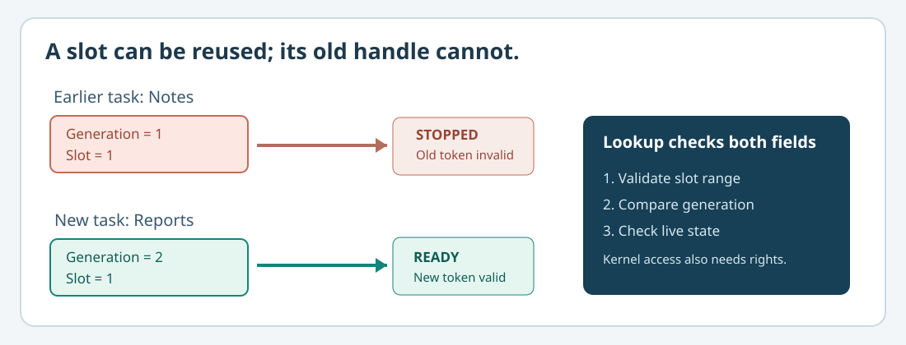

# 104. Close a task without leaving a stale handle behind

An application service may stop while another part of a system still holds an old reference to it. If a new task later occupies the same internal slot, that old reference must not gain access to the new task.

This lesson explains **handles**, **generations**, **resource owners** and **cancellation** using the same Notes service developed in the previous chapter.

## 1. A handle is not a pointer

A pointer refers to a memory address. A handle is an identifier that an owning service looks up before performing an operation. A handle does not guarantee access just because it contains a number: the service must validate the live object, its owner and the requested operation.

The `BtbRoundRobin` classroom model stores up to eight task slots. Its 64-bit handle contains a one-based slot number and a generation:

```text
63                         32 31                          0
+----------------------------+-----------------------------+
| generation number          | slot index + 1              |
+----------------------------+-----------------------------+
```

The slot number tells the scheduler where to look. The generation distinguishes **this task** from an earlier task that happened to use the same slot.



## 2. Observe an old handle being refused

The test `test_round_robin.c` admits Notes, runs it, then exits it. Another task can reuse the vacated slot. The new task receives a larger generation number.

The previous handle now fails with `BTB_SCHED_STALE`. Reusing a slot is allowed; silently reusing the authority of a previous handle is not.

Generation-tagged handles are useful for detecting stale references. They are **not** proof that a caller may perform a privileged operation. The actual Umicom Kernel also applies owner and rights checks to capability handles.

## 3. Closing a service is not deleting its shared queue

Suppose the Notes service is waiting for a message. A sender has already copied a message into the queue. Then the service closes before that message is delivered.

The correct sequence in our laboratory is:

1. The service stops accepting new operations.
2. Its pending wait is cancelled using the matching wait key.
3. The scheduler marks the task Stopped and rejects the old handle.
4. The **channel remains owned by its creator** and retains the accepted message.
5. A separately authorised consumer can later read that message from the channel.

`BtbSessionClose` does **not** destroy the borrowed `BtbChannel`. It also does not pretend it can retract a send that was already accepted. Ownership boundaries determine which component may release which resource.

## 4. Look at the C23 source

Open `labs/native/blocking-ipc-lifetimes/session.c`. Find the `BtbSessionClose` function. It selects between two existing scheduler operations:

```c
/* A waiting task is cancelled; a running task exits normally. */
BtbRoundRobinCancelWait(scheduler, taskHandle, waitKey);
BtbRoundRobinExit(scheduler, taskHandle);
```

These are excerpts, not code to execute consecutively for the same task. The implementation chooses the matching operation for the current state and only publishes `closed = 1` after that operation succeeds.

## 5. Test a cancellation

After building the blocking IPC laboratory from [Lesson 103](103-wait-and-wake-without-spinning.md), run:

```powershell
Set-Location "C:\umicom\Umicom-Bits2Banking"

& ".\output\learning-build\blocking-ipc-lifetimes\btb-blocking-ipc-test.exe" cancellation
```

Expected output:

```text
[OK] Cancellation stops the waiter without consuming an accepted message.
```

Open `test_session.c` to see how the test checks queue contents after closure.

## 6. Compare with Umicom Kernel

The classroom scheduler has eight slots and a single cooperative owner. The real Kernel has separate process/task and message-handle domains, native memory validation, trap-frame lifetime, wait records and privilege constraints. See [Kernel message channels](https://github.com/umicom-foundation/umicom-kernel/blob/main/kernel/message_channel.c) and [Kernel pending IPC](https://github.com/umicom-foundation/umicom-kernel/blob/main/kernel/user_ipc.c).

A handle model is only part of safe resource ownership. Kernel code must also validate live rights, reject aliasing or mismatched identities and make its close/cancel behaviour race-safe under its actual execution assumptions.

## 7. Practise

Explain the difference between stopping a task and destroying a message queue. Find the generation increment in `round_robin.c` and explain what would happen if it were omitted. Why must `BtbSessionClose` avoid setting `closed` before a failed cancellation?

Continue with [Lesson 105 — Inspect a scheduling trace](105-inspect-a-scheduler-trace-with-c23.md).
