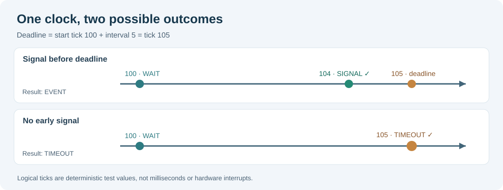

# 107. Understand monotonic clocks and checked deadlines

Imagine the Notes application is waiting for a search index to finish. It should remain usable even when the indexing service is slow or unavailable. A **deadline** gives the application a clear point after which it can report that the operation took too long.

A deadline is not a stopwatch or a sleep instruction. It is an agreed point on a clock. The service compares the current clock reading with that point and decides whether it may continue waiting.

## 1. Choose the right kind of clock

A **wall clock** tells us the date and time. Users and time-synchronisation software can change it. The displayed time might move forwards or backwards when the system clock is corrected. It is valuable for timestamps in a report, but poor for measuring how long to wait.

A **monotonic clock** measures elapsed progress and does not run backwards within its advertised operating range. Timeouts normally use a monotonic source because they should not be extended merely because someone corrects the wall clock. A monotonic counter still has an associated frequency, wrap behaviour and platform contract that the programmer must understand.

Our laboratory starts even more simply: **logical ticks**. A test moves the clock deliberately to 100, 104 and 105, without sleeping. This makes the result reproducible. These numbers are not milliseconds, and the programme does not configure the computer's physical timer.



## 2. Calculate the deadline safely

Suppose the current tick is `100` and the allowed interval is `5` ticks. The deadline is:

```text
Current tick    100
Wait interval     5
-------------------
Deadline        105
```

A 64-bit unsigned value cannot hold numbers greater than `UINT64_MAX`. C23 unsigned arithmetic wraps instead of reporting an overflow. An unchecked addition near this limit could create a deadline smaller than the current clock and cause a surprising immediate timeout.

Our laboratory checks the addition **before changing the timer**:

```c
if (interval != 0U && clock->now > UINT64_MAX - interval)
    return BTB_TIMER_OVERFLOW;
```

`interval == 0` has a special, documented meaning here: wait without a finite deadline. The zero is not interpreted as “expire right now”. A real product must specify this convention clearly because other APIs use different meanings for zero.

Read the full implementation in [`deadline.c`](https://github.com/umicom-foundation/Bits2Banking/blob/main/labs/native/monotonic-deadlines/deadline.c). It first checks the requested interval, then publishes the new state in one assignment. A rejected request leaves the old state untouched.

## 3. Observe without changing the timer

`BtbDeadlineStatus()` answers whether a pending timer is due. It does not fire an interrupt or wake a task. An observer should not secretly change ownership.

At tick 104, the deadline of 105 is not due. At tick 105, it is due. In the exercise, calling `BtbDeadlineCancel()` at tick 105 is rejected: the timeout has already won. The caller must explicitly acknowledge that result with `BtbDeadlineFire()`.

A timer becoming due is **not** equivalent to a blocked task instantly executing on the CPU. The scheduler decides when the task is allowed to run again. That distinction will matter in Lesson 109.

## 4. Build the C23 example

Open PowerShell and enter:

```powershell
Set-Location "C:\umicom\Umicom-Bits2Banking"
$env:Path = "C:\msys64\ucrt64\bin;$env:Path"

cmake -S ".\labs\native\monotonic-deadlines" `
    -B ".\output\learning-build\monotonic-deadlines" `
    -G Ninja `
    -DCMAKE_C_COMPILER="C:\msys64\ucrt64\bin\gcc.exe" `
    -DBUILD_TESTING=ON

cmake --build ".\output\learning-build\monotonic-deadlines" --parallel 2

ctest --test-dir ".\output\learning-build\monotonic-deadlines" --output-on-failure

& ".\output\learning-build\monotonic-deadlines\btb-deadline.exe"
```

One test should pass. The demonstration prints the deadline at tick 105 and then reports that it expired at tick 105. If it does not, read the compiler or CTest message rather than changing unrelated files.

## 5. Try three changes

1. Change the demonstration's interval from `5U` to `3U`. Update the later clock advance to the new deadline and confirm the result.
2. In the test, set the clock to `UINT64_MAX` and arm a one-tick timer. Verify that it returns `BTB_TIMER_OVERFLOW`, retaining the old timer state.
3. Arm an interval of zero, advance the clock and confirm that `BtbDeadlineStatus()` continues to report “not due”.

**Check your understanding:** Why is a wall-clock timestamp useful for an audit record but unsuitable as the sole source of a timeout? Why must a failed arm operation preserve the previous timer? Why does a due timer not execute a task by itself?

Continue with [Lesson 108 — Event signals, waiting and recovery](108-event-signals-waits-and-recovery.md).
