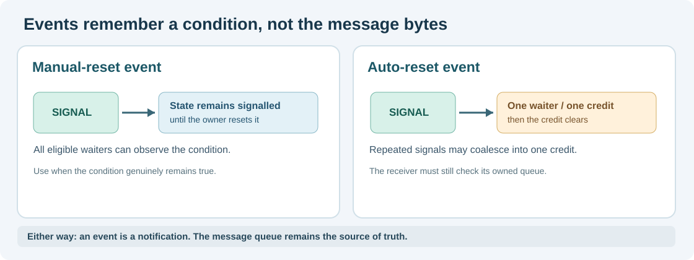

# 108. Understand event signals, waits and recovery

The Notes application has two different needs. It may be waiting for a search result, or it may be waiting for a fixed deadline. An **event** describes something that has happened; a **timer** describes when enough time has passed. Both can make a waiting task eligible to run again, but neither should replace the scheduler.

## 1. A signal is not the data

Consider a service that has a queue of copied Notes messages. After accepting a message, it might signal “the queue may be readable”. This notification is useful because the receiver need not consume CPU cycles checking an empty queue continuously.

However, the notification itself is not proof that the queue still contains a message. Another receiver might have consumed it, a notification might be coalesced with an earlier one, or the producer might have closed. The receiver must **check the queue again** when it runs.

This is the reason the previous [Blocking IPC service](103-wait-and-wake-without-spinning.md) checks its queue in `BtbSessionPoll()`. The queue is the authority; the notification only prompts another inspection.

## 2. Understand remembered events

There are two common ways of remembering an event:

| Event | Behaviour after a signal | Typical purpose |
| --- | --- | --- |
| Manual-reset | Remains signalled until explicitly reset | A condition which stays true until its owner changes it |
| Auto-reset | Can award one waiter or retain one credit for a future waiter | Notify one consumer that progress may be possible |

For an auto-reset event, repeated signals while no waiter consumes the credit may coalesce into one stored credit. It is **not a counting semaphore** and does not count messages. A separate queue must preserve the actual records.



## 3. The lost-wake problem

Imagine a receiver checks “queue empty” at precisely the moment another worker sends a message. If the receiver later registers a wait after the sender's notification, it may sleep despite the queued message. The dangerous interval is the gap between **checking** and **registering** the wait.

The C23 teaching laboratories are single-threaded. Their check/register operation has no other thread running in the middle. This assumption makes the sequence easy to inspect, but it does **not** solve concurrent access on real multi-core processors.

Umicom Kernel's existing event owner uses its scheduler's serialised critical section for a bounded wait registration. Read [EVENTS_AND_WAIT_ANY.md](https://github.com/umicom-foundation/umicom-kernel/blob/main/docs/EVENTS_AND_WAIT_ANY.md) and [`kernel/events.c`](https://github.com/umicom-foundation/umicom-kernel/blob/main/kernel/events.c) to see why that contract matters. It must not be confused with a general-purpose SMP-safe event implementation.

## 4. Decide the outcome at the boundary

A waiting operation can end because its event arrives, its deadline expires, it is cancelled, or the service closes. Once an outcome has been decided, repeating an old signal should not change that decision.

In our next laboratory, a Notes task waits at tick 100 with a five-tick timeout:

```text
Tick 100: enter WAITING, deadline 105
Tick 104: matching event arrives -> READY; result = EVENT
Tick 105: no timeout is delivered: the wait already completed
```

Now compare the tie:

```text
Tick 100: enter WAITING, deadline 105
Tick 105: matching event arrives -> event refused as too late
Tick 105: timeout is processed -> READY; result = TIMEOUT
```

The explicit rule **timeout wins at the deadline** removes ambiguity from the teaching model. A different production API may define a different tie policy, but it must define one.

## 5. Cancellation is not reversal

If the Notes task is cancelled while waiting, the system releases the wait registration and prevents its old continuation from being scheduled again. This does not retract a message which was already accepted into a queue. Nor does it restore resources freed by another component.

For a practical service, cleanup belongs to the owner of each resource. A queue owns accepted bytes, the scheduler owns task state, and a timer owner controls its deadline. A single “cancel” call cannot blindly modify all of them without checking their lifetimes.

## 6. Explore the Kernel implementation

Read the first two sections of [Umicom Kernel's events guide](https://github.com/umicom-foundation/umicom-kernel/blob/main/docs/EVENTS_AND_WAIT_ANY.md). Find the explanation of why an auto-reset event is not a message counter. Next, locate the copied wait handles and the completion-before-wake ordering in [`kernel/events.c`](https://github.com/umicom-foundation/umicom-kernel/blob/main/kernel/events.c).

**Practise:** Draw a three-column timeline: sender, event owner and receiver. Place a message acceptance, a signal, a scheduling delay and a queue read on it. Which component decides whether the message is still available?

Continue with [Lesson 109 — Compose a timed C23 service](109-compose-a-timed-service-wait.md).
