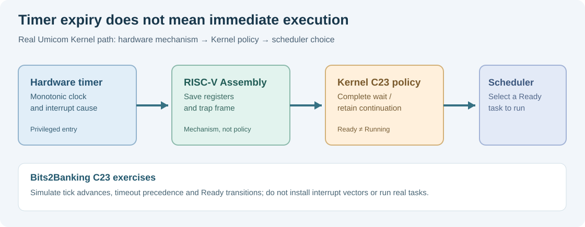

# 109. Build a timed Notes service in C23

Our Notes application has a scheduler and a small service that waits for a reply. We now want to allow a finite timeout without changing either the existing scheduler algorithm or the clock implementation.

We will build **a coordinating service**, not a second scheduler or another timer library. This is an important software engineering principle: reusable components should keep their responsibilities, while applications combine them to solve a problem.

## 1. Identify the owners

Three C23 components cooperate:

| Component | What it owns |
| --- | --- |
| `BtbRoundRobin` | Task identities, Ready/Running/Waiting states and dispatch order |
| `BtbLogicalClock` and `BtbDeadline` | Logical ticks, timer state and its checked deadline |
| `BtbTimedWaitService` | Which task waits for which event and the final wait outcome |

The service borrows pointers to the scheduler and clock. The caller must keep both alive for the whole service lifetime. This is **borrowing**, not transferring ownership. The service's timer is stored inside the service itself.



## 2. Prepare the project

The source is in [`labs/native/timed-service-waits`](https://github.com/umicom-foundation/Bits2Banking/tree/main/labs/native/timed-service-waits). Its `CMakeLists.txt` uses the exact earlier files:

```cmake
add_library(btb_timed_dependencies STATIC
    ../round-robin-scheduler/round_robin.c
    ../monotonic-deadlines/deadline.c)
```

This build file is necessary build configuration, not application logic in another programming language. The new `service.c` implements only the coordination calls. It does not copy the scheduling and timer algorithms.

## 3. Register a wait safely

A Notes task must first be Running. The service then checks the deadline arithmetic:

```c
const BtbTimerResult armed =
    BtbDeadlineArm(&service->deadline, service->clock, ticks);
if (armed == BTB_TIMER_OVERFLOW)
    return BTB_TIMED_OVERFLOW;
```

Only after the timer is valid does the service ask `BtbRoundRobinWait()` to move that task into Waiting. If the scheduler refuses the change, the service cancels the freshly armed timer. This makes failures visible rather than leaving a timer that claims to belong to a wait that was never registered.

The service has no thread and no running interrupt. A caller explicitly changes the test clock and invokes the next operation. This keeps the laboratory deterministic.

## 4. Signal, expire or cancel

The service exposes three distinct decisions:

- `BtbTimedWaitSignal()` checks the matching event key and refuses a signal that arrives at or after the deadline.
- `BtbTimedWaitPump()` checks the clock and, when due, marks the result as a timeout.
- `BtbTimedWaitCancel()` stops a pending task through the existing scheduler's cancellation contract.

A successful signal or timeout calls `BtbRoundRobinWake()`. This marks the task **Ready**. It does not run that task. The caller must request the next scheduler dispatch with `BtbRoundRobinNext()`.

A cancelled task is instead **Stopped**; it cannot be dispatched again under its old handle. These are different lifecycle outcomes.

## 5. Build and test

```powershell
Set-Location "C:\umicom\Umicom-Bits2Banking"
$env:Path = "C:\msys64\ucrt64\bin;$env:Path"

cmake -S ".\labs\native\timed-service-waits" `
    -B ".\output\learning-build\timed-service-waits" `
    -G Ninja `
    -DCMAKE_C_COMPILER="C:\msys64\ucrt64\bin\gcc.exe" `
    -DBUILD_TESTING=ON

cmake --build ".\output\learning-build\timed-service-waits" --parallel 2
ctest --test-dir ".\output\learning-build\timed-service-waits" --output-on-failure
& ".\output\learning-build\timed-service-waits\btb-timed-service.exe"
```

Three tests should pass. The demonstration prints that the Notes task timed out at tick 105, became Ready and was subsequently dispatched. The automated tests also cover a signal at tick 104, a timeout tied at tick 203, a wrong event key, cancellation and rejected overflowing deadlines.

## 6. Inspect a failure without breaking ownership

In `test_service.c`, find the case that advances the clock to `UINT64_MAX` before asking for a one-tick timeout. The service returns `BTB_TIMED_OVERFLOW`. Use `BtbRoundRobinSnapshotRead()` to confirm that the task is **still Running**, because the invalid timeout was rejected before any scheduler change.

Now try changing the event key in the signalling test. The wrong key must not turn the task into Ready. This is a consistency check, not a security mechanism: a number named an “event key” is not a replacement for a Kernel capability or an authenticated identity.

## 7. Where the model stops

This lesson does not implement real sleeping threads, clock interrupts, shared-memory synchronisation or user-mode system calls. Its clock is caller-controlled, and only one execution context changes its state. Umicom Kernel's [timer-driven user scheduling](https://github.com/umicom-foundation/umicom-kernel/blob/main/docs/TIMER_DRIVEN_USER_SCHEDULING.md) is the authoritative implementation for the actual RISC-V execution path.

Continue with [Lesson 110 — Inspect a timer trace](110-inspect-a-timer-trace-in-c23.md).
