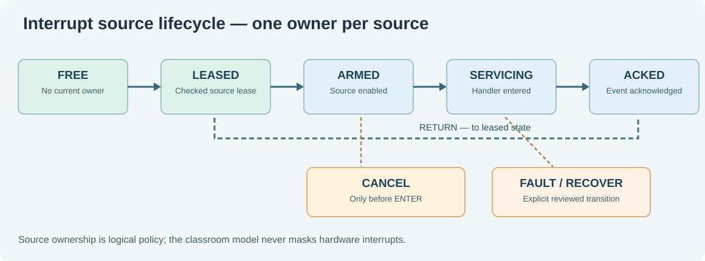

# 112. Who owns an interrupt? Critical sections and source leases

Consider a Notes application that saves a document while a background service is indexing its contents. A timer allows an operating system to interrupt user code and give another task some processor time. But if two privileged services both try to control the **same hardware timer**, neither can assume it alone owns that device.

This lesson explains ownership, interrupt masking and the difference between a protected operation and a device lease. We will first build an ordinary C23 model. Later we will read the genuine RISC-V mechanism in Umicom Kernel.

## 1. Understand what an interrupt changes

An **interrupt** is a hardware request for the processor to handle something that needs attention. When an eligible interrupt arrives, the processor transfers control to a privileged handler. A timer is one possible source.

A **critical section** is a small region of operations that must not be interrupted by a conflicting operation. A **source lease** records which trusted Kernel component has permission to change a particular interrupt source. These solve different problems: masking delivery does not create ownership, and ownership alone does not stop an interrupt from arriving.



In our teaching model, a source moves through these states:

```text
FREE -> LEASED -> ARMED -> SERVICING -> ACKED -> LEASED -> FREE
```

`FREE` means no owner currently holds the source. `LEASED` records its owner, and `ARMED` means the model permits an interrupt to enter. `SERVICING` means the handler has begun work. `ACKED` means the handler has recorded acknowledgement; a separate return ends that handling interval. Releasing a lease requires a quiescent `LEASED` state. A real hardware timer has additional requirements: its pending condition, enable bits, compare value and platform-specific state must be checked too.

## 2. Learn why nested critical sections need ownership

Suppose `SaveNotes()` enters a critical section. While inside it, `UpdateIndex()` enters a second critical section. If the inner function blindly re-enables interrupts when it returns, it ends the protection still needed by `SaveNotes()`.

Correct nesting remembers the prior state and the order in which sections were entered:

```text
Outer enters: save previous enabled state; disable eligible delivery
  Inner enters: delivery stays disabled
  Inner leaves: delivery stays disabled
Outer leaves: restore the original state
```

The inner function is **not** allowed to restore a state owned by the outer function. Equally, if interrupts were already disabled before the outer call, leaving must not accidentally enable them.

The genuine Umicom Kernel [interrupt ownership guide](https://github.com/umicom-foundation/umicom-kernel/blob/main/docs/INTERRUPT_OWNERSHIP.md) explains how the RISC-V MIE bit is captured and cleared with an atomic CSR instruction. `MIE` controls eligible machine-mode interrupt delivery. It is not the same as acknowledging a pending interrupt at a device.

## 3. Build a classroom ownership model

The source is in [`labs/native/interrupt-ownership`](https://github.com/umicom-foundation/Bits2Banking/tree/main/labs/native/interrupt-ownership). The public file `owner.h` defines a source lease containing `source`, `owner` and `generation` identifiers.

An **owner** is a trusted identity in this model. A **generation** increases whenever a source is leased again. The generation makes a previously issued lease stale, even when a new service reuses the same source number.

```c
BtbIrqDomain domain = {0};
BtbIrqLease lease = {0};

BtbIrqInitialize(&domain);
BtbIrqClaim(&domain, 1U, 20U, 1U, &lease);
BtbIrqArm(&domain, lease);
BtbIrqEnter(&domain, lease);
BtbIrqAcknowledge(&domain, lease);
BtbIrqReturn(&domain, lease);
BtbIrqRelease(&domain, lease);
```

The complete demonstration checks every result. This fragment shows the sequence, but **real C code must not discard operation failures**. The returned lease belongs to the caller, while the domain owns the actual source state. The lease is not a secret and cannot grant access independently of the live domain.

## 4. Configure, build and run

From PowerShell on Windows:

```powershell
Set-Location "C:\umicom\Umicom-Bits2Banking"
$env:Path = "C:\msys64\ucrt64\bin;$env:Path"

cmake -S ".\labs\native\interrupt-ownership" `
    -B ".\output\learning-build\interrupt-ownership" `
    -G Ninja -DCMAKE_C_COMPILER="C:\msys64\ucrt64\bin\gcc.exe" `
    -DBUILD_TESTING=ON

cmake --build ".\output\learning-build\interrupt-ownership" --parallel 2
ctest --test-dir ".\output\learning-build\interrupt-ownership" --output-on-failure
& ".\output\learning-build\interrupt-ownership\btb-interrupt-ownership.exe"
```

The two registered tests should pass. The application describes the full ownership sequence and confirms that it has **not touched hardware**.

## 5. Investigate a refused operation

Open `test_owner.c`. Follow the test which attempts to release a source while the state is `ARMED`. Release must fail, because an armed source could still produce an interrupt. Next find the test which changes `lease.owner`: the wrong owner cannot change the source state. Finally find the stale lease test. Once generation 2 has been issued, generation 1 must never become valid again.

A refused operation must not partially change the state. Otherwise, a harmless error message could disguise an accidentally released resource.

## 6. Check your understanding

1. Why does disabling interrupts not mean that a hardware timer has been acknowledged?
2. What must the outer critical section remember before the inner section starts?
3. Why is `generation` necessary when source numbers are reused?
4. What could happen if a source were released while its handler was executing?

**Practise:** Edit a *copy* of `test_owner.c` to attempt `BtbIrqReturn()` before acknowledgement. Run CTest and explain the refusal. Do not modify the actual Umicom Kernel while completing this exercise.

**Next:** [Lesson 113 — Cancellation is not acknowledgement](113-cancellation-is-not-acknowledgement.md).
