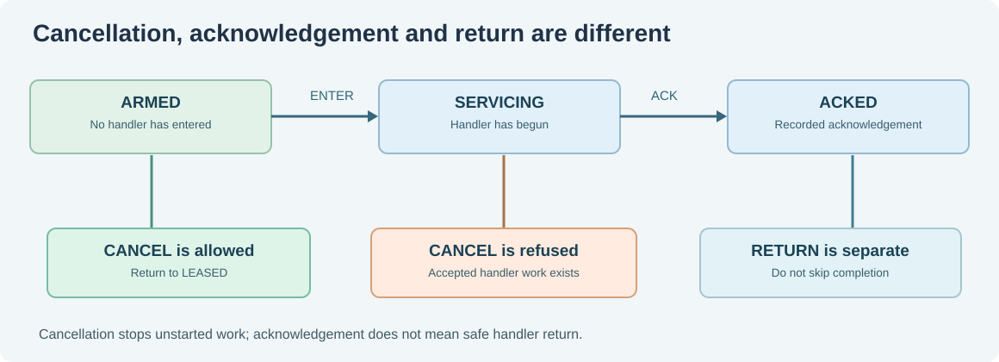

# 113. Cancellation is not acknowledgement

A document-indexing service receives a request to stop. At almost the same moment, the operating system timer might already have interrupted a task. Can the service simply cancel the timer and assume nothing else needs attention?

No. **Cancelling future work, acknowledging an already observed event, and completing a handler are separate operations.** Confusing them can lose information or release resources too early.

## 1. Identify the decision boundary

The key question is: *Has the operation already been accepted or started?*

In the fictional interrupt-source model, cancellation is allowed from `ARMED` because no handler has entered. Once the source moves to `SERVICING`, an interrupt is already being handled. This cannot be rewritten as though it never happened.



A useful analogy is a payment simulator. A request can be cancelled **before** the simulated transfer is accepted. Once the ledger has accepted a posting, cancelling the original request does not erase that entry; a separate, auditable reversal is required. We use fictional money and no real financial account here.

## 2. Examine three distinct outcomes

| Starting state | Operation | Expected result |
| --- | --- | --- |
| ARMED | CANCEL | Return to LEASED; no handler has begun |
| SERVICING | CANCEL | Refused; the handler already has work |
| SERVICING | ACK | Mark the event acknowledged; RETURN remains separate |

Acknowledgement and return are not interchangeable. A handler might acknowledge a source but encounter a fault before completing its return sequence. A real Kernel must examine its actual hardware and saved machine state before deciding what can be restored.

## 3. Test the refused cancellation

Open [`interrupt-ownership/test_owner.c`](https://github.com/umicom-foundation/Bits2Banking/blob/main/labs/native/interrupt-ownership/test_owner.c) and locate the following two calls:

```c
CHECK(BtbIrqEnter(&domain, token) == BTB_IRQ_OK);
CHECK(BtbIrqCancel(&domain, token) == BTB_IRQ_WRONG_STAGE);
```

The first call transitions from `ARMED` to `SERVICING`. The second must fail without modifying the source. This is more useful than merely testing the normal happy path: a professional system is defined partly by what it **refuses to do**.

Now find the normal sequence: `Acknowledge`, `Return`, `Release`. Observe how each operation has one responsibility and does not silently perform the next.

## 4. Add an explicit fault boundary

A failure during an active operation must be visible. Our model provides:

```c
BtbIrqFault(&domain, token);
BtbIrqRecover(&domain, token);
```

The educational `FAULTED` state prevents an ordinary `Release`. `Recover` means the *fictional owner* has reviewed the state and accepted an explicit transition back to `LEASED`. It is **not** a safe recovery mechanism for a real CPU trap. A real fault may have damaged the register frame, device state, memory ownership or privilege context. Those conditions cannot be dismissed merely by toggling a C enum.

The Kernel's [`trap_guard.c`](https://github.com/umicom-foundation/umicom-kernel/blob/main/kernel/trap_guard.c) demonstrates a stricter response: unexpected control-state corruption enters an emergency path rather than pretending that execution can safely resume.

## 5. Compare with message queues and cancellation

This same distinction occurs in the existing [Umicom Kernel blocking IPC guide](https://github.com/umicom-foundation/umicom-kernel/blob/main/docs/BLOCKING_IPC.md). A pending send owns copied bytes until accepted; cancelling a pending operation discards work **not yet committed**. Cancellation does not retract a message already accepted by its destination queue.

In both systems, a request and its effect have different lifetimes. A command can be refused, accepted, completed or faulted. A safe design always says which state has actually changed.

## 6. Exercise

Run the interrupt ownership laboratory tests, then reason through these scenarios:

1. A source is `ARMED`. The owner cancels. Is an ACK expected?
2. A source is `SERVICING`. The owner tries CANCEL. What must remain unchanged?
3. A source is `ACKED` when a fault is recorded. May it be released immediately?
4. A stale lease refers to the same source number as a newer owner. What must the domain compare before accepting it?

**Next:** [Lesson 114 — Restore a fictional service after a failure](114-restore-a-service-after-failure.md).
