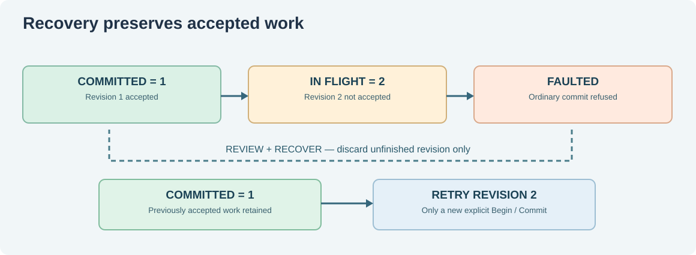

# 114. Restore a service after a failure in C23

Suppose our Notes service has successfully processed revision 1. It begins revision 2, but a simulated fault occurs before the operation is acknowledged. The service must remember that revision 1 completed and that revision 2 did **not**.

We will implement this behaviour by reusing the ownership model from Lesson 112. This example is deliberately local and in memory. It teaches the difference between an accepted checkpoint, unfinished work and a reviewed retry.

## 1. Know what a checkpoint means

A **checkpoint** is a recorded point from which a service knows how much work it has completed. In this laboratory `committed` is a simple 32-bit integer stored in RAM. It is not saved to disk. If the process exits, it will be lost.

That limitation matters: an in-memory checkpoint can demonstrate state transitions, but it cannot provide durable recovery after a computer loses power. Durable systems also need storage protocols, write ordering, checksums, transactions and recovery from partially written records.



## 2. Follow the normal sequence

A service starts by claiming one source and arming it. A revision can begin only if its number exceeds the last accepted one.

```c
BtbService service = {0};
BtbServiceStart(&service, 7U);
BtbServiceBegin(&service, 1U);
BtbServiceCommit(&service);
```

The complete demonstration checks each status; this shortened excerpt emphasises the sequence. After success, `committed` equals 1 and `inFlight` equals zero. The underlying owner model returns to `ARMED`, ready for another operation.

## 3. Fail while revision 2 is in progress

Now run:

```c
BtbServiceBegin(&service, 2U);
BtbServiceFault(&service);
```

Revision 2 is recorded as in progress but **not accepted**. The ownership model enters `FAULTED`, where normal Commit, Release and Cancel operations are refused. This prevents the program from pretending that the half-finished operation succeeded.

The next action is an explicit review:

```c
BtbServiceRecover(&service);
```

The teaching service now clears the abandoned in-flight number, preserves `committed == 1`, and re-arms the fictional source. It does **not** automatically replay revision 2. A caller may choose to begin revision 2 again after investigating why the earlier attempt failed.

## 4. Test deliberate retry and shutdown

Open [`service-recovery/test_recovery.c`](https://github.com/umicom-foundation/Bits2Banking/blob/main/labs/native/service-recovery/test_recovery.c). Observe that a second attempt to commit a faulted operation is refused. Next confirm that the accepted revision remains unchanged until a new Begin/Commit pair completes.

A service must also refuse shutdown while an operation is still in flight. Our model allows Stop only after the source is back to `ARMED` with no in-flight revision. Stop cancels the outstanding invitation to run, then releases the lease. It does not delete a previously accepted revision.

## 5. Build the composed laboratory

The `service-recovery/CMakeLists.txt` file builds `recovery.c` and **reuses the original `interrupt-ownership/owner.c` implementation** by adding its directory to the build. There is no copied interrupt model.

```powershell
Set-Location "C:\umicom\Umicom-Bits2Banking"
$env:Path = "C:\msys64\ucrt64\bin;$env:Path"

cmake -S ".\labs\native\service-recovery" `
    -B ".\output\learning-build\service-recovery" `
    -G Ninja -DCMAKE_C_COMPILER="C:\msys64\ucrt64\bin\gcc.exe" `
    -DBUILD_TESTING=ON

cmake --build ".\output\learning-build\service-recovery" --parallel 2
ctest --test-dir ".\output\learning-build\service-recovery" --output-on-failure
& ".\output\learning-build\service-recovery\btb-service-recovery.exe"
```

Both tests should pass. The application prints the last accepted revision, 2, after the deliberate retry.

## 6. Where real recovery is harder

A real system cannot treat a software variable as proof that a financial posting, file update or device operation was durably committed. A robust implementation needs a durable owner, an explicit transaction boundary, replay-safe identifiers and tests that simulate failure during each write or acknowledgement step.

Our lab also runs synchronously on one thread. It does not provide multicore locking, IRQ-safe synchronization, a real device-driver model or operating-system recovery.

**Practise:** Change the test to attempt `BtbServiceStop()` while revision 2 is faulted. Explain why Stop must refuse. Then identify the single statement which publishes the accepted checkpoint only after the operation's modelled acknowledgement and return.

**Next:** [Lesson 115 — Inspect an interrupt ownership trace](115-inspect-interrupt-ownership-traces.md).
