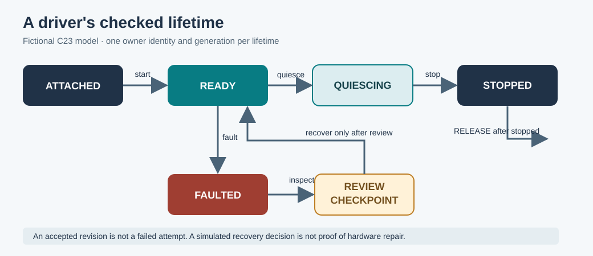

# 117. Understand interrupt diagnostics and event order

When a driver fails, the most important question is not only **what went wrong**.
We also need to know **what happened first**, **which component owned the
operation**, **whether it had finished**, and **what happened afterwards**.
These are questions that a diagnostic record can help us answer.

Imagine a note-taking application that sends an item to a fictional printer.
The printer service starts, accepts a document and then reports a fault.
A message saying only *Printer unavailable* does not tell us whether the item
was accepted, still queued or printed twice. The order of events matters.

## 1. What is a diagnostic record?

A **diagnostic record** describes one observation: a timestamp or logical tick,
a component identifier, a diagnostic code and the operation involved. A
**sequence number** establishes the order in which records were written. It is
not necessarily the time at which hardware first experienced the event.

A useful sequence might look like this:

| Sequence | Driver event | Meaning |
|---:|---|---|
| 1 | Attach | One owner takes responsibility for the fictional device. |
| 2 | Ready | The driver can accept a request. |
| 3 | Observe | A diagnostic measurement has been recorded. |
| 4 | Checkpoint | A named earlier observation is selected for review. |
| 5 | Fault | The current operation cannot continue. |
| 6 | Recover | A reviewed decision permits the simulated service to resume. |
| 7 | Quiesce | No additional work may begin. |
| 8 | Stop | Active activity has stopped. |
| 9 | Release | The ownership token becomes invalid. |

**Attach** is not the same as **Ready**. The first establishes ownership; the
second means the service has completed its initialisation. Similarly, a request
to stop is not proof that a device has stopped. The separate **Stop** operation
records the end of the active lifetime.

## 2. Understand ownership and generation numbers

Suppose Driver A owns slot 1 with generation 1. The service stops and releases
it. Later Driver B is assigned the same slot with generation 2.

If an old callback still carries `slot=1, generation=1`, it must not be allowed
to operate on Driver B. The generation number prevents one kind of **stale
handle**: a reference to an object whose previous lifetime has ended.

A slot alone identifies a position in a table. A slot **plus generation**
identifies a particular lifetime in that position. Production systems must
also validate the authorised owner and access rights; a generation is not a
secret password.

## 3. Separate an observation from a decision

A fault observation states that something failed. A recovery record states that
a decision was made after reviewing it. Neither record alone proves the device
has returned to a safe physical state.

For a storage device, an actual recovery procedure could additionally require
checking outstanding writes, device readiness, filesystem consistency and
ownership of outstanding requests. Those checks belong to the production
kernel and driver, not this lesson's classroom model.

## 4. Follow the Umicom source

The real [Umicom Kernel interrupt controller](https://github.com/umicom-foundation/umicom-kernel/blob/main/kernel/interrupts.c)
records critical-section nesting and source leases. Its corresponding
[interrupt-ownership guide](https://github.com/umicom-foundation/umicom-kernel/blob/main/docs/INTERRUPT_OWNERSHIP.md)
explains why a nested helper may not re-enable interrupts before its outer
caller finishes.

The [RISC-V trap entry](https://github.com/umicom-foundation/umicom-kernel/blob/main/arch/riscv64/trap.S)
saves processor context before the C handler examines the reason for a trap.
The mechanism is written in Assembly because ordinary C cannot safely provide
the first instructions of a privileged exception entry.

## 5. Your turn

Read these statements and decide which one is justified by the evidence:

1. A log contains `Fault`: **a failure was observed**.
2. A log contains `Recover`: **a recovery decision was recorded**.
3. A log contains `Release`: **the teaching model considers the slot free**.
4. A log contains `Checkpoint`: **the data is safely stored on disk**.

Statements 1–3 describe the meaning of their respective records. Statement 4
does **not** follow: the checkpoint may only refer to an earlier observation.
Durable storage needs a separate file and durability contract.

**Next:** [118. Build a driver lifecycle from reusable C23 services](118-build-a-driver-lifecycle.md).
