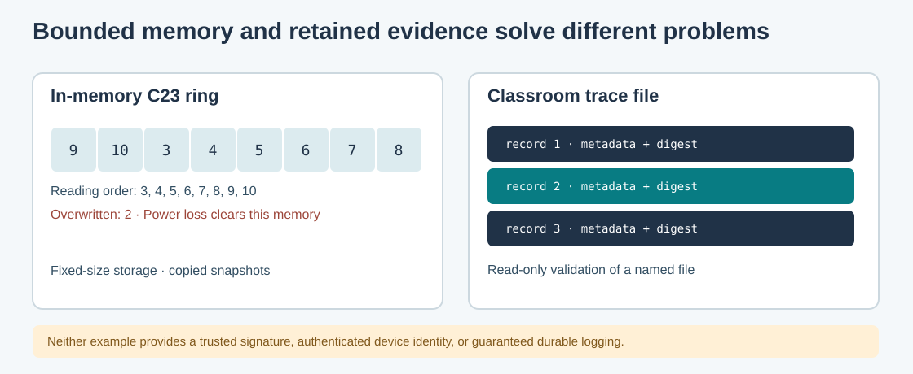

# 119. Keep diagnostic records in a bounded C23 ring

A service can produce many diagnostic messages. Keeping every message in
memory forever would eventually consume too much space. One simple option is
a **circular buffer**, also called a ring buffer. It keeps a fixed number of
records and replaces the oldest one when a new one arrives.

This chapter develops an eight-record ring in C23. It is an in-memory learning
exercise, not a database or an audit journal.

## 1. Understand the storage layout

Imagine eight numbered positions:

```text
Physical positions:  0  1  2  3  4  5  6  7
Initial state:       -  -  -  -  -  -  -  -
After 8 events:      1  2  3  4  5  6  7  8
After 10 events:     9 10  3  4  5  6  7  8
Reading oldest first: 3, 4, 5, 6, 7, 8, 9, 10
```

The physical memory positions do not change size. An index called `head`
points to the oldest retained record. Once the buffer is full, inserting a
record advances `head` and increases a **dropped count**.



## 2. What information should a record contain?

The sample uses four fixed-width values:

```c
typedef struct BtbDiagnostic {
    uint64_t sequence;
    uint64_t logicalTick;
    uint32_t source;
    uint32_t code;
} BtbDiagnostic;
```

A **sequence** orders recorded events. A **logical tick** is a value generated
by the example; it is not automatically a wall-clock timestamp. The **source**
identifies the fictional component; the **code** identifies a specific
observation.

We use integer codes instead of placing unrestricted text into the ring.
That avoids accidentally treating pointers to temporary strings as long-lived
diagnostic data. A complete application could maintain an authorised lookup
table for human-readable descriptions.

## 3. Build the laboratory

From PowerShell:

```powershell
Set-Location "C:\umicom\Umicom-Bits2Banking"
$env:Path = "C:\msys64\ucrt64\bin;$env:Path"
cmake -S ".\labs\native\diagnostic-ring" `
    -B ".\output\learning-build\diagnostic-ring" `
    -G Ninja -DCMAKE_C_COMPILER="C:\msys64\ucrt64\bin\gcc.exe"
cmake --build ".\output\learning-build\diagnostic-ring" --parallel 2
ctest --test-dir ".\output\learning-build\diagnostic-ring" --output-on-failure
& ".\output\learning-build\diagnostic-ring\btb-diagnostic-ring.exe"
```

Expected output:

```text
Retained rows: 8. Overwritten rows: 2. First sequence: 3.
```

Ten events were produced, but eight remain. The first two have been replaced.
Their earlier contents are no longer available from the ring.

## 4. Understand safe failure

`BtbDiagnosticPush` checks its input before changing the ring. It refuses
zero source IDs, zero diagnostic codes and a logical tick that moves backwards.
If the 64-bit sequence counter has exhausted its range, the program refuses to
wrap back to one. Otherwise, old records could appear to have new identities.

The function `BtbDiagnosticRead` copies the retained records into a caller-owned
snapshot in chronological order. The caller does not receive an address into
the live ring, so an unrelated append cannot silently change an older
snapshot. The sample does not implement concurrent access; in a multithreaded
programme, additional synchronisation would be required.

## 5. Know what this design cannot do

A ring buffer is useful for bounded diagnostics, but it does not preserve a
complete history. Power loss deletes its contents, and overwritten events
cannot be reconstructed. It provides neither signatures nor authenticated
producer identity.

For durable history, a system needs explicitly managed persistent storage,
retention policy, backups and integrity or authentication controls suited to its
threat model.

## 6. Your turn

Find `BTB_DIAGNOSTIC_RING_CAPACITY` in `ring.h`. Predict the output if you change
it from eight to four, then adjust the tests to match the new capacity and
rebuild. Observe the difference between the number of **events written** and
**records retained**.

**Next:** [120. Validate a chained evidence trace with SHA-256](120-inspect-a-chained-evidence-trace.md).
