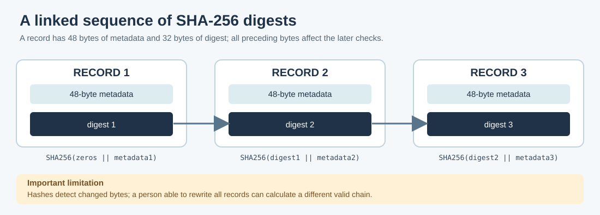

# 120. Inspect a chained evidence trace with SHA-256

A log can be accidentally damaged when bytes are copied or stored. We can
identify many such changes by calculating a **hash**: a fixed-size digest
computed from the input bytes. A cryptographic hash such as SHA-256 always
produces 32 digest bytes, irrespective of the size of the message.

In this lesson we inspect a **fictional driver-evidence trace** using an
existing Framework-owned SHA-256 implementation. We do not introduce a second
hashing algorithm. The inspector reads the file and refuses damaged or
out-of-order records.

## 1. Understand a chained digest

For the first record, calculate a digest from 32 zero bytes followed by the
record's 48 metadata bytes. For every later record, use the preceding record's
digest followed by the next 48 metadata bytes:

```text
First = SHA256(zero-digest || first-record-metadata)
Next  = SHA256(previous-digest || next-record-metadata)
```

The `||` sign means **join the two byte sequences in order**. We do not hash
the 32-byte digest stored inside the same record; that would make its definition
circular.



If one earlier record is edited without updating all later digests, verification
fails. This helps detect accidental damage and incomplete edits.

**A SHA-256 chain does not prove who wrote the file.** Someone able to replace
the whole file can calculate a new, internally consistent chain. Authentic
provenance needs a separately trusted signature, authenticated logging service
or another suitable integrity mechanism. Nothing here claims durable storage.

## 2. Read the teaching file format

The complete format is documented in
[`evidence_trace.h`](https://github.com/umicom-foundation/umicom-framework/blob/main/include/umicom/education/evidence_trace.h).
The file has a 24-byte header followed by zero or more 80-byte records.

| Field | Bytes | Description |
|---|---:|---|
| Header magic | 8 | `UMIEVD1` followed by a zero byte. |
| Version and reserved | 4 | Version 1; other flags must be zero. |
| Record count and reserved | 12 | Count of records, plus reserved fields. |
| Record metadata | 48 | Order, event, driver, owner, generation and diagnostic values. |
| Record digest | 32 | SHA-256 of the previous digest plus this record's metadata. |

All integer values use **little-endian byte order**. The inspector caps the
input to 4,096 records so malformed counts cannot request unlimited memory.
It refuses extra or truncated bytes, invalid states, stale generations and
digests that do not match the recorded metadata.

## 3. Build Umicom Education

From PowerShell:

```powershell
Set-Location "C:\umicom\Umicom-Applications"
$env:Path = "C:\msys64\ucrt64\bin;$env:Path"
cmake -S ".\framework\tools\umicom-education" `
    -B ".\build\umicom-education" -G Ninja `
    -DCMAKE_C_COMPILER="C:\msys64\ucrt64\bin\gcc.exe" `
    -DBUILD_TESTING=ON
cmake --build ".\build\umicom-education" --parallel 2
ctest --test-dir ".\build\umicom-education" -R "evidence_trace" --output-on-failure
```

The first evidence test creates a deterministic file. The second opens it
through the command-line application. The test fixture is named:

`build/umicom-education/education-evidence-trace-test/fixture with spaces/driver evidence.evd`

Now inspect the file:

```powershell
& ".\build\umicom-education\bin\umicom-education.exe" evidence-trace `
    --file ".\build\umicom-education\education-evidence-trace-test\fixture with spaces\driver evidence.evd"
```

The report begins:

```text
Evidence trace: 20 records
Attach: 3 | Ready: 3 | Observations: 2 | Checkpoints: 1
Faults: 2 | Recoveries: 1 | Quiesce: 2 | Stop: 3 | Release: 3
```

The file describes a **simulation**. No real driver, device interrupt, service
restart or secure audit operation occurred.

## 4. Understand the negative tests

Open `framework/tests/education/test_evidence_trace.c` and locate the checks
that change the input before asking the inspector to parse it again.

A changed byte invalidates a digest. Other tests deliberately recalculate all
digests after introducing a **semantic** problem, such as a stale generation,
wrong owner or invalid checkpoint. These second tests are important: a
cryptographically consistent sequence may still describe impossible or
unauthorised state transitions.

The inspector prepares its complete report in local storage and only copies it
to the caller when every check succeeds. If a later record is malformed, the
caller's earlier report remains unchanged.

## 5. Your turn

1. Find the constants for header size, record size and maximum records.
2. Locate the line calling `UmiSha256Update` with the previous digest.
3. Find a test where the record's SHA-256 digest is correct, but its generation
   is stale. Explain why it must still be rejected.
4. Describe how you would verify a signed audit record without confusing a
   matching hash with a trusted identity.

**Next:** [121. Follow actual Umicom Kernel driver and interrupt boundaries](../06-umicom/121-kernel-driver-and-interrupt-boundaries.md).
