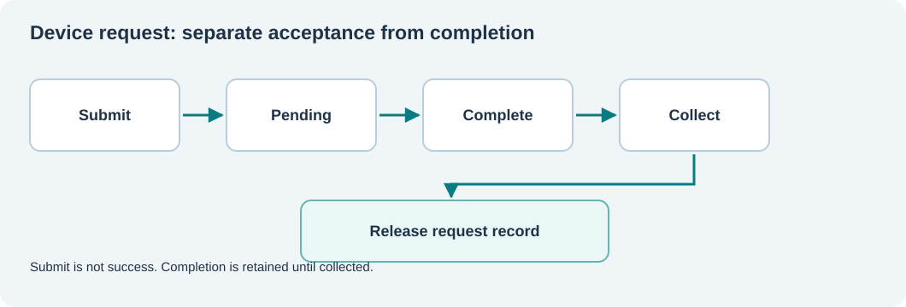

# 122. Follow a device request from submission to completion

A note-taking application saves a document. The text reaches a storage service, which eventually asks a device to write bytes. The application wants a simple answer: **was my work accepted and is it safe to continue?** The device driver has to answer several smaller questions first.

## Submission and completion are different events

A driver **submits** a request when it makes a command available to the device. The device might not act immediately. The driver receives a **completion** later when the device has reported a result and the driver has checked it.



Imagine a fictitious Notes application requesting that 256 bytes be saved:

1. The service validates that 256 is within the accepted range and assigns request ID 1.
2. It retains the request information while the device is allowed to work.
3. The device finishes and reports a status and byte count.
4. The completion is copied into a bounded queue.
5. The service **collects** the completion and releases the old request record.

The first step does not prove the fifth. A submitted request is not the same thing as a completed request; completion of a write is not automatically proof of permanent persistence either.

## One request has a lifetime

The [I/O request laboratory](https://github.com/umicom-foundation/Bits2Banking/tree/main/labs/native/io-request-lifecycle) uses the following states:

| State | Meaning | What may happen next |
| --- | --- | --- |
| Pending | Accepted; no terminal result exists | Completion or cancellation request |
| Cancellation requested | Caller would prefer the work to stop | Device still reports a terminal result |
| Completed | Validated result has entered the queue | Caller collects it |
| Released | Caller has collected the result | Record slot may be used again |

A request identity and the state of its slot are separate facts. The laboratory issues increasing request identities so an old result cannot silently refer to a later request occupying the same slot.

## Read the C23 interface

Open `labs/native/io-request-lifecycle/device.h` and find:

```c
BtbDeviceStatus BtbDeviceSubmit(BtbDevice *device, uint32_t owner,
                                uint32_t bytes, uint32_t *outId);

BtbDeviceStatus BtbDeviceComplete(BtbDevice *device, uint32_t owner,
                                   uint32_t id, BtbCompletionResult result,
                                   uint32_t transferred);

BtbDeviceStatus BtbDeviceCollect(BtbDevice *device, BtbCompletion *out);
```

The `outId` parameter points to storage supplied by the caller. `Submit` must not change it when an invalid size or exhausted slot prevents admission. `Complete` must not discard a request when the completion queue is full. `Collect` must not release the request until a result can actually be returned to the caller.

A pointer has no automatic lifetime guarantee. For this reason the completion queue stores **copied result values**, never a pointer to a function's temporary local variable.

## Build the experiment

Open PowerShell in the Bits2Banking checkout:

```powershell
Set-Location "C:\umicom\Umicom-Bits2Banking"
$env:Path = "C:\msys64\ucrt64\bin;$env:Path"
cmake -S ".\labs\native\io-request-lifecycle" `
    -B ".\output\learning-build\io-request-lifecycle" `
    -G Ninja -DCMAKE_C_COMPILER="C:\msys64\ucrt64\bin\gcc.exe"
cmake --build ".\output\learning-build\io-request-lifecycle" --parallel 2
ctest --test-dir ".\output\learning-build\io-request-lifecycle" --output-on-failure
```

Both laboratory tests should pass. Run the demonstration executable from its build directory and look for `I/O request 1 completed: 256 of 256 bytes.`

## Practise

Before opening `test_device.c`, predict what happens if the service is asked to release itself while a request has completed but not yet been collected. Then inspect the assertions. The expected result is `BTB_DEVICE_BUSY`. Collection is a separate operation with a separate ownership boundary.

In the next lesson, you will implement the bounded queue that retains these results.
