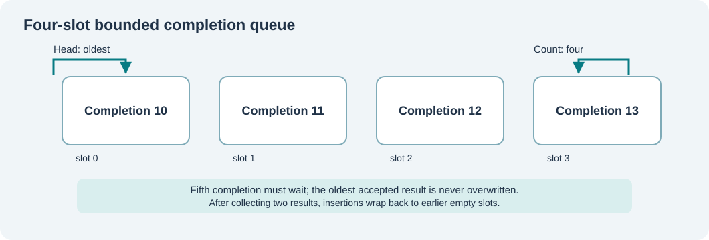

# 123. Build a bounded completion queue in C23

A queue preserves the order of accepted items. In device I/O, it allows the driver to report that requests have completed even when the caller is not ready to process the results immediately.

The completion queue in this lesson does not allocate memory. Its capacity is four records, chosen so that you can inspect every case by hand.

## Understand the ring



The queue stores three pieces of information for each result: its request identity, the number of transferred bytes and its terminal outcome. The head identifies the oldest record. The count tells us how many valid records are present.

When a fifth completion arrives while four are still waiting to be collected, the correct behaviour is **refusal**, not overwriting the oldest accepted result.

Open `labs/native/completion-queue/queue.h`:

```c
#define BTB_COMPLETION_CAPACITY 4U

typedef struct BtbCompletion {
    uint32_t requestId;
    uint32_t bytesTransferred;
    BtbCompletionResult result;
} BtbCompletion;
```

Each result is a value. `Push` makes its own copy. A function that submitted an operation may return, but the queue retains the result bytes until `Pop` collects them.

## Follow the insertion calculation

The next free position is:

```c
const size_t slot = (queue->head + queue->count) % BTB_COMPLETION_CAPACITY;
```

If the head is 3, the count is 2 and the capacity is 4, the next position is `(3 + 2) % 4 = 1`. The remainder operation wraps around the storage array.

But the calculation must not run until the state is validated. `queue.c` checks that the head is within the array, the count is no larger than the capacity, the request ID is not zero, and a failed/cancelled result has no declared successful byte transfer.

## A queue must refuse without damage

A **failure-atomic** operation either makes the complete accepted change or makes no change. In `BtbCompletionQueuePush`, the capacity check comes before the write:

```c
if (queue->count == BTB_COMPLETION_CAPACITY)
    return BTB_QUEUE_FULL;
```

A full queue must never evict an older completion. Likewise, `BtbCompletionQueuePop` leaves the caller's output unchanged if the queue is empty.

This contract matters if a completion represents a financial report, a saved Notes document or an accepted device operation. Silently losing results makes a system appear to have finished work that nobody has actually reviewed.

## Build and verify

```powershell
Set-Location "C:\umicom\Umicom-Bits2Banking"
$env:Path = "C:\msys64\ucrt64\bin;$env:Path"
cmake -S ".\labs\native\completion-queue" `
    -B ".\output\learning-build\completion-queue" `
    -G Ninja -DCMAKE_C_COMPILER="C:\msys64\ucrt64\bin\gcc.exe"
cmake --build ".\output\learning-build\completion-queue" --parallel 2
ctest --test-dir ".\output\learning-build\completion-queue" --output-on-failure
```

Expect two passing tests. The demonstration prints `Collected completion for request 42: 128 bytes.`

## Try it yourself

1. Draw a four-slot queue and mark slots 0, 1, 2 and 3.
2. Push request IDs 10, 11, 12 and 13. The fifth push should fail.
3. Pop 10 and 11, then push 14 and 15. Predict where those records will be stored.
4. Compare your drawing against `test_queue.c` and its wraparound assertions.

The queue in this exercise is deliberately single-threaded. A production queue shared by multiple threads requires a genuine synchronisation contract, which `volatile` does not provide.
