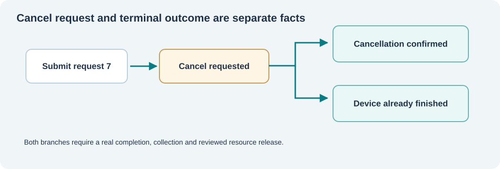

# 124. Cancel, quiesce and release device work safely

Stopping a service takes more than setting a Boolean variable. A driver may already have accepted a request, exposed buffers to hardware or queued a result for the caller. Those resources still belong to someone until the operation reaches a reviewed terminal boundary.

## Cancellation is a request, not a result

Consider this sequence:

1. A Notes service submits request 7.
2. The user closes the document and asks to cancel request 7.
3. The service records the cancellation request.
4. The device completes the operation successfully before it can honour cancellation.
5. The service records **successful completion**, despite the earlier cancellation request.
6. The caller collects the completion, then the service releases the request record.



Step 3 must not be reported as successful cancellation. In C23 the distinction appears directly in the API:

```c
BtbDeviceStatus BtbDeviceRequestCancel(
    BtbDevice *device, uint32_t owner, uint32_t id);

BtbDeviceStatus BtbDeviceComplete(
    BtbDevice *device, uint32_t owner, uint32_t id,
    BtbCompletionResult result, uint32_t transferred);
```

`RequestCancel` changes only the pending request's intent. `Complete` publishes the terminal result, which may be success, failure or acknowledged cancellation. A `BTB_COMPLETION_CANCELLED` result is refused if there was no preceding cancellation request.

## Quiesce before stopping

**Quiescing** means stopping admission of new work while allowing work already accepted to complete. This gives a driver a controlled way to become idle.

```c
BtbDeviceStatus BtbDeviceQuiesce(BtbDevice *device, uint32_t owner);
BtbDeviceStatus BtbDeviceRelease(BtbDevice *device, uint32_t owner);
```

The classroom model refuses `Release` until the device is quiesced and every outstanding completion has been collected. A finished result still consumes a retained request record until its consumer acknowledges collection.

`BtbDeviceResume` is available when a quiesced device is allowed to accept new work again. It does not silently finish or discard earlier requests.

## A completion queue can be full

The test creates five outstanding requests but a completion queue with room for only four. The fifth call to `Complete` receives `BTB_DEVICE_CAPACITY`. The request stays pending, so it can be completed after the caller collects a previous result. No completion is dropped.

Read `labs/native/io-request-lifecycle/test_device.c`. Find `FullCompletionQueue`. Observe that its test of the pending request occurs **after** the refusal. This is more valuable than a test that only checks the error code; it checks that the original state was preserved.

## An important real-device distinction

The classroom laboratory never submits DMA descriptors. In a real driver, a timeout or cancellation does not prove that a device has stopped accessing a DMA buffer. The buffer must not be freed merely because a caller has stopped waiting.

The [Umicom Kernel VirtIO block interface](https://github.com/umicom-foundation/umicom-kernel/blob/main/include/umicom/kernel/virtio_block.h) explicitly distinguishes request publication, validated completion and reset acknowledgement. A reset acknowledgement is part of the contract that allows the driver to release device-accessible memory safely. The educational model is intentionally simpler; it does not simulate the hardware reset protocol.

## Check your understanding

Why is `CancelRequested` not a terminal state? What happens if an application exits after cancellation but before the device confirms its outcome? Why does a pending completion still count as outstanding work? Write down your answers, then explain the state transitions using the diagram.
