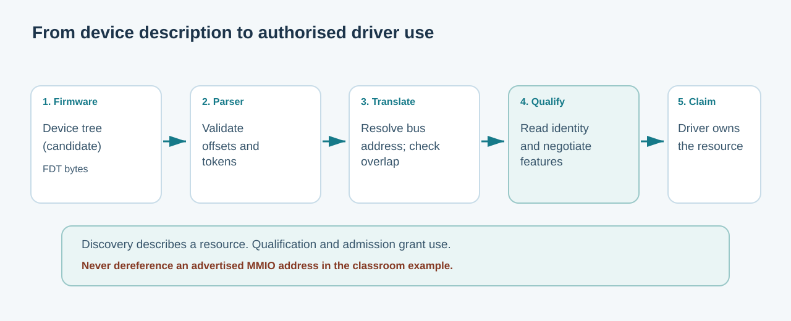

# 127. Discover hardware by reading a device tree in C23

A computer cannot safely use a piece of hardware simply because someone has supplied an address. Before a storage driver can communicate with a device, it needs to discover what the firmware says is present, interpret that description, and check whether a supported driver can manage it.

In this lesson you will inspect a **Flattened Device Tree (FDT)**. You will build a C23 application that reads a small, artificial device tree and finds a possible VirtIO storage device. Your application will not access the device itself.

## 1. From a device description to a driver

Consider an Umicom note-taking application. When you save a note, the application asks a service to write the document. Eventually, a storage driver might have to communicate with a virtual disk.

That path has several distinct stages:



Firmware can describe a candidate device's name, register range and compatibility strings. A driver must still check the advertised type, bus translation, actual register behaviour, negotiated features and exclusive ownership. **Discovery provides information; it does not grant permission to touch hardware.**

A *device tree* is a hierarchical description of the machine. Nodes describe devices or buses; properties contain data about those nodes. The binary FDT representation allows boot firmware to pass that description to an operating-system kernel.

## 2. Read the shape of an FDT file

An FDT blob begins with a header. The header gives the positions of its major blocks:

| Region | Contains | First consideration |
| --- | --- | --- |
| Header | Magic number, total size, offsets and format versions | Is the complete declared extent accessible? |
| Memory reservations | Address-and-size pairs ending in `(0,0)` | Is the table complete and bounded? |
| Structure | Begin-node, property, end-node and end tokens | Do the tokens form one complete tree? |
| Strings | Reusable, zero-terminated property names | Are name offsets inside the string block? |

The 32-bit FDT magic value is `0xd00dfeed`. Integers in the FDT header and structure are **big-endian**: the most significant byte comes first. A Windows x86-64 computer normally stores multibyte integers in little-endian order, so reading bytes through a cast to `uint32_t *` would be incorrect and might violate alignment requirements.

Instead, the C23 inspector assembles a value explicitly:

```c
static uint32_t Read32(const unsigned char *data)
{
    return ((uint32_t)data[0] << 24U) |
           ((uint32_t)data[1] << 16U) |
           ((uint32_t)data[2] << 8U) |
           (uint32_t)data[3];
}
```

The first four bytes `d0 0d fe ed` therefore become the expected magic number on any supported host byte order.

## 3. Begin with safe ranges

A malformed header might claim that a block starts at byte 65,000 and contains 100,000 bytes. The program must not compute an unchecked end address or read past the allocated buffer.

Find `Span()` in [`fdt.c`](https://github.com/umicom-foundation/Bits2Banking/blob/main/labs/native/device-tree-inspector/fdt.c):

```c
static int Span(size_t offset, size_t bytes, size_t total)
{
    return offset <= total && bytes <= total - offset;
}
```

Notice the subtraction. The expression `offset + bytes <= total` could overflow for extreme values. By first checking `offset <= total`, subtraction remains defined. We use the same reasoning throughout the parser.

The laboratory limits a complete image to 64 KiB, 64 nodes, 128 properties and eight levels of nesting. These are **learning-tool limits**, not limits imposed by the FDT specification or by Umicom Kernel.

## 4. Walk through the synthetic device

The [`fixture.c`](https://github.com/umicom-foundation/Bits2Banking/blob/main/labs/native/device-tree-inspector/fixture.c) example builds this logical tree:

```text
/                                  (root)
├── #address-cells = <2>
├── #size-cells    = <2>
└── virtio_block@10001000
    ├── compatible = "virtio,mmio"
    └── reg = <0x0 0x10001000 0x0 0x1000>
```

Two *address cells* represent a 64-bit candidate address. Two *size cells* represent a 64-bit extent. Consequently, the `reg` property contains four 32-bit big-endian words, or sixteen bytes.

The example address is `0x10001000`, and the advertised extent is `0x1000` bytes, which equals 4096 decimal bytes. Those values exist only inside our synthetic image. They do not identify a genuine device on your PC.

Open `fdt.c` and find the main loop inside `BtbFdtInspect()`. It reads one token at a time. `FDT_BEGIN_NODE` increases the depth, `FDT_END_NODE` decreases it, and `FDT_PROP` reads a property name and value. The final `FDT_END` token is accepted only after every node has closed.

The reader looks for the exact `virtio,mmio` compatibility string and a valid `reg` value. A missing terminator, incorrect property-name offset or unsupported cell layout causes a refusal.

## 5. Build the example

From PowerShell:

```powershell
Set-Location "C:\umicom\Umicom-Bits2Banking"
$env:Path = "C:\msys64\ucrt64\bin;$env:Path"

cmake -S ".\labs\native\device-tree-inspector" `
    -B ".\output\learning-build\device-tree-inspector" `
    -G Ninja `
    -DCMAKE_C_COMPILER="C:\msys64\ucrt64\bin\gcc.exe" `
    -DBUILD_TESTING=ON

cmake --build ".\output\learning-build\device-tree-inspector" --parallel 2

ctest --test-dir ".\output\learning-build\device-tree-inspector" `
    --output-on-failure

& ".\output\learning-build\device-tree-inspector\btb-fdt-demo.exe"
```

CTest should report **two passing tests**. The demonstration should display a discovered candidate with address `0x10001000` and an extent of 4096 bytes.

If CMake cannot find the compiler, run `& "C:\msys64\ucrt64\bin\gcc.exe" --version` and inspect the command's output. If configuration succeeds but the test fails, read the failing assertion; do not remove it merely to make the test green.

## 6. Reject untrusted input without losing a useful result

The parser fills a temporary `BtbFdtSummary`. It writes the caller's output **only after the complete tree has been validated**. An error cannot replace the last trustworthy summary with a partially decoded one.

Open `test_fdt.c`. It changes header fields, truncates the image and mutates 10,000 deterministic byte positions. For every refused parse, the test checks that the caller's output remains unchanged. These tests also exercise the bounded structure walker.

A mutated input is not proof that every possible malformed FDT has been considered; the parser's documented scope is deliberately limited. Automated testing gives evidence about the tested contract, not permission to accept a file as trusted hardware configuration.

## 7. Try a controlled change

In `fixture.c`, find the sixteen-byte `reg` property. Change its final size bytes from `0x1000` to `0x2000`, using correct big-endian representation. Rebuild and run the demonstration; it should report 8192 bytes.

Next, change the `reg` property so that it declares only twelve bytes instead of sixteen. The parser must refuse the candidate. Restore the original valid fixture before committing the laboratory.

## 8. Connect this lesson to Umicom Kernel

The real Kernel is more complex than this classroom reader. Its [hardware-discovery guide](https://github.com/umicom-foundation/umicom-kernel/blob/main/docs/HARDWARE_DISCOVERY.md) describes immutable device-tree parsing, bounded property indexing, `ranges` bus translation and a separate hardware catalogue. You will examine those source files directly in [Chapter 131](../06-umicom/131-read-umicom-kernel-device-discovery.md).

**Questions to answer:** Why do we read a big-endian header byte by byte? What is the difference between a device being *advertised* and a driver being *authorised* to use it? Why must the parser check the whole image before returning a successful summary?

[Next: Memory-mapped I/O and transport negotiation](128-mmio-and-transport-negotiation.md).
