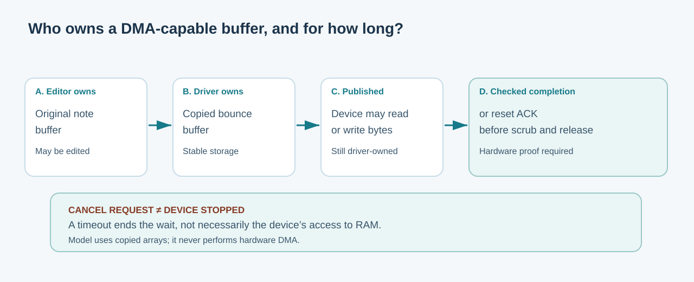

# 129. Understand DMA buffers and why cancellation is not completion

A storage driver often needs to transfer many bytes. Making the processor copy each byte into a device register would be inefficient. **Direct Memory Access (DMA)** allows a device to read or write a region of memory using an agreed hardware mechanism.

DMA creates a new ownership question: who may reuse or release that memory while the device can still access it?

## 1. Follow a Notes document into device memory

Suppose an Umicom Notes application saves a document. The application owns its editing buffer. A service prepares storage work. The driver may copy the data into a **bounce buffer**, a separate region specifically managed for a device transfer.

The driver must ensure that the device-accessible buffer remains at a valid address for the transfer's lifetime. The original Notes application may continue editing a different working copy without changing bytes that the device is currently using.



A pointer on its own does not express this lifetime. The driver needs an explicit record of the request, the buffer, the device that can access it and the condition under which it may be released.

## 2. Identify who owns each buffer

| Buffer | Owner | When may it be changed? |
| --- | --- | --- |
| Notes editor working copy | Notes document/editor service | Under its document-revision and editing rules |
| Prepared device buffer | Driver | Until publication, according to driver admission |
| Published DMA buffer | Driver retains memory; device is authorised to access it | Not reclaimed until device use is conclusively finished |
| Collected result | Application/service | After checked completion and ownership transfer |

Notice that “the device can access memory” does not mean the device owns the operating system's allocator record. The driver remains responsible for allocating, reserving and eventually releasing the physical memory safely.

## 3. Study a race between cancellation and completion

A cancellation request changes what the caller *wants* to happen. It does not necessarily change what the device is already doing.

Imagine this sequence:

```text
Time   Application / driver                 Device
  1    prepare owned buffer
  2    publish request -------------------> may begin DMA
  3    request cancellation
  4                                           finishes write
  5    observe checked completion <------ reports completion
  6    collect result and release buffer
```

If the driver freed the buffer immediately at time 3, the device might still write to memory that has already been reused for something else. That is a serious memory-corruption hazard.

A software timeout similarly means **the wait ended**. It is not proof that the hardware has stopped accessing the request's memory.

## 4. Reset requires acknowledgement

When ordinary completion cannot be established, a driver may need to stop or reset the device. Even then, issuing a reset request is not the same as observing that the device has completed reset.

The existing Umicom Kernel [VirtIO block implementation](https://github.com/umicom-foundation/umicom-kernel/blob/main/kernel/virtio_block.c) explicitly retains queue and bounce pages when reset completion is uncertain. Its [block-driver guide](https://github.com/umicom-foundation/umicom-kernel/blob/main/docs/WRITABLE_VIRTIO_BLOCK.md) distinguishes work publication, completion, stable-write behaviour and cleanup obligations.

A real system also has to consider cache coherence, platform-specific memory barriers, address translation and IOMMU protection where available. Our hosted learning application does none of those privileged tasks.

## 5. Build the ownership model

Open the [`virtqueue-lifetime` laboratory](https://github.com/umicom-foundation/Bits2Banking/tree/main/labs/native/virtqueue-lifetime). It deliberately copies at most 256 bytes into one of four fixed slots. No caller-supplied buffer is retained as a pointer.

Find the following declarations in `queue.h`:

```c
BtbVqStatus BtbVqPrepare(BtbVq *queue, uint32_t owner,
                         const void *bytes, size_t length,
                         uint64_t *outToken);
BtbVqStatus BtbVqPublish(BtbVq *queue, uint32_t owner,
                         uint64_t token);
BtbVqStatus BtbVqCancelRequested(BtbVq *queue,
                                  uint32_t owner, uint64_t token);
```

The caller retains responsibility for its original input buffer. `BtbVqPrepare` copies the complete accepted value into queue-owned storage. When the input is invalid or the queue is full, the output token is not changed.

After publication, `BtbVqCancelRequested` records cancellation intent but **does not free the slot**. The fake device may still report successful completion; this is exactly the race we want to understand.

## 6. Test the reset boundary

Run the commands from [the laboratory README](https://github.com/umicom-foundation/Bits2Banking/blob/main/labs/native/virtqueue-lifetime/README.md). Its tests verify that:

1. An accepted buffer is a copy rather than a borrowed pointer.
2. Another owner cannot publish or collect the request.
3. A cancellation request does not silently remove accepted work.
4. Pending reset prevents new work from being admitted.
5. Published bytes remain allocated until the **separately simulated** reset acknowledgement.
6. An old generation-tagged token cannot be used after a slot has been released.

The laboratory's reset-acknowledgement function is called by a test. It is not evidence of a hardware reset. In a real driver, the hardware-specific adapter must establish the necessary condition before releasing the memory.

## 7. What could go wrong?

**Problem: the device seems finished, but no completion was received.** Treat the result as uncertain and retain device-accessible resources while following the driver's recovery protocol. Do not guess success from elapsed time.

**Problem: the device returns a byte count greater than the request.** Reject the malformed result; do not let it overflow a destination buffer.

**Problem: the same queue slot is reused.** Require a new generation-tagged token. The old handle must no longer refer to the new request.

**Problem: the system has no IOMMU.** The driver still needs correct ownership and trusted hardware assumptions. The lack of an IOMMU makes it especially important not to overstate isolation from a malicious DMA-capable device.

## 8. Apply the idea elsewhere

This same distinction appears in financial systems: *an instruction was submitted*, *the receiving service accepted it*, *the operation completed* and *the result became durable* are different statements. A careful audit trail records what was actually observed at each step rather than collapsing them into a single “success”.

**Questions to answer:** Why may the editor modify its original buffer after a successful copy? Why is a timeout not a DMA completion? What event must be observed before a driver can safely release a published buffer?

[Next: VirtIO queues in C23](130-understand-virtio-split-queues.md).
