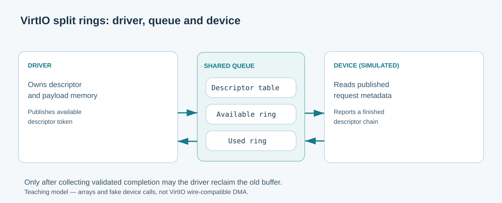

# 130. Understand VirtIO split queues with a C23 model

VirtIO is a family of interfaces for virtual devices. Instead of inventing a different protocol for every emulated disk or network adapter, a guest operating system can implement a standard transport for supported device types.

A common VirtIO transport uses a **virtqueue**: a shared-memory structure that tells the device which work is available and tells the driver which work has completed.

## 1. Three parts of a split queue

A conventional VirtIO split virtqueue has three cooperating structures:

| Structure | Purpose | Typically written by |
| --- | --- | --- |
| Descriptor table | Describes the location and length of buffers, plus flags and optional chains | Driver |
| Available ring | Identifies descriptors made available for the device to process | Driver |
| Used ring | Reports descriptor chains that the device has finished using | Device |



The structures are maintained in shared memory. Their layout, alignment and memory-ordering rules come from the VirtIO specification. A real driver cannot replace them with an arbitrary C queue and expect hardware to understand it.

**The exercise in this chapter deliberately uses a simpler hosted model.** It teaches the same *ownership decisions* using arrays and fake device calls, without pretending to implement the real VirtIO wire layout.

## 2. Follow a prepared request

A note-taking application asks a storage service to write a small block of data:

1. The service checks the requested length and owner.
2. The driver prepares a bounded, owned data buffer.
3. The driver publishes a descriptor chain in the available ring.
4. The device processes it at some later time.
5. The device records the result in the used ring.
6. The driver validates the used entry, copies a completion result and finally reclaims the old buffer.

At step 3, the driver has granted the device permission to access the prepared buffer. At step 5, the device claims to have completed work. At step 6, the driver checks that claim against its own request records before handing memory back to its allocator.

## 3. Why a ring wraps around

A ring reuses a bounded number of slots. For a four-slot teaching ring, the positions are `0, 1, 2, 3`, then `0` again.

The laboratory calculates a tail position as:

```c
const uint32_t tail =
    (queue->availableHead + queue->availableCount) % BTB_VQ_SLOT_COUNT;
```

This is sufficient for our host-side model because counts are bounded to four. Real VirtIO queue indexes have their own fixed-width wrap semantics and device-visible memory ordering; the teaching counter is not a substitute for those protocol fields.

## 4. Keep an identity separate from a slot number

Slot 2 can be used by one request now and a completely different request later. The number 2 by itself does not prove that a caller still owns the current contents.

The laboratory issues a generation-tagged token:

```c
static uint64_t Token(uint32_t index, uint32_t generation)
{
    return ((uint64_t)generation << 32U) |
           (uint64_t)(index + 1U);
}
```

The lower half selects the slot. The upper half identifies which lifetime of that slot the token belongs to. After a request is collected, the generation advances and its old token becomes stale. Reusing a token from an earlier operation must be rejected.

These tokens are classroom identities, not security secrets or VirtIO descriptor indexes.

## 5. Build the working laboratory

Open PowerShell:

```powershell
Set-Location "C:\umicom\Umicom-Bits2Banking"
$env:Path = "C:\msys64\ucrt64\bin;$env:Path"

cmake -S ".\labs\native\virtqueue-lifetime" `
    -B ".\output\learning-build\virtqueue-lifetime" `
    -G Ninja `
    -DCMAKE_C_COMPILER="C:\msys64\ucrt64\bin\gcc.exe" `
    -DBUILD_TESTING=ON

cmake --build ".\output\learning-build\virtqueue-lifetime" --parallel 2

ctest --test-dir ".\output\learning-build\virtqueue-lifetime" `
    --output-on-failure

& ".\output\learning-build\virtqueue-lifetime\btb-vq-demo.exe"
```

CTest should report **two passing tests**. The demonstration should report that a cancellation was requested, while the simulated device nevertheless completed the original request.

## 6. Inspect the four ownership transitions

Open `queue.c` and locate the following functions:

| Function | What the code must prove before changing state |
| --- | --- |
| `BtbVqPrepare` | Caller, length, pointer and free slot are valid; input can be copied completely |
| `BtbVqPublish` | Owner matches and request is prepared; available ring has space |
| `BtbVqSimulateComplete` | Token identifies the oldest available request; result length fits; used ring has space |
| `BtbVqCollect` | Caller owns the completed request and it is the oldest used entry |

The name `SimulateComplete` is intentional. A real device writes its own used-ring state, and the driver must follow the device protocol to validate it.

The laboratory also supports `BtbVqRequestReset` and `BtbVqSimulateResetAcknowledged`. Reset request freezes new work. The fake device's separate acknowledgement then permits cleanup. The driver must never release a device-visible buffer merely because software asked the device to stop.

## 7. Challenge the queue deliberately

In `test_queue.c`, follow these three experiments:

**Queue full:** Prepare and publish four requests. A fifth prepare must return `BTB_VQ_FULL` and leave its output token unchanged.

**Wrong order:** Submit two requests and attempt to complete the second one first. The simple course model returns `BTB_VQ_WRONG_ORDER`, preserving the available ring.

**Reset in progress:** Request reset while a published buffer exists. A new prepare must return `BTB_VQ_BUSY`. The old bytes remain available to the simulated device until reset acknowledgement is explicitly recorded.

Try changing one assertion so that it expects an unsafe operation to succeed. Run CTest and inspect the failure message. Restore the assertion afterwards. A failing assertion can be valuable evidence that the test is exercising the intended boundary.

## 8. Compare the classroom model with the real driver

The [Umicom Kernel VirtIO block driver](https://github.com/umicom-foundation/umicom-kernel/blob/main/kernel/virtio_block.c) has transport-level requirements absent from this exercise: queue memory alignment, MMIO access, device status negotiation, descriptor fields, barriers, DMA coherence assumptions, request timeouts, device reset and cleanup retries.

The Kernel's code also distinguishes explicitly authorised writes, successful completions and later FLUSH operations. We will read that code in [Chapter 131](../06-umicom/131-read-umicom-kernel-device-discovery.md).

**Questions to answer:** What is the difference between a descriptor and a completion? Why does a generation matter when a slot number is reused? Why does a cancelled request still require a terminal outcome or confirmed reset?

[Next: Follow the actual Umicom Kernel driver](../06-umicom/131-read-umicom-kernel-device-discovery.md).
