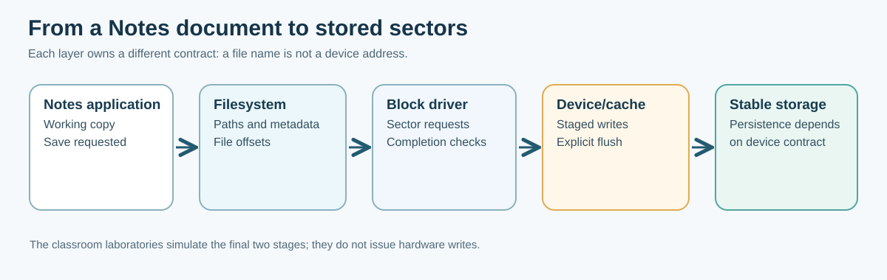

# 132. From device sectors to files and directories

A saved note looks like a named document. A storage device, however, does not know what a *note* or a *file* is. It accepts operations on numbered regions of storage. The filesystem gives those regions names, sizes, directories, ownership rules and a way to find their bytes again.

In this chapter you will follow an Umicom Notes document from a Save command down through a filesystem, a block driver and a storage device. You will also discover why **writing bytes**, **receiving a completion** and **making bytes survive a restart** are different events.

## 1. The layers beneath Save



Suppose a student types this into a Notes application:

```text
Cash plan — week 1
Keep a record of the budget approved by the class.
```

The program holds this text in memory. Pressing Save begins a sequence of operations:

1. The application decides **which document** the Save operation concerns.
2. The document service chooses the **file** to update and checks for conflicts.
3. The operating system resolves the **path**, for example `/notes/cash-plan.txt`.
4. A filesystem maps the file's byte offsets to blocks or clusters.
5. A block driver submits requests to read or write numbered sectors.
6. The device reports a completion. A separate flush or persistence protocol may be required before the caller can claim stable storage.

These layers are useful because different applications should not have to understand the physical disk's register interface. A banking application, note-taking application and programming editor can all use the same filesystem contracts.

## 2. A sector is not a file

A **sector** is a numbered unit of block-device access. A common logical sector size is **512 bytes**, although devices and formats may use other sizes. A **block** can mean a unit used by a device, filesystem or memory allocator; the precise size depends on which layer is being discussed.

Imagine a small fictional device with four sectors:

| Sector number | Byte range | Possible use in our laboratory |
| --- | --- | --- |
| 0 | 0–511 | Journal record |
| 1 | 512–1023 | Saved Notes snapshot |
| 2 | 1024–1535 | Another document or spare sector |
| 3 | 1536–2047 | Another document or spare sector |

If sector 1 contains the text of a note, the device still does not know its filename. A filesystem maintains the information needed to associate `/notes/cash-plan.txt` with the relevant stored bytes.

A filesystem might describe a file using an allocation chain, extent list or tree. FAT16 stores cluster relationships in a **File Allocation Table**. Other filesystems use different metadata. We will not treat these different designs as interchangeable.

### Work out an address

For a hypothetical device with 512-byte sectors, sector 9 begins at byte offset:

```text
9 × 512 = 4608 bytes
```

The final byte of that sector is at offset 5119. A request for sector 9 cannot be interpreted safely until the device capacity is known; multiplying a hostile sector number without a bounds check can overflow an integer.

**Try it:** determine the first byte of sector 12 and the exclusive end of the 512-byte interval. Then explain why one should first check that sector 12 exists on the device.

## 3. What a directory contributes

A directory relates a **name** to a filesystem object. It is not simply an operating-system shortcut to the first byte of a file. A filesystem must also represent file sizes, allocation, file types and permissions, and it may track timestamps, links and other metadata.

Consider:

```text
/
└── notes/
    ├── cash-plan.txt
    └── study-plan.txt
```

Opening `/notes/study-plan.txt` involves resolving each component. The filesystem checks whether `/notes` is a directory and whether `study-plan.txt` refers to an object the caller may access.

Never assume that a string containing slashes is already a safe path. Real implementations must consider empty components, traversal (`..`), symlinks, filesystem aliases, encoding, volume boundaries and the caller's authority. A path check should happen **before** opening or changing storage, not after a partial operation has started.

## 4. Three storage states to distinguish

Imagine the application requests a complete sector write:

**Staged:** the driver or cache has accepted bytes into volatile memory. The application may read its own changes, but they are not yet known to survive a restart.

**Write completed:** a lower layer reports that an individual request finished. What this guarantees depends on the device's published contract and its write-cache configuration.

**Durability acknowledged:** the required flush or force-to-stable-storage sequence completed successfully *under the chosen backend's contract*. This is stronger than simply calling a write function, but actual power-loss safety also depends on truthful device and storage implementation.

A timeout or cancellation after submission does not prove that the device left the bytes unchanged. The caller must not blindly reissue a financial payment or other non-idempotent operation based on an uncertain outcome.

## 5. Understand caches and write-back

A **cache** keeps data near the program so repeated access is fast. A write-back cache can accept a new sector but postpone copying it to the persistent image. A write-through policy attempts to propagate modifications immediately. Neither label alone defines a complete power-loss guarantee.

For the exercises we will model two copies:

```text
Staged copy (volatile):     changes visible before flush
Stable copy (simulated):    changes retained by our Crash() operation
```

In Chapter 133 you will write one complete 512-byte sector, simulate a crash before flush and observe it disappear. After a successful simulated flush, the same bytes will survive that simulated restart.

This is a useful model of *ordering*, not proof about real flash cells or hardware caches.

## 6. Filesystems need consistency rules

Suppose saving a note requires two changes: replacing its content and updating a directory's recorded length. What happens if only the first change reaches storage?

A filesystem needs rules to detect or repair an incomplete update. Possible techniques include ordered writes, dirty markers, copy-on-write checkpoints, write-ahead logs, redundant metadata and explicit recovery tools. These techniques have different guarantees. A dirty marker may warn that an update was interrupted without retaining enough information to restore the old version.

Chapter 134 introduces a tiny write-ahead journal for one Notes record. We will deliberately stop the save at three different points and inspect which version can be recovered.

## 7. Connect the concepts to Umicom Kernel

The real [Umicom Kernel](https://github.com/umicom-foundation/umicom-kernel) separates VFS namespaces, RAM-backed files and disk-backed providers. Its [read-only filesystem provider guide](https://github.com/umicom-foundation/umicom-kernel/blob/main/docs/READ_ONLY_FILESYSTEM_PROVIDER.md) explains how a qualified VirtIO handle is retained while the filesystem mount uses it. The [writable VirtIO guide](https://github.com/umicom-foundation/umicom-kernel/blob/main/docs/WRITABLE_VIRTIO_BLOCK.md) distinguishes a submitted write, a completed write and a completed flush.

We will inspect their actual source boundaries in Chapter 136. Our classroom models do not replace the Kernel's real device ownership, VFS or FAT16 implementation.

## Check your understanding

1. Which layer knows the filename `cash-plan.txt`: the block device or the filesystem?
2. Can a successful write-request completion always be treated as a power-loss-safe save?
3. Why must the filesystem validate both a requested path and the caller's permissions?
4. What information might be missing if file contents are written but directory metadata is not?

**Expected answers:** the filesystem supplies names; write completion alone does not necessarily establish durability; path and authority checks protect the namespace; interrupted metadata writes can leave file sizes, allocation or names inconsistent with data.

[Next: Build a simulated write-back sector store in C23](133-build-a-writeback-sector-store.md).
