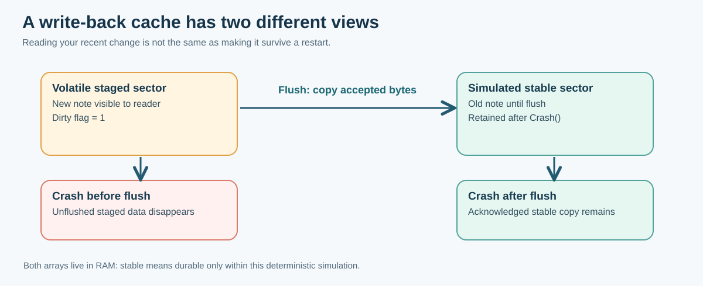

# 133. Build a write-back sector store in C23

In this lesson you will build a small storage model with four 512-byte sectors. It will teach you to distinguish **bytes a program has staged** from **bytes it has explicitly flushed**. The code lives in a self-contained Bits2Banking laboratory and does not access a real disk controller.



## 1. Meet the storage object

Open [`block_store.h`](https://github.com/umicom-foundation/Bits2Banking/blob/main/labs/native/writeback-sector-store/block_store.h). The important fields are:

```c
#define BTB_SECTOR_BYTES 512U
#define BTB_SECTOR_COUNT 4U

typedef struct BtbBlockStore {
    unsigned char stable[BTB_SECTOR_COUNT][BTB_SECTOR_BYTES];
    unsigned char staged[BTB_SECTOR_COUNT][BTB_SECTOR_BYTES];
    unsigned char dirty[BTB_SECTOR_COUNT];
} BtbBlockStore;
```

An `unsigned char` holds one byte. The first index chooses a sector, and the second chooses a byte inside it. Each copy contains `4 × 512 = 2048` bytes.

The `dirty` array records which staged sectors have changed but have not yet reached the simulation's stable copy. Nothing in the structure says that C RAM is truly non-volatile. Here, `stable` is *defined* to survive the laboratory's `BtbStorageCrash()` operation; real hardware needs a different contract.

## 2. Stage one complete sector

A sector write uses a caller-provided array of exactly 512 accessible bytes:

```c
BtbStorageStatus BtbStorageStage(
    BtbBlockStore *store,
    size_t sector,
    const unsigned char data[BTB_SECTOR_BYTES]);
```

`const` prevents the function from intentionally modifying the input bytes. It does not make the input pointer permanently valid, so the function copies the bytes immediately into its own buffer.

Open [`block_store.c`](https://github.com/umicom-foundation/Bits2Banking/blob/main/labs/native/writeback-sector-store/block_store.c). Find the check that rejects a missing pointer or a sector number of four or greater. On a four-sector device, the valid sector indices are **0, 1, 2, 3**.

After validation, `BtbStorageStage()` copies exactly one sector and marks that sector dirty. A later `BtbStorageRead()` returns these staged bytes. `BtbStorageReadStable()` still returns the original stable bytes.

**Try it:** predict what the following prints before you run it:

```c
unsigned char sector[BTB_SECTOR_BYTES] = {0};
sector[0] = 'N';
BtbStorageStage(&store, 1U, sector);
BtbStorageReadStable(&store, 1U, observed);
```

If `store` was initialised to zero, `observed[0]` is still zero because the write has not been flushed.

## 3. Flush and examine the result

Call:

```c
BtbFlushReport report;
BtbStorageStatus status = BtbStorageFlush(&store, SIZE_MAX, &report);
```

`SIZE_MAX` tells this model to process every dirty sector. The report records how many sectors reached the simulated stable copy and how many remain dirty.

There is also a deliberate **failure budget**. If you staged two sectors but pass `1U` as the maximum, only one is copied. The function returns `BTB_STORAGE_INCOMPLETE`, not success. This is useful for testing partial progress and for teaching why an interrupted flush cannot honestly be reported as completely durable.

The test demonstrates this outcome:

```text
Staged: sector 0 and sector 1
Flush budget: 1 sector
Durable in simulation: sector 0
Still dirty: sector 1
```

A real device may complete requests in a different order, and a real flush protocol has additional requirements. We use deterministic ascending sector order only so the lesson can be tested precisely.

## 4. Simulate a crash

`BtbStorageCrash(&store)` discards every unflushed staged sector by restoring it from the stable copy. It resets the dirty flags, but does not change the stable bytes.

Run two experiments. First, stage a sector and crash *without* flushing it. The new text disappears. Second, stage the same sector, flush it successfully and then crash. The text survives the simulated restart.

The application is not allowed to confuse what it can currently *read* with what will survive a restart. This distinction is essential for Notes documents, accounting journals, treasury instructions and configuration files.

## 5. Save and load a sector image through C standard I/O

The model also supplies:

```c
BtbStorageStatus BtbStorageExportStable(const BtbBlockStore *store, FILE *stream);
BtbStorageStatus BtbStorageImportStable(BtbBlockStore *store, FILE *stream);
```

`ExportStable()` writes only the stable image. The caller opens and closes the stream. The implementation calls `fwrite()` for each sector and then `fflush()`.

Import reads exactly 2048 bytes and rejects either a truncated image or trailing data. It prepares a separate `BtbBlockStore` and replaces the destination only after every byte and the complete file length have been checked. A failed import therefore does not destroy the previously useful storage object.

**Important:** `fflush()` transfers C-library buffers towards the operating system. It is *not* a portable guarantee that the data survives a loss of electrical power. The lab's durable-state simulation and host-file export have different guarantees.

## 6. Configure, build and test on Windows

Open PowerShell and run:

```powershell
Set-Location "C:\umicom\Umicom-Bits2Banking"
$env:Path = "C:\msys64\ucrt64\bin;$env:Path"

cmake -S ".\labs\native\writeback-sector-store" `
    -B ".\output\learning-build\writeback-sector-store" `
    -G Ninja `
    -DCMAKE_C_COMPILER="C:\msys64\ucrt64\bin\gcc.exe" `
    -DBUILD_TESTING=ON

cmake --build ".\output\learning-build\writeback-sector-store" --parallel 2

ctest --test-dir ".\output\learning-build\writeback-sector-store" --output-on-failure

& ".\output\learning-build\writeback-sector-store\btb-sector-store-demo.exe"
```

**Expected:** two passing CTest tests. The demo prints an empty stable sector before flush and the saved Notes text after flush and simulated restart.

If configuration fails, verify the compiler path. If a test fails, retain the failing output and inspect the corresponding `REQUIRE` expression instead of disabling the test.

## 7. Understand what the tests actually check

The automated tests include invalid sector numbers, staged-versus-stable reads, a zero-sector flush budget, a partially successful flush, a simulated crash, complete image export/import and refusal of malformed images.

Try changing the flush budget in `test_block_store.c` from `1U` to `0U`. Predict the changed number of stable sectors, then run the test. Restore the original expected result before committing.

## 8. What would a real implementation still need?

Our four-sector model has no controller registers, no DMA, no cache-coherency protocol, no wear levelling, no concurrency and no actual power-loss experiment. A production block device must also handle alignment, request lifetime, reset acknowledgement, persistent write ordering, error reporting and device-specific guarantees.

The actual Umicom Kernel [VirtIO block driver](https://github.com/umicom-foundation/umicom-kernel/blob/main/kernel/virtio_block.c) and [writable-device guide](https://github.com/umicom-foundation/umicom-kernel/blob/main/docs/WRITABLE_VIRTIO_BLOCK.md) are the reference for those additional responsibilities.

**Questions:** Why does `BtbStorageRead()` sometimes return a different result from `BtbStorageReadStable()`? What does an incomplete flush mean? Why does importing a file into a temporary object protect the previous state?

[Next: Add a write-ahead journal and recover a Notes save](134-write-ahead-journalling-and-recovery.md).
