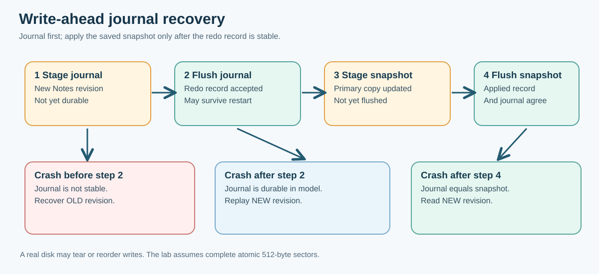

# 134. Write-ahead journalling and recovery in C23

Imagine pressing Save in a Notes application. The program has enough time to record the new text in a journal, but the computer stops before the ordinary saved copy is updated. When the application starts again, which note should appear?

A **write-ahead log** (WAL) solves this kind of problem by writing enough recovery information **before** changing the primary copy. The recovery process can then recognise an accepted update and complete its application after an interruption.

Our laboratory implements one 80-byte Notes record on top of the write-back sector model from Chapter 133. All storage is simulated. This keeps the instruction sequence visible and lets us interrupt the operation at specific, repeatable points.



## 1. Keep two different records

The simulated four-sector image reserves:

| Sector | Contents | Responsibility |
| --- | --- | --- |
| 0 | Journal entry | Records the newest accepted Notes revision |
| 1 | Snapshot | Holds the current applied Notes revision |
| 2–3 | Spare sectors | Available for later exercises |

Both sectors use the same record structure, but one has record kind `J` and the other kind `S`. Each record includes a revision number, the length of its text and a CRC32 check value.

We do **not** write an ordinary C structure directly to the image. C compilers may place padding bytes between members, and integers can have different byte order on different processors. The journal encodes fields one byte at a time using a documented format.

## 2. The exact record layout

| Byte offset | Size | Meaning |
| --- | ---: | --- |
| 0–3 | 4 | `BTBJ` for journal, `BTBS` for snapshot |
| 4 | 1 | Format version: 1 |
| 5 | 1 | Text length: 0 to 80 |
| 6–13 | 8 | Revision, little-endian |
| 14–17 | 4 | CRC32 of header fields 0–13 and the text |
| 18–97 | Up to 80 | Note text bytes |
| Remaining bytes | Variable | All zero |

A CRC is useful for detecting accidental alterations. **It is not a digital signature or proof that a record came from a trusted author.**

The reader checks the complete record, including the length and unused bytes, before publishing a decoded Notes object. A partially decoded or corrupted record does not silently become an empty note.

## 3. Commit in a deliberate order

Open [`journal.c`](https://github.com/umicom-foundation/Bits2Banking/blob/main/labs/native/journalled-notes/journal.c). Find `BtbJournalCommit()` and trace its operations:

1. Confirm the caller's expected revision matches the latest accepted snapshot. Refuse a stale update.
2. Prepare the complete new note in local memory.
3. Write the new journal record into sector 0's **staged** copy.
4. Flush the journal sector successfully. In our model, this establishes the stable recovery record.
5. Stage the same revision as the snapshot in sector 1.
6. Flush sector 1 and return success.

The important rule is **journal first, snapshot second**. If the simulation stops between steps 4 and 6, the journal still contains the accepted revision and recovery can apply it.

The code refuses to start another commit while a previous snapshot still needs replay. This prevents a new journal record from overwriting the only durable copy of an unfinished accepted operation.

## 4. Test three different interruptions

The API provides three named stop points:

```c
BTB_STOP_BEFORE_JOURNAL_FLUSH
BTB_STOP_AFTER_JOURNAL_FLUSH
BTB_STOP_AFTER_SNAPSHOT_STAGE
```

Predict the outcome before reading the table:

| Interruption | Stable journal | Stable snapshot | Recoverable revision |
| --- | --- | --- | --- |
| Before journal flush | Old | Old | Old revision |
| After journal flush | New | Old | New revision |
| After snapshot staged, before its flush | New | Old | New revision |

In the first case the journal was only staged, so a crash discards it. In the other cases the journal was acknowledged by the simulation's flush boundary. Recovery can then apply its complete value to the snapshot.

An interrupted operation returns `BTB_JOURNAL_INTERRUPTED`. This is not the same as an ordinary successful return. Callers must inspect and recover the state instead of simply retrying with an assumption about what happened.

## 5. Recovery is an explicit operation

The laboratory's `BtbJournalRecover()` simulates a restart, reads both **stable** records and checks their formats and checksums.

If the journal revision is one greater than the snapshot revision, it writes the journal's content into the snapshot and flushes the snapshot. If they are equal with identical text, no replay is needed. If they disagree at the same revision, or if a record is corrupt, recovery refuses the state rather than guessing which bytes are correct.

For example:

```text
Before interruption:
Journal   revision 2: "Approved budget note"
Snapshot  revision 1: "Quarterly cash plan"

After recovery:
Journal   revision 2: "Approved budget note"
Snapshot  revision 2: "Approved budget note"
```

Our implementation does not delete the journal immediately after replay. The matching journal and snapshot records remain as evidence of the last accepted update.

## 6. Build and inspect the complete exercise

```powershell
Set-Location "C:\umicom\Umicom-Bits2Banking"
$env:Path = "C:\msys64\ucrt64\bin;$env:Path"

cmake -S ".\labs\native\journalled-notes" `
    -B ".\output\learning-build\journalled-notes" `
    -G Ninja `
    -DCMAKE_C_COMPILER="C:\msys64\ucrt64\bin\gcc.exe" `
    -DBUILD_TESTING=ON

cmake --build ".\output\learning-build\journalled-notes" --parallel 2

ctest --test-dir ".\output\learning-build\journalled-notes" --output-on-failure

& ".\output\learning-build\journalled-notes\btb-journalled-notes-demo.exe"
```

**Expected:** two passing tests, followed by a demonstration that recovers revision 1 of the fictional Notes document after an interruption.

This lab deliberately compiles `block_store.c` from the previous sector laboratory as one shared source. It does not duplicate the storage implementation inside `journal.c`.

## 7. Make one safe change

In `test_journal.c`, find the test that stops after `BTB_STOP_AFTER_JOURNAL_FLUSH`. Write down why the recovery result is revision 2 and why the next commit must be refused until recovery completes.

Now change the stop point to `BTB_STOP_BEFORE_JOURNAL_FLUSH` in a copy of that test. The *old* revision should survive instead. Adjust only the test's experimental expectation, run it, then restore the original test.

Next, inspect the CRC-corruption test. It changes one stored check byte and confirms that `BtbJournalRead()` returns a corruption status **without modifying the caller's existing Notes result**. That is a failure-atomic output contract.

## 8. Limits of the example

The model assumes complete atomic 512-byte sector writes to its simulated stable array. Real media may suffer torn sectors, reordered writes, loss of cached data, controller failure and untrustworthy flush reporting. A real filesystem needs additional redundancy, crash-consistency design and platform-specific persistence qualification.

Our lab handles **one note** and one operation at a time. It does not implement concurrent writers, multi-file transactions, encryption, filesystem directories, live financial postings or actual hardware recovery. It is a controlled way to understand the essential ordering rule.

The real [Umicom Kernel ordered FAT16 commits](https://github.com/umicom-foundation/umicom-kernel/blob/main/docs/FAT16_ORDERED_COMMITS.md) implement a **different** mechanism: marking an update dirty, flushing and explicitly finishing it. A FAT dirty marker detects interruption but does not itself contain the redo data that our classroom journal stores. Read both approaches without confusing their guarantees.

**Questions:** What becomes recoverable after a journal flush? Why is rewriting the journal too early dangerous? Why is a CRC insufficient to authenticate an update? Why might a real storage device require more than a simple `fflush()` call?

[Next: Filesystem paths, directories and checked changes](135-filesystem-paths-and-metadata.md).
