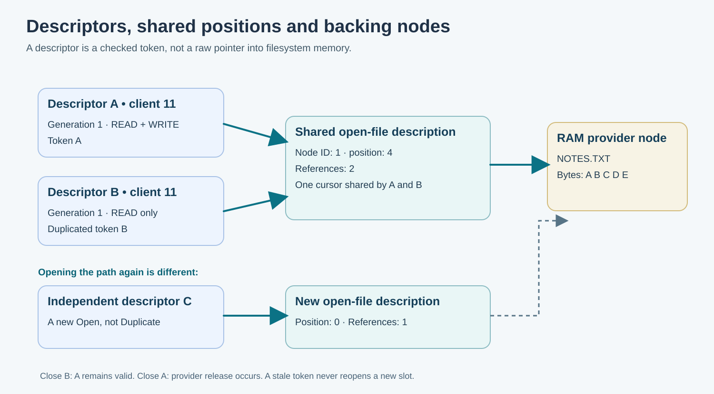

# 143. File Descriptors, Shared Positions and Stale Handles

Two buttons in an editor can refer to the same file. A search function might
read from one position while a Save command writes at another. To reason about
those operations correctly, we must distinguish a **filename**, a **file
object**, an **open-file description**, and a **descriptor**.

The filename is a way to *find* an object. The open-file description remembers
which object was opened and its current position. A descriptor is a token that
one client uses to refer to that description. Duplicating a descriptor may
create a second token that shares the same description and position.



## 1. Watch the position move

Suppose `/notes/NOTES.TXT` contains the five bytes `ABCDE`.

1. Open the file with read permission. Its position begins at byte zero.
2. Read two bytes. The result is `AB`; the position becomes two.
3. Duplicate the descriptor, requesting no additional rights.
4. Read two bytes through the duplicate. The result is `CD`; the **shared**
   description's position becomes four.
5. Read through the first descriptor. The result is `E`.

Neither descriptor independently remembers the position. Both refer to the
same open-file description.

Opening the *path again* is different: that creates another independent
description whose position begins at zero.

## 2. Read the token type

The laboratory uses a 64-bit integer to represent a descriptor token:

```c
typedef uint64_t BtbVfsHandle;
```

The low portion identifies a slot in the descriptor table. The high portion
contains the slot's **generation**. When a descriptor closes, its generation
advances. An older token is then rejected even if the slot is used again by
a different file. This avoids a common error known as a **stale handle**.

A token is not a pointer and is not a password. The operation must also check
which client owns the descriptor. In this laboratory the simulated client's
identity is passed by the test harness. In Umicom Kernel, that identity must
be obtained from the current running task or verified Kernel-owned session.

## 3. Narrow rights during duplication

The original descriptor might have both `BTB_VFS_READ` and `BTB_VFS_WRITE`.
A new descriptor may request **read only**:

```c
BtbVfsHandle reader = 0U;
BtbVfsStatus result = BtbVfsDuplicate(
    &vfs, 11U, original, BTB_VFS_READ, &reader);
```

If successful, `reader` can read but cannot write. A duplicate must not gain
rights the original descriptor did not have. The VFS checks:

```c
(narrowedRights & source->rights) == narrowedRights
```

This bitwise expression asks whether every requested permission bit already
exists in the original rights set. If even one new bit is requested, the
operation returns `BTB_VFS_DENIED` without allocating another descriptor.

## 4. Closing is a lifetime operation

Closing one duplicate does not necessarily close the provider's underlying
node. The VFS counts references to the **open-file description**. Only when
the last descriptor referring to it closes does it call the provider's
`release` operation.

This order matters. If the provider refuses a final release because a resource
is temporarily busy, destroying the descriptor anyway would lose the only
way to retry cleanup. In this laboratory, a failed last-reference release
leaves the handle valid for an explicit retry.

Unmounting is refused while any open-file description still depends on that
provider. This is not a filesystem performance detail: it protects the
lifetime of the provider's data and callback context.

## 5. Run the ownership tests

Build the project from [Chapter 142](142-how-a-virtual-filesystem-finds-a-file.md),
then run the focused tests:

```powershell
Set-Location "C:\umicom\Umicom-Bits2Banking"
ctest --test-dir ".\output\learning-build\vfs-descriptors" `
  -R "bits2banking.vfs.ownership" -V
```

The test opens a five-byte Notes file, duplicates a descriptor, reads through
both, attempts a write with insufficient rights, tries to use the descriptor
from the wrong client, and checks that unlinking cannot discard a still-open
file. It also verifies a stale token after `Close`.

Open [the test source](https://github.com/umicom-foundation/Bits2Banking/blob/main/labs/native/vfs-descriptors/test_vfs.c).
Find the first call to `BtbVfsDuplicate`. Follow the subsequent reads, then
locate the wrong-client and stale-handle checks. Every check exercises a
particular rule, not just a successful output string.

## 6. Try changing the reading order

Move the duplicate's read before the first descriptor's read. Rebuild and run.
Which two characters will each descriptor receive? Record your prediction.

The shared offset starts at zero, so the duplicate now reads `AB` and advances
the position to two; the original then reads `CD`. The underlying bytes have
not changed. Only the order in which they were consumed has changed.

Restore the original test afterwards. In the next chapter we will separate
**removing a name** from **releasing an open file**.

**Umicom reference:** [Kernel VFS public contract](https://github.com/umicom-foundation/umicom-kernel/blob/main/include/umicom/kernel/vfs.h).
