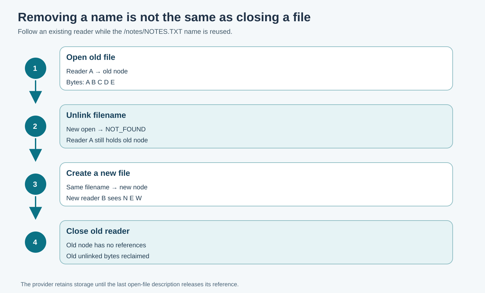

# 144. Build a Notes Filesystem Provider in C23

Our VFS now knows how to select a provider and maintain file descriptors. But
where do the document bytes live? The answer belongs to the **filesystem
provider**. In this chapter we will inspect the in-memory provider used by the
Notes exercise and examine what happens when a file is removed while it is
still open.

The provider stores a fixed number of files in ordinary C objects. Nothing
is written to a physical disk. This makes it possible to test file ownership
without risking personal data.

## 1. Understand the backing store

The [RAM provider header](https://github.com/umicom-foundation/Bits2Banking/blob/main/labs/native/vfs-descriptors/ram_provider.h)
defines eight file slots. Each slot has a filename, an array of 256 bytes,
a current size, a linked/unlinked flag and a reference count.

A `linked` file has a name that new `Open` calls can discover. An `unlinked`
file no longer has that name. Its bytes may still be needed by an already-open
description. When the last reference closes, the provider may scrub and reuse
the slot.



## 2. File contents are bytes, not always text

Consider a Notes file containing the text `Draft`.

```c
BtbRamProvider notes = {0};
BtbVfsStatus status = BtbRamFileCreate(
    &notes, "DRAFT.TXT", "Draft", 5U);
```

The number `5U` is the number of input **bytes** to copy. The provider does
not borrow the original string pointer. After this call succeeds, its own
array contains those five bytes.

Unlike C strings, a file's data does not need a terminating zero byte.
A read operation returns an explicit byte count. If an application wants to
print the bytes as text, it must reserve room for a terminator, append it
itself after the read, and check that the content really is text.

In the demonstration programme, the destination has 16 bytes; the read asks
for at most 15 and writes the final `\0` at the returned length.

## 3. Keep updates within capacity

`BtbRamWrite` accepts a source buffer, byte count and current open-file
position. Before copying, it verifies that the write fits the 256-byte file
capacity. It also rejects gaps beyond the current end of the file.

Suppose the current Notes file has four bytes and its position is zero. An
attempt to write 257 bytes is refused. The existing four bytes and the
current position remain unchanged. The caller can inspect the error and
choose a shorter write; it must not interpret a rejected request as a partial
success.

The laboratory deliberately does not implement growing heap buffers,
filesystem snapshots or durable commits. Those concepts are covered in the
preceding [storage and recovery lessons](134-write-ahead-journalling-and-recovery.md).

## 4. Remove the filename while the file is open

Assume `/notes/NOTES.TXT` currently contains `ABCDE`. An application opens
and reads it. An authorised namespace operation then removes the name:

```c
BtbVfsStatus status = BtbVfsUnlink(
    &vfs, 11U, "/notes/NOTES.TXT");
```

On success, a *new* open for that path returns `BTB_VFS_NOT_FOUND`. An existing
open description still refers to the older provider node, however, so it may
finish reading the old contents.

Now the provider may create a **new** file under the same name with bytes
`NEW`. A new open reaches the new node; the old description still refers to
the original node until it closes. This separation prevents an application
from unexpectedly switching to different data merely because a filename was
reused.

Namespace deletion is an authorisation decision separate from descriptor
write rights. In this classroom model, a mount records an administrative
client identity. A production system would require a verified process identity
and a real namespace permission policy.

## 5. Run the example and its tests

```powershell
Set-Location "C:\umicom\Umicom-Bits2Banking"
$env:Path = "C:\msys64\ucrt64\bin;$env:Path"
cmake --build ".\output\learning-build\vfs-descriptors" --parallel 2
ctest --test-dir ".\output\learning-build\vfs-descriptors" --output-on-failure
```

Run all three tests. The ownership test includes the unlink/recreate sequence;
the validation test includes path traversal and oversized writes.

To inspect the actual implementation, open `ram_provider.c`, locate
`BtbRamUnlink`, and follow its use of the `references` count. Next locate
`BtbRamRelease`, which performs the final cleanup when an unlinked file no
longer has any open references.

## 6. Experiment with a failed write

In `test_vfs.c`, find the oversized write using an array one byte larger than
`BTB_RAM_FILE_CAPACITY`. Temporarily change the array to exactly 256 bytes.
What else must remain true for the operation to succeed? The current position
must also leave enough room, and writes may not jump beyond the existing end
of the file. The file's current length is part of the validation.

Restore the original test after the experiment. These rules will matter again
when we connect a second provider to the same VFS.
