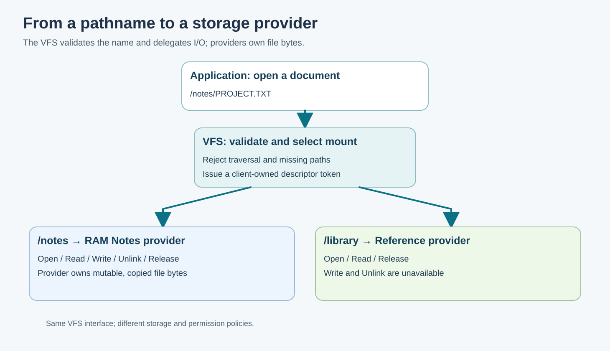

# 146. Follow File Ownership Through Umicom Kernel

Our C23 laboratories use two small providers and a bounded descriptor table.
The Umicom Kernel repository contains a more extensive filesystem architecture
that also manages process lifetimes, object caches, physical pages and storage
transport. In this chapter we will follow the actual source without changing
any of the Kernel files.

The native kernel is a research implementation targeting RISC-V64. It is not
the same thing as the Linux-libre-based Umicom OS distribution. The files below
belong to the independent **Umicom Kernel** project.

## 1. Start with the public VFS contract

Open [include/umicom/kernel/vfs.h](https://github.com/umicom-foundation/umicom-kernel/blob/main/include/umicom/kernel/vfs.h).
Find the type `UmicomKernelFileDescriptor`, the rights constants beginning
`UMICOM_VFS_RIGHT_READ`, and the `UmicomKernelVfsClient` declaration.

Next find the functions `UmicomKernelVfsOpen`, `UmicomKernelVfsDuplicate` and
`UmicomKernelVfsClose`. Notice that the Kernel passes an owned **VFS client**,
not a fictional integer written by an untrusted application into a command
line. A client belongs to a Kernel-selected principal and has its own ceiling
of rights.

Also compare the Kernel's actual limits with our lesson's limits. The current
header declares `UMICOM_VFS_DESCRIPTOR_LIMIT` as sixteen, while our laboratory
has twelve descriptor slots. These are independent choices. A classroom
constant is not a promise about the production API.

## 2. Follow one read through the layers

Consider a hypothetical programme opening a saved Notes file. The essential
layers are:

1. The user programme requests a file operation through a native service call.
2. The Kernel validates the current task identity and the request's buffer.
3. A VFS client resolves the descriptor and its permitted operations.
4. The mounted provider translates the file operation into its own storage
   representation.
5. The result is returned to the programme through an explicitly checked
   output area.

A pathname does not itself grant access, and an address supplied by user mode
is not automatically a pointer that machine-mode code may dereference.

Read [kernel/user_files.c](https://github.com/umicom-foundation/umicom-kernel/blob/main/kernel/user_files.c)
and the [process file-services guide](https://github.com/umicom-foundation/umicom-kernel/blob/main/docs/PROCESS_FILE_SERVICES.md).
The latter explains why the Kernel stages a file request before performing
operations that may allocate filesystem storage. The user trap still borrows
a privileged execution environment; the actual VFS work runs only after a
safe Kernel-owned return boundary.

## 3. Follow file data into RAMFS

Open [kernel/ramfs.c](https://github.com/umicom-foundation/umicom-kernel/blob/main/kernel/ramfs.c).
The Kernel's RAMFS uses object-cache nodes and owned physical pages. It does
not simply point into a caller's temporary text array.

Find how the RAMFS differentiates removal of a namespace entry from release of
a pinned file. An open file can outlive its removed filename, just as the
educational `BtbRamProvider` demonstrates. But Kernel RAMFS also has to deal
with resource release failures and actual page ownership.

Read [kernel/vfs.c](https://github.com/umicom-foundation/umicom-kernel/blob/main/kernel/vfs.c)
next. Its path parser checks bounded components before dispatching an
operation. Compare that with our simpler one-component path rule. The full
Kernel design handles additional operations and rights that the classroom
model deliberately excludes.

## 4. Understand how another provider is attached

The FAT16 course introduced a read-only disk-image inspector. Umicom Kernel
can use a checked FAT16 provider behind the VFS interface. Open
[kernel/fat16_provider.c](https://github.com/umicom-foundation/umicom-kernel/blob/main/kernel/fat16_provider.c)
and [the read-only provider guide](https://github.com/umicom-foundation/umicom-kernel/blob/main/docs/READ_ONLY_FILESYSTEM_PROVIDER.md).

The provider owns node identities, metadata snapshots and pins while the disk
mount owns the underlying block-device lifetime. A filesystem read can be
safe only while the necessary backing storage remains available. This is why
unmounting is an ownership operation rather than merely deleting a name from
a list.

Write authority is not obtained by silently upgrading a read-only mount.
The [writable block guide](https://github.com/umicom-foundation/umicom-kernel/blob/main/docs/WRITABLE_VIRTIO_BLOCK.md)
explains the separate admission and flush requirements for storage changes.

## 5. Compare three kinds of identity

| Identity | Classroom example | Umicom Kernel purpose |
| --- | --- | --- |
| Pathname | `/notes/PROJECT.TXT` | Find a node within an authorised namespace |
| File descriptor | `BtbVfsHandle` | Refer to an open description belonging to a client |
| Provider node | `uint32_t node` | Refer to provider-owned storage independently of its name |

A file can be renamed or unlinked without turning a prior open-file
description into a different object. A descriptor can be closed and its slot
reused without making an old token valid again. A provider can refuse a
cleanup request without silently abandoning the resource.

## 6. Practise reading the repository

Use your browser or existing local Kernel checkout. Find one function for
each operation below and note the source path and the preconditions it
checks: path validation, file open, descriptor duplication, descriptor close,
RAM-backed read, and filesystem-provider admission.

Then build both Bits2Banking VFS laboratories and compare their tests with the
Kernel's public contracts. Identify one property that the classroom tests
prove, and one property they **cannot** prove. For example, a deterministic
RAM-provider test can demonstrate shared file positions; it cannot prove the
safety of copying data from a RISC-V user address across page boundaries.

No Kernel source is changed during this exercise. As the Kernel evolves,
continue to consult its current code and documentation for authoritative
implementation details.
