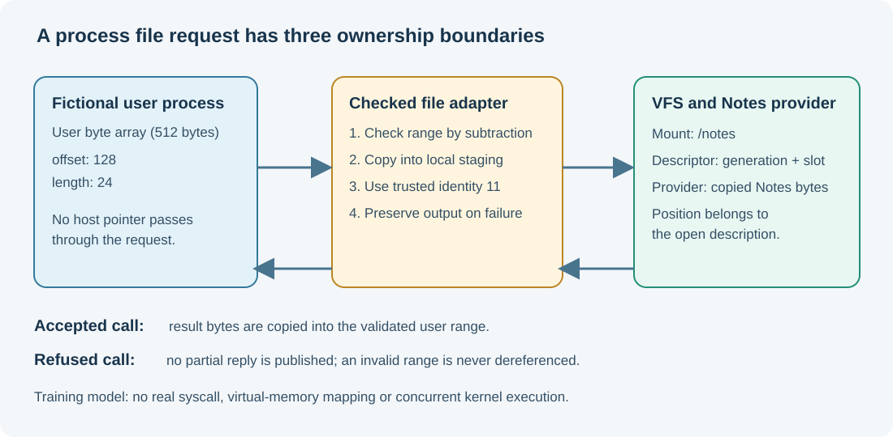

# 147. How a process reads a file without owning the filesystem

When Umicom Notes opens `LESSON.TXT`, several pieces of software cooperate. The Notes process decides **what** to open. The operating system decides **whether that process is allowed** to use the file. A virtual filesystem (VFS) finds the provider responsible for the file, and the provider supplies its contents.

A program should not need access to disk-driver structures to read a saved note. The same file interface might access an in-memory teaching document today and a disk-backed provider tomorrow.



## 1. Three different objects

Consider a request to read `/notes/LESSON.TXT`.

- **Process:** the running program with its own identity, memory and resources. In our model, the trusted identity is `11`.
- **File descriptor:** a small identifier for one open file reference. It is not an address in memory or the address of a disk sector.
- **Open-file description:** an operating-system record containing the current position in that open file. Two duplicated descriptors can share one description and therefore one position.

The previous [VFS laboratory](https://github.com/umicom-foundation/Bits2Banking/blob/main/labs/native/vfs-descriptors/README.md) already implements mount lookup, descriptor generations, file positions and release of provider references. We will **reuse** that implementation, not write another filesystem.

## 2. Understand user memory

A running process works with its own virtual address space. A system call that asks a kernel to write 100 bytes at an arbitrary address cannot be trusted simply because its request contains a number.

The kernel must establish that the complete address range belongs to the caller and has the required permissions. It must also ensure that copying cannot race with unexpected changes in the underlying mapping. Those are real-kernel responsibilities.

For this educational model, the process has one **512-byte array** instead of real page tables. Requests use an offset and a length inside that array. We can practise the boundary check without changing privileged memory mappings.

| Offset | Length | Last byte accessed | Outcome |
|---:|---:|---:|---|
| 128 | 24 | 151 | Allowed |
| 500 | 12 | 511 | Allowed |
| 500 | 13 | 512 | Refused: byte 512 is outside the array |
| 510 | 2 | 511 | Allowed |
| 510 | 3 | 512 | Refused |

In C, checking `offset + length <= capacity` can itself overflow when the values are extremely large. Instead, validate `offset <= capacity` first and then compare `length <= capacity - offset`.

```c
static int BtbProcessSpan(size_t offset, size_t bytes)
{
    return offset <= BTB_PROCESS_USER_BYTES &&
           bytes <= BTB_PROCESS_USER_BYTES - offset;
}
```

This is the precise check in our [process file service](https://github.com/umicom-foundation/Bits2Banking/blob/main/labs/native/process-file-services/process_files.c). It is not safe to reverse the order and perform subtraction before checking the offset.

## 3. Keep identity separate from request data

The process-file adapter receives a trusted identity when it is initialised:

```c
BtbProcessFilesInitialise(&process, &vfs, 11U);
```

A request does **not** have a `clientId` field. Otherwise a caller could attempt to change the number from 11 to 22 and claim to be a different process.

In Umicom Kernel, process identity comes from the currently admitted task and its service binding. Reading an identity from a user buffer would cross the trust boundary in the wrong direction.

## 4. Follow an OPEN request

The example prepares the pathname as **bytes** inside the process array:

```c
const char path[] = "/notes/LESSON.TXT";
BtbProcessFilesPut(&process, 0U, path, sizeof path - 1U);
```

The OPEN request says which bytes hold the path and which rights the process wants:

```c
BtbProcessFileRequest open = {
    .operation = BTB_PROCESS_FILE_OPEN,
    .rights = BTB_VFS_READ,
    .offset = 0U,
    .length = sizeof path - 1U
};
```

The adapter checks the complete span, refuses an embedded NUL byte, copies the path into a terminated local array, and finally asks the existing VFS to open it with the trusted identity.

An embedded NUL is refused because a string such as `LESSON.TXT\0/other` could otherwise hide a suffix from code that stops scanning at the first terminator.

On success, the adapter records the returned descriptor as part of the process lifetime. On failure, it leaves the reply unchanged.

## 5. Follow a READ request

A READ request contains the descriptor, a user-array offset and the number of bytes requested. The adapter first validates the output range. It then asks the VFS to read into a **local staging buffer** of at most 64 bytes. Only an accepted result is copied into the process array.

This is the difference between **receiving data from a provider** and **publishing data to the process**. The bytes must not appear at an invalid destination simply because some lower layer already read them.

The example displays:

```text
Process 11 read: Umicom Notes
```

The example uses a fictional text file. No disk, live banking data or real process memory is accessed.

## 6. Build and run

Open PowerShell:

```powershell
Set-Location "C:\umicom\Umicom-Bits2Banking"
$env:Path = "C:\msys64\ucrt64\bin;$env:Path"
cmake -S ".\labs\native\process-file-services" -B ".\output\learning-build\process-file-services" -G Ninja -DCMAKE_C_COMPILER="C:\msys64\ucrt64\bin\gcc.exe" -DBUILD_TESTING=ON
cmake --build ".\output\learning-build\process-file-services" --parallel 2
ctest --test-dir ".\output\learning-build\process-file-services" --output-on-failure
& ".\output\learning-build\process-file-services\btb-process-files-demo.exe"
```

The project reuses the previous VFS static library through CMake's `add_subdirectory()`. The expected result is three passing tests followed by the printed Notes text.

## 7. Practise

Before editing any code, predict the result when a request uses offset 510 and length 3. Locate the matching assertion in `test_process_files.c` and explain why the published reply and the two existing bytes at offset 510 remain unchanged.

Next, change the opening rights from `BTB_VFS_READ` to `BTB_VFS_WRITE` in a disposable copy of the example, and predict what happens if you then request a read. Restore the file after investigating the result.

**Check your understanding:** Why is a file descriptor not an ordinary pointer? Why does the file provider outlive the process's request buffer? What must a real kernel do that this 512-byte model does not?

Continue with [Chapter 148: checked copies and file lifetimes](148-checked-file-copies-and-descriptor-lifetimes.md).
