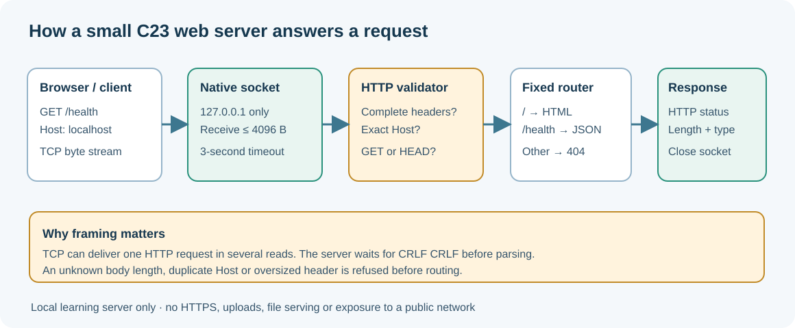

# 149. TCP/IP and native C23 sockets, one connection at a time

We have learned how an operating system lets a program open a file. Next we will learn how a program exchanges bytes with another program over a network.

A browser accessing a local documentation website is an example. The browser makes a connection, sends an HTTP request and waits for a response. A web server must interpret those bytes and decide what it is allowed to return.



## 1. What is a network address?

An **IP address** identifies a network interface in a particular network context. Our example uses `127.0.0.1`, the IPv4 loopback address: connections remain on the same computer.

A **port number** identifies the listening service on that address. Port 8765 is an ordinary example, not a special HTTP port.

```text
127.0.0.1:8765
|       |   |
|       |   +--- TCP port used by the service
+-------+------- IPv4 loopback address
```

You can run two development services on one machine when they listen on different ports. If Umicom Education is already using 8765, run the new laboratory on 8766.

## 2. How TCP differs from a message queue

A queue often delivers one complete message at a time. TCP instead delivers an ordered **stream of bytes**. A single HTTP request can arrive in multiple receives; two writes from a sender do not guarantee two matching reads at the receiver.

Our server must therefore accumulate counted bytes until the full HTTP header has arrived. It may not assume that the first `recv` returns the whole request.

TCP ensures reliable, ordered delivery while the connection is functioning, but applications must still handle disconnections, timeouts, short reads and protocol errors. A completed send is not proof that the other application accepted or processed the request.

## 3. Understand a listening socket

A socket is a handle supplied by the operating system's networking stack. Our C23 programme asks for a TCP socket, binds it to `127.0.0.1`, and waits for incoming connections.

In [`tcp_server.c`](https://github.com/umicom-foundation/Bits2Banking/blob/main/labs/native/http-loopback-server/tcp_server.c) the main lifecycle is:

```text
socket → bind → listen → accept → recv → validate → send → close
```

These are operating-system calls, not direct access to a network card. The native operating system handles TCP packets, sequence numbers, retransmission and most network transport details.

Our Windows adapter uses Winsock2, while our Linux adapter uses POSIX sockets. Both keep the same C23 parser and response code.

## 4. Why we bind to loopback

The example intentionally uses:

```c
.sin_addr = {.s_addr = htonl(INADDR_LOOPBACK)}
```

`INADDR_LOOPBACK` selects the local IPv4 interface. Binding to every network interface would expose the server to other devices and require a much more extensive security review.

The demonstration contains no authentication, HTTPS, uploads or public-host protection beyond narrow request checks. It is not a production HTTP server.

## 5. Build the web server

Open PowerShell:

```powershell
Set-Location "C:\umicom\Umicom-Bits2Banking"
$env:Path = "C:\msys64\ucrt64\bin;$env:Path"
cmake -S ".\labs\native\http-loopback-server" -B ".\output\learning-build\http-loopback-server" -G Ninja -DCMAKE_C_COMPILER="C:\msys64\ucrt64\bin\gcc.exe" -DBUILD_TESTING=ON
cmake --build ".\output\learning-build\http-loopback-server" --parallel 2
ctest --test-dir ".\output\learning-build\http-loopback-server" --output-on-failure
```

The build creates `btb-http-server.exe` and the parser test executable. A missing `ws2_32` link dependency on Windows would appear as a linker error; the supplied CMake target includes the Winsock library only on Windows.

## 6. Run the server

```powershell
& ".\output\learning-build\http-loopback-server\btb-http-server.exe" --port 8765
```

The console should display:

```text
Bits2Banking C23 HTTP lab: http://127.0.0.1:8765/
Routes: GET / and GET /health. HEAD is supported. Stop with Ctrl+C.
```

Visit `http://127.0.0.1:8765/` in your browser. You should see **Bits2Banking C23 web lab**. The `/health` route returns a short JSON response.

To stop the server, return to the console and press **Ctrl+C**.

## 7. What happens when a client is slow?

If a client connects and sends only part of a request, the server should not wait indefinitely. The laboratory applies a short socket timeout and a 4 KiB maximum request-header size.

The listener also uses `select` with a short interval so it can notice a stop request without continuously consuming processor time.

These are bounded engineering choices for the exercise. A service intended for arbitrary internet clients needs stronger resource controls, TLS, protocol conformance, logging, isolation and testing.

## 8. Practise

Run the server with `--port 8766` and open the matching address. Then stop it and run again with the `--once` argument. The server should answer one connection and return to PowerShell.

Use another PowerShell window to inspect a real response:

```powershell
Invoke-WebRequest -Uri "http://127.0.0.1:8766/health" | Select-Object StatusCode, Content
```

**Questions:** Why is a port different from an IP address? What does a successful `bind` establish? Why can `recv` return only part of a request? Why should a beginner web-service example not listen on all interfaces by default?

Continue with [Chapter 150: inspect and validate HTTP bytes](150-parse-http11-request-bytes-safely.md).
