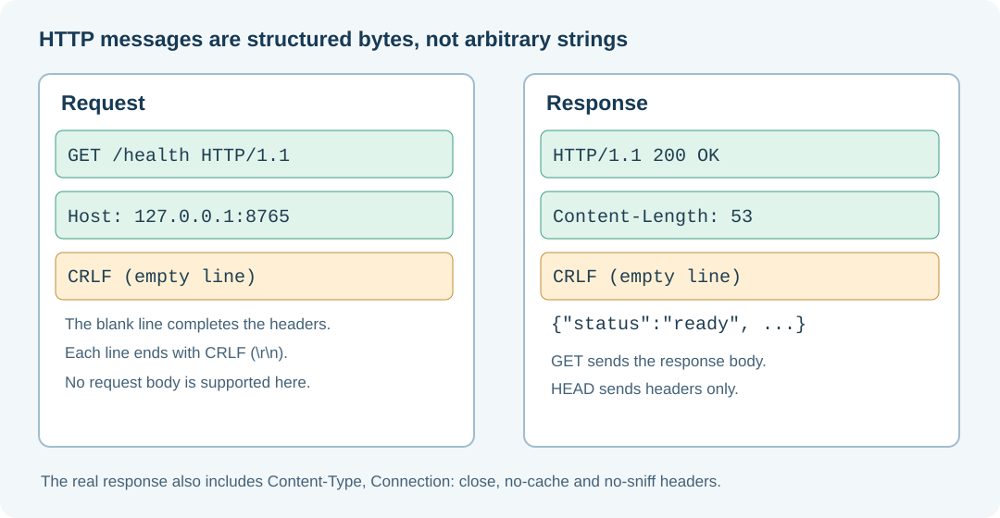

# 150. Parse HTTP/1.1 request bytes safely in C23

Our C23 server can listen for a TCP connection, but it must not treat received bytes as a valid HTTP request until it has checked them.

A browser can send a normal request. A malformed client can send missing line breaks, invalid lengths, an unexpected body, duplicate headers or an extremely long path. Even a correct browser might deliver its request in more than one TCP segment.

This lesson explains how to accept a deliberately small, clearly defined HTTP/1.1 subset.



## 1. Understand the request line

A simple request begins with:

```http
GET /health HTTP/1.1
Host: 127.0.0.1:8765
```

The actual bytes use **CRLF** (`\r\n`) after each line, followed by an additional CRLF to mark the end of headers.

The first line has three fields:

| Field | Example | Meaning |
|---|---|---|
| Method | `GET` | Ask for the representation of a resource |
| Target | `/health` | Name the requested route |
| Version | `HTTP/1.1` | Select the request protocol |

Our programme accepts `GET` and `HEAD`. `HEAD` requests the same metadata as `GET`, but the server does not send the response body.

## 2. Byte arrays are not C strings

The socket supplies a pointer and the number of bytes actually received:

```c
const int amount = recv(client, buffer, capacity, 0);
```

That buffer does **not** automatically contain a final `\0` terminator. Calling `strlen()` on it could read beyond the bytes that were received. A request can also contain deliberately embedded zero bytes.

Our parser receives an explicit length:

```c
BtbHttpResult BtbHttpParse(
    const unsigned char *bytes,
    size_t byteCount,
    BtbHttpRequest *out);
```

The function operates only on the supplied byte range and refuses control characters it does not support. It constructs a terminated copy of the path only after checking its complete length and characters.

## 3. Find the end of the headers

The relevant wire sequence is:

```text
\r \n \r \n
```

This four-byte sequence marks the end of an HTTP/1.1 header block. The parser returns `BTB_HTTP_INCOMPLETE` until it has received all four bytes.

This is an important distinction:

- **Incomplete** means additional bytes might complete a valid request.
- **Invalid** means the bytes already received violate the rules the server accepts.
- **Too large** means the bound has been exhausted before completion.

The teaching server permits at most 4,096 request-header bytes. It does not assume the client will be polite enough to stop transmitting on its own.

## 4. Validate the Host header

HTTP/1.1 requires a Host header. Our local-only server accepts exactly one Host value naming either `localhost` or `127.0.0.1`, with an optional port.

A request such as:

```http
GET / HTTP/1.1
Host: external.example
```

is refused. The server also rejects two Host headers because it should not guess which one is authoritative.

For this laboratory, any explicit port in the Host field must match the listening port before a fixed route can be served. This avoids a common ambiguity when several local services share one machine.

## 5. Reject request bodies we cannot process

Some HTTP requests contain a body and declare it using `Content-Length` or `Transfer-Encoding`. Our sample server does not implement a body decoder, so it refuses either header instead of guessing where the next request begins.

This is safer than ignoring conflicting length declarations or treating an extra payload as a second request. Parsing a full production HTTP implementation includes many additional rules; the small lesson must not pretend to be one.

The server also accepts only simple paths without percent-escaping, query strings or dot segments. A missing valid route returns 404. An unsupported method returns 405 with an `Allow: GET, HEAD` header.

## 6. Compose a response

The health route replies with the following structure (line breaks shown for readability):

```http
HTTP/1.1 200 OK
Content-Type: application/json
Content-Length: 53
Connection: close

{"service":"bits2banking-http-lab","status":"ready"}
```

The actual programme also sends no-cache, no-sniff and restrictive content-security headers. It calculates the content length from the fixed body rather than trusting a caller-supplied number.

For a `HEAD /health` request, it sends the same headers, including the body's advertised length, but it sends no body bytes.

## 7. Run the parser regression suite

If you have already configured and built the HTTP laboratory:

```powershell
ctest --test-dir ".\output\learning-build\http-loopback-server" --output-on-failure
```

The tests cover normal GET/HEAD requests, partial inputs, duplicate Host headers, disallowed methods, malformed line endings, embedded NUL bytes, unsupported bodies, extra trailing data and response generation.

The mutation test tries 8,192 deterministic altered input strings. Its objective is to expose memory errors and unexpected return values; it is not proof of complete protocol security.

## 8. Inspect a real request safely

Start the local server in one PowerShell window:

```powershell
& ".\output\learning-build\http-loopback-server\btb-http-server.exe" --port 8765
```

In another window, request the health route:

```powershell
Invoke-WebRequest -Uri "http://127.0.0.1:8765/health" | Select-Object StatusCode, Content
```

Expected: HTTP status `200` and a response whose `status` field is `ready`. A different status, missing output or inability to connect means the request did not complete as expected.

## 9. Exercises

Find the constant `BTB_HTTP_MAX_HEADER` in `http.h`. Explain why the server cannot read indefinitely into the same fixed array. Find the exact test that rejects two Host headers.

Then inspect `BtbHttpRespond()` and identify where it decides whether the request is a GET or HEAD. Why must the declared Content-Length represent the GET body even when no bytes are sent for HEAD?

**Questions:** Why is an HTTP parser different from a C string parser? Why must it reject ambiguous request lengths? Why is `127.0.0.1` a deliberate security boundary for this exercise?

Continue with [Chapter 151: file services and networking in Umicom](151-connect-vfs-and-networking-to-umicom-source.md).
