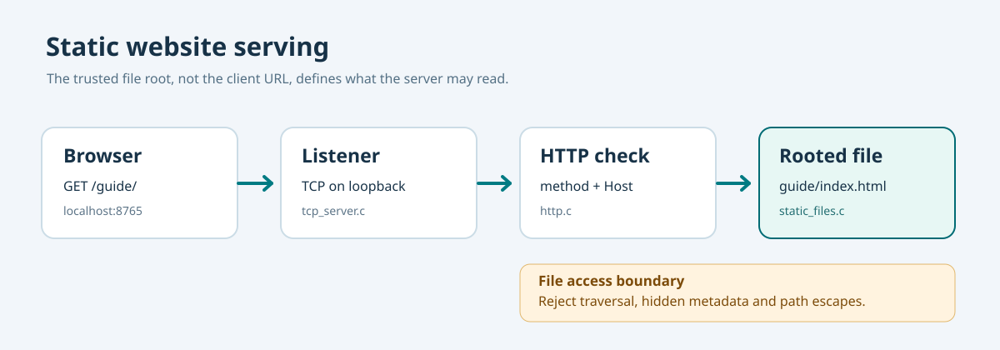

# 152. Serve an ordinary website using C23

A website does not have to start with a framework or a database. It can begin with two ordinary files: `index.html`, which contains the page, and `site.css`, which controls its appearance. A **web server** reads those files and returns their bytes when a browser requests them.

In [Chapter 149](149-tcp-ip-and-native-c23-sockets.md), we created a socket that listens on the computer's loopback address, `127.0.0.1`. In [Chapter 150](150-parse-http11-request-bytes-safely.md), we read and checked a short HTTP request. We will now connect those existing parts to a read-only file service. There is **no second networking implementation**.



## 1. The files and the request

The website used in this exercise lives at:

```text
labs/native/http-loopback-server/sample_site/
    index.html
    assets/
        site.css
```

When a browser requests `/`, the server selects `index.html`. When it requests `/assets/site.css`, the server selects the stylesheet. The HTTP request contains a URL **path**, not a Windows filename. The server is responsible for interpreting it safely.

The browser and the server communicate through **HTTP** (Hypertext Transfer Protocol). A browser sends a request such as:

```http
GET / HTTP/1.1
Host: 127.0.0.1:8765
```

The server replies with a status, headers, a blank line and the file bytes. The actual network lines end with `\r\n` (carriage return and line feed), which is why the C parser checks those exact bytes.

## 2. Build the existing C23 web server

Open PowerShell:

```powershell
Set-Location "C:\umicom\Umicom-Bits2Banking"
$env:Path = "C:\msys64\ucrt64\bin;$env:Path"

cmake -S ".\labs\native\http-loopback-server" `
    -B ".\output\learning-build\http-loopback-server" `
    -G Ninja `
    -DCMAKE_C_COMPILER="C:\msys64\ucrt64\bin\gcc.exe" `
    -DBUILD_TESTING=ON

cmake --build ".\output\learning-build\http-loopback-server" --parallel 2
ctest --test-dir ".\output\learning-build\http-loopback-server" --output-on-failure
```

The expected result is **six passing tests**, including the four tests from the earlier HTTP chapter. If a build or test fails, read the first reported error rather than moving to the next command.

## 3. Start the server with a document root

A **document root** is the one directory from which the server may return files. Resolve it to a full path before launching:

```powershell
$Root = (Resolve-Path ".\labs\native\http-loopback-server\sample_site").Path
& ".\output\learning-build\http-loopback-server\btb-http-server.exe" `
    --port 8765 --root $Root
```

Open `http://127.0.0.1:8765/` in your browser. The heading should read **Bits2Banking — Static website served by C23**. Open `http://127.0.0.1:8765/assets/site.css` to view the returned stylesheet as text. The route `/health` still returns the earlier fixed JSON message.

This terminal will stay occupied while the server runs. Stop it with **Ctrl+C** when finished. If port 8765 is already in use, use 8766 in both the command and the browser address.

## 4. Follow one request through the source

Open the following files in your editor:

| File | Responsibility |
| --- | --- |
| `main.c` | Read `--port`, `--root` and `--once`. |
| `tcp_server.c` | Accept one TCP client and send the response. |
| `http.c` | Validate HTTP/1.1 framing, method and `Host`. |
| `static_files.c` | Select and open one file beneath the approved directory. |
| `static_files.h` | Declare the owned root and file handles. |

In `main.c`, find `BtbStaticRootOpen()`. It opens the root once before the listening loop begins. The server retains that owner until it shuts down. In `tcp_server.c`, follow `BtbHttpParseForFiles()` to `BtbStaticFileOpen()` and finally to `BtbSendStaticFile()`.

The earlier two-route mode still works without `--root`:

```powershell
& ".\output\learning-build\http-loopback-server\btb-http-server.exe" --port 8765
```

That mode serves fixed C string responses. It does not expose files.

## 5. Practise

1. Change the heading in `sample_site/index.html` to **Umicom Learning — Native C23**.
2. Reload the browser page. The change appears without recompiling C because the file is read on each request.
3. Change a colour in `sample_site/assets/site.css` and reload.
4. Stop the server; run the CTests again; confirm the original fixed-response tests still pass.

Keep these changes in your local exercise copy until you are ready to submit a reviewed contribution.

## What you have learned

You have built a native C23 application that converts a checked HTTP path into an ordinary file read. You can distinguish source code, compiled server logic, and independently editable website files. The next chapter examines why selecting files safely is more complicated than joining two strings.

Continue with [Chapter 153 — Paths, MIME types and safe file selection](153-safe-http-paths-and-mime-types.md).
