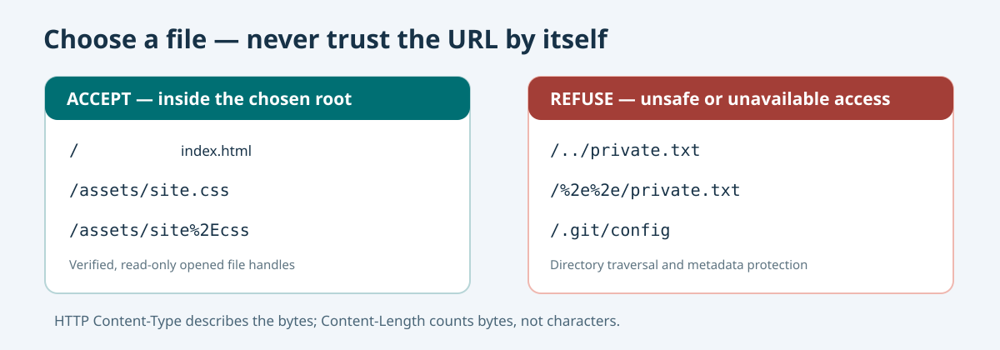

# 153. HTTP paths, MIME types and safe file selection

When a browser requests `/assets/site.css`, it is asking for a resource. It is **not** giving the web server permission to open arbitrary files on the computer. The server must decide which directory it owns, check the requested path and tell the browser what kind of content it returned.



## 1. A URL path is not a disk path

Suppose the configured document root is:

```text
C:\umicom\Umicom-Bits2Banking\site
```

The HTTP request might contain:

```http
GET /assets/stylesheets/umicom.css HTTP/1.1
Host: 127.0.0.1:8765
```

The URL path is `/assets/stylesheets/umicom.css`. A naïve implementation might join that text to the root and open whatever file the result names. That is unsafe: a path can contain special components, encoded characters or links that redirect the read somewhere else.

The laboratory therefore treats a path as **untrusted input** and checks it before opening a file.

## 2. Understand ordinary and special components

A path component is the text between two slash characters. In `/assets/site.css` the components are `assets` and `site.css`.

A component named `.` means the current directory. A component named `..` means its parent. These are useful in a trusted shell, but a web client must not use them to escape the selected document root.

The laboratory refuses all of these requests:

```text
/../private.txt
/%2e%2e/private.txt
/assets/%2fsecret
/.git/config
/assets//site.css
/CON.txt
```

`%2e` is a **percent encoding** for `.` and `%2f` represents `/`. It would be a mistake to reject only the literal text `..`: the encoded form could mean the same thing after decoding. Our implementation decodes once, checks the complete components and refuses escaped separators. A second decode is never performed.

`CON.txt` is refused because Windows has reserved device names. Keeping the same restriction on Linux makes the learning example behave consistently across platforms.

## 3. Why a symlink matters

On a filesystem, a **symbolic link** can name another file or directory. If a server is allowed to follow a link in its document root, a request that appears to stay within the root can reach an unrelated file.

On Linux, `static_files.c` opens each path component relative to an already opened directory descriptor, using `openat()` and `O_NOFOLLOW`. It accepts only directories for intermediate components and regular files for the final component.

On Windows, the laboratory uses `CreateFileW()` with reparse-point checks and verifies the final resolved file handle remains beneath the selected root. This is an educational implementation, not a general-purpose security boundary for a folder that an untrusted person can modify concurrently. Further Windows filesystem-race hardening would be required for a public server.

Notice the distinction: checking that the **text** begins with `C:\umicom\...\site` is not the same as checking which **opened file handle** it actually identifies.

## 4. Tell the browser what it received

An HTTP response's `Content-Type` header describes the bytes being returned. This is called a **MIME type** or **media type**.

| Filename | Content type |
| --- | --- |
| `index.html` | `text/html; charset=utf-8` |
| `assets/site.css` | `text/css; charset=utf-8` |
| `data.json` | `application/json` |
| `diagram.svg` | `image/svg+xml` |
| `logo.png` | `image/png` |
| `unknown.xyz` | `application/octet-stream` |

Find the `BtbStaticMediaType()` function in `static_files.c`. It matches a small, explicit set of filename suffixes. An unknown type is returned as ordinary bytes instead of being executed.

The server also sends `X-Content-Type-Options: nosniff`, instructing browsers not to guess a more active media type for a returned file.

## 5. Test the path rules

From PowerShell, after configuring the laboratory in the previous chapter:

```powershell
Set-Location "C:\umicom\Umicom-Bits2Banking"
ctest --test-dir ".\output\learning-build\http-loopback-server" `
    -R "bits2banking.http.static" --output-on-failure
```

The two tests should pass. In `test_static.c`, inspect `BtbParserTests()` and `BtbFileTests()`. One test checks URL parsing and response headers; the other creates a temporary directory, opens legitimate files and refuses attempts to leave the root.

To try a live refusal while the server is running, use `curl.exe` (if available):

```powershell
curl.exe --path-as-is -i "http://127.0.0.1:8765/%2e%2e/private.txt"
```

The expected response is **403 Forbidden**. The normal path `/assets/site.css` should still return **200 OK**.

## 6. Understand the deliberate limitations

The path grammar in this lesson accepts portable ASCII filenames, with letters, numbers, `.`, `_`, `-` and `/`. Encoded ASCII dots are accepted within legitimate names. The implementation does not yet support Unicode filenames, literal spaces, encoded spaces, filesystem directory listings or general URL rewriting. URL queries such as `?version=2` can be present but do not change the selected file.

This is useful for learning and for a small locally generated site. It is not a complete, standards-conformant web routing system and must not be exposed as a public hosting service.

## Your exercise

In the `test_static.c` file, add a test rejecting `/assets/%2e%2e/secret`. Build and run the tests. Then add a valid filename such as `/assets/new-page.html` to the sample site and confirm that it is served with the HTML content type.

Continue with [Chapter 154 — Stream a file larger than memory buffers](154-stream-static-files-and-head.md).
