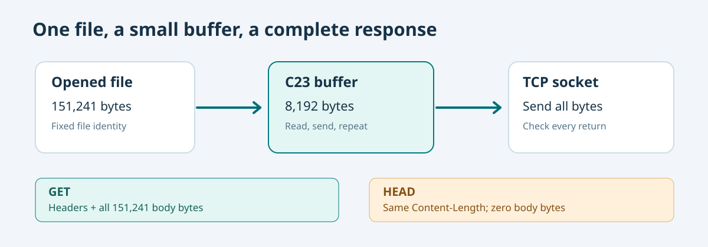

# 154. Stream a file, return a correct length and support HEAD

In our original web server, each response fitted into a small C character array. That works for a short JSON message, but it cannot hold a complete educational book, large illustration or generated website asset.

The solution is **streaming**: open the file once, read a small part, send it, then repeat until the declared file length has been delivered.



## 1. Bytes are not always text

C strings end with a zero byte (`\0`). A PNG image, compressed archive or PDF contains arbitrary bytes and may include zeros in the middle. Therefore a binary file is not handled with `strlen()`.

The native file reader reports a **byte count** after each read:

```c
unsigned char buffer[BTB_STATIC_STREAM_BYTES];
size_t received = 0U;
BtbStaticResult result =
    BtbStaticFileRead(&file, buffer, sizeof buffer, &received);
```

`received` tells the caller how many bytes are valid. It may be smaller than the buffer capacity; at end-of-file it is zero. The caller must never assume the unused part contains file data.

Open `labs/native/http-loopback-server/tcp_server.c` and locate `BtbSendStaticFile()`. It tracks `remaining` bytes separately from `received` bytes. The loop ends only after all bytes advertised by the open file have been sent.

## 2. What Content-Length means

A browser needs to know whether the response has finished. In this teaching server, every HTTP connection closes after one response, and the server also supplies an exact `Content-Length` header.

For a file containing 151,241 bytes, the response begins:

```http
HTTP/1.1 200 OK
Content-Type: text/plain; charset=utf-8
Content-Length: 151241
Connection: close
```

The numbers describe the bytes, not the number of characters or lines. In a UTF-8 document, some characters occupy more than one byte.

The laboratory limits an individual file to **64 MiB**. This limit is an admission rule, not the size of the transfer buffer. A file of 151,241 bytes can therefore be served using the same **8 KiB** workspace repeatedly.

## 3. Why HEAD is different from GET

A `GET` request asks for the headers and the resource body. A `HEAD` request asks for the same descriptive headers without transmitting the body.

The server checks the method before streaming:

```c
if (delivered && request.method != BTB_HTTP_HEAD) {
    if (code == 200U)
        delivered = BtbSendStaticFile(client, &file, began);
}
```

The `Content-Length` for a successful HEAD request remains the *size of the file*, even though no body bytes are sent. This lets a client inspect metadata without downloading the file.

## 4. Run a reproducible test

Configure and build the [HTTP laboratory](../../labs/index.md) from Chapter 152. Then run:

```powershell
Set-Location "C:\umicom\Umicom-Bits2Banking"
ctest --test-dir ".\output\learning-build\http-loopback-server" `
    -R "bits2banking.http.static_files" --output-on-failure
```

The test writes a 151,241-byte fixture to a temporary build directory, reads it through the native static-file API and compares every byte with its expected value. The fixture is created in the build tree, not in your source checkout.

Now start the server using `--root` as shown in Chapter 152. In a second PowerShell window:

```powershell
curl.exe -I "http://127.0.0.1:8765/assets/site.css"
```

Look for **200 OK**, **Content-Type: text/css** and a nonzero **Content-Length**. Use `curl.exe -i` instead of `-I` to inspect the actual response body.

## 5. Handle a partial send or disconnection

The networking API's `send()` call may accept fewer bytes than requested. It is not correct to advance the file position by an assumed 8 KiB and ignore the return value.

The existing `BtbSendAll()` routine advances a `used` offset only by the number of bytes actually accepted by `send()`. A negative or zero return ends the response as incomplete. The native file handle is still closed.

A client can also stop reading partway through a file. This does **not** undo bytes that were already sent, and the server must not retry the entire response indefinitely. The classroom server uses a per-socket timeout, an overall **10-second** client deadline and closes the connection on failure.

The teaching implementation processes one connection at a time. It does not support byte ranges, caching negotiation, keep-alive, compression, TLS or concurrent clients. Those features have additional contracts and security considerations.

## Your exercise

Change the generated fixture length in `test_static.c` from 151,241 to 131,073 bytes. Explain why the test still passes without allocating a buffer of that size. Then change the file content and verify the test catches the mismatch before restoring the expected generator.

Continue with [Chapter 155 — Test a file server without exposing your files](155-test-a-local-web-server-safely.md).
