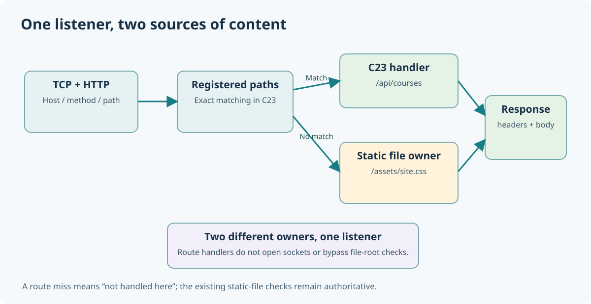

# 157. Route HTTP requests to C23 functions

A web server receives requests for different resources. The same listener might receive `/`, `/api/courses`, `/api/status` and `/assets/site.css`. Each address needs a clear owner: a C function may produce a response, or a file provider may supply the bytes. Routing is the step that chooses the owner.

In [Chapter 152](152-serve-a-static-website-in-c23.md), you served files from a directory. In this chapter you will add live C23 handlers **without replacing the existing file server**.



## 1. Prepare the learning application

Open PowerShell in the Bits2Banking checkout:

```powershell
Set-Location "C:\umicom\Umicom-Bits2Banking"
$env:Path = "C:\msys64\ucrt64\bin;$env:Path"
cmake -S ".\labs\native\http-loopback-server" `
    -B ".\output\learning-build\http-loopback-server" `
    -G Ninja `
    -DCMAKE_C_COMPILER="C:\msys64\ucrt64\bin\gcc.exe" `
    -DBUILD_TESTING=ON
cmake --build ".\output\learning-build\http-loopback-server" --parallel 2
```

The executable is `output\learning-build\http-loopback-server\btb-http-server.exe`. It still supports its original fixed routes and the read-only `--root` option.

## 2. Understand the three parts of a route

A route has a **path**, a **handler** and a **context**. The path is the address requested by the browser. The handler is a C function that prepares the answer. The context is optional data belonging to the application; the routing service **borrows** it and does not free it.

The contract in `route_service.h` is:

```c
typedef BtbRouteResult (*BtbRouteHandler)(
    const BtbHttpRequest *request,
    BtbRouteResponse *out,
    void *context);
```

The request contains a method (`GET` or `HEAD`) and the validated path. The handler returns a status indicating whether it prepared a complete response; it does **not** send bytes to a socket. Keeping those tasks separate means a handler can be tested without starting a server.

For example, `learning_routes.c` uses a fixed JSON result for `/api/courses`:

```c
static const char contents[] =
    "{\"courses\":[\"Computer Architecture\",\"C23\",\"Assembly\",\"Umicom Kernel\"]}\n";
return BtbRouteResponseSet(out, 200U, BTB_ROUTE_JSON,
                           contents, sizeof contents - 1U);
```

`sizeof contents - 1U` measures the bytes of the string without its terminating zero. An HTTP response uses the **byte length**, not an assumed end-of-string marker in a network packet.

## 3. Register the handlers before starting the service

`BtbLearningRoutesInstall()` registers three paths: `/api/courses`, `/api/status` and `/workshop`. Registration uses a fixed-capacity table; there is no heap allocation or runtime plugin loader in this exercise.

```c
BtbRouteService service = {0};
BtbRouteServiceInit(&service);
BtbLearningRoutesInstall(&service);
BtbRouteServiceStart(&service);
```

Real application code checks each return value. The excerpt shows the order of operations; the complete checks are in `main.c`.

A duplicate path is rejected. Registering a path after `Start` is also rejected. These checks prevent a request from observing a routing table that is being changed underneath it.

## 4. Start the server and call the routes

In one PowerShell window:

```powershell
Set-Location "C:\umicom\Umicom-Bits2Banking"
& ".\output\learning-build\http-loopback-server\btb-http-server.exe" `
    --port 8765 --routes
```

In another PowerShell window, send a request:

```powershell
Invoke-RestMethod "http://127.0.0.1:8765/api/courses"
```

You should receive a JSON document containing **Computer Architecture**, **C23**, **Assembly** and **Umicom Kernel**. Next, open `http://127.0.0.1:8765/workshop` in a browser and read the HTML supplied by a C23 handler. Stop the server with Ctrl+C.

## 5. Combine a dynamic route and a static website

The previous file-serving mode has not been removed. Start both features together:

```powershell
$Root = (Resolve-Path ".\labs\native\http-loopback-server\sample_site").Path
& ".\output\learning-build\http-loopback-server\btb-http-server.exe" `
    --port 8765 --root $Root --routes
```

Now `/api/courses` is handled in C, while `/` and `/assets/site.css` are read from the selected directory. The existing `/health` response remains available. When a parsed path does not match any registered handler, the routing service returns `NOT_FOUND` so the established file lookup can continue. It does not confuse a filename such as `site.css` with an invalid route.

## 6. Test an invalid route

Try requesting `/api/unknown`. In route-only mode, the existing fixed-route fallback reports `404 Not Found`. With `--root`, the static-file owner also reports 404 when the named resource does not exist. No new filesystem access is introduced by route registration.

Run the focussed tests:

```powershell
ctest --test-dir ".\output\learning-build\http-loopback-server" `
    -R "bits2banking.http.(routing|route_mutations)" --output-on-failure
```

### Questions

1. What is the difference between selecting a handler and sending a network response?
2. Why does a route borrow its context rather than take ownership of an arbitrary pointer?
3. Why should a request for `/assets/site.css` continue to the static-file provider?

The next chapter explains precisely how a handler turns its content into an HTTP response and why HEAD must not send the message body.
