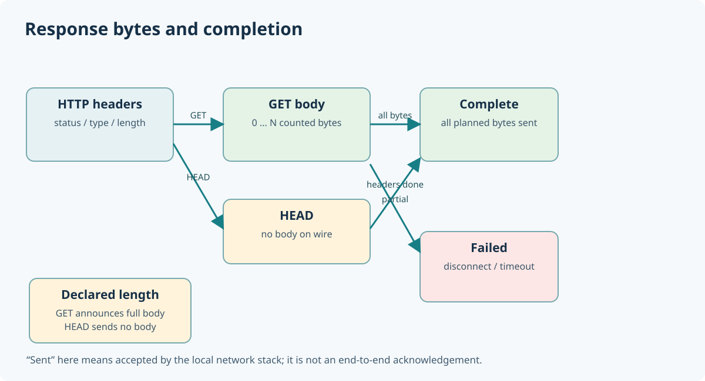

# 159. Handle HTTP disconnections and complete responses correctly

Suppose the Notes website has a 150 KiB illustration. A server cannot assume that one call to `send()` transfers the whole file. The operating system may accept only part of a buffer, and the client may disconnect while the transfer is still in progress.

In [Chapter 154](154-stream-static-files-and-head.md) you learned to stream a file in bounded chunks. This chapter adds **response-completion accounting** so the server can distinguish completed transfers from incomplete ones.



## 1. Count bytes actually accepted by the socket

The C socket API returns a byte count from `send()`. For example, asking it to send 1,024 bytes does not guarantee that all 1,024 bytes have been accepted.

The existing `BtbSendAll()` loops until the whole buffer has been accepted or an error or deadline stops it. Update 26 feeds each successful return count to `BtbResponseProgressAdvance()`.

The progress owner records two separate quantities: **header bytes** and **body bytes**. It cannot count body bytes before the complete headers have been sent.

## 2. Read the transfer state

The type `BtbResponseProgress` contains:

```c
typedef struct BtbResponseProgress {
    uint64_t expectedHeaders;
    uint64_t expectedBody;
    uint64_t sentHeaders;
    uint64_t sentBody;
    BtbResponsePhase phase;
} BtbResponseProgress;
```

A transfer begins in `BTB_RESPONSE_HEADERS`, advances to `BTB_RESPONSE_BODY` when necessary, and becomes `BTB_RESPONSE_COMPLETE` only after every expected byte has been accepted. A disconnected client causes the caller to mark it `BTB_RESPONSE_FAILED`.

This is **not a receipt from the browser**. A successful `send()` call means the local networking stack accepted the bytes, not that the remote application displayed, saved or understood them.

## 3. Simulate a large response without opening a socket

A unit test can exercise the bookkeeping directly:

```c
BtbResponseProgress progress = {0};
BtbResponseProgressBegin(&progress, 80U, 20000U);
BtbResponseProgressAdvance(&progress, BTB_RESPONSE_HEADER_PART, 80U);
BtbResponseProgressAdvance(&progress, BTB_RESPONSE_BODY_PART, 8192U);
```

At this point the response is **not complete**: only 8,192 of the expected 20,000 body bytes have been counted. A later advance of 11,808 body bytes completes it. Attempting to count even one additional byte is refused.

Use the test executable rather than hand-editing production server code:

```powershell
ctest --test-dir ".\output\learning-build\http-loopback-server" `
    -R "bits2banking.http.(response_completion|disconnect_semantics)" `
    --output-on-failure
```

## 4. Simulate a disconnected client

The second test counts the full headers and the first 100 bytes of a 2,048-byte body. It then marks the response failed. The test verifies that it is never reported as complete and that later advances are refused.

This distinction matters in banking and treasury applications too: **accepting an operation, completing an operation and confirming the result are separate facts**. A network error does not prove that the recipient did nothing; higher-level protocols need IDs, acknowledgements and retry rules.

## 5. Test HEAD separately

A HEAD response announces the GET representation length, but its *wire body* is zero bytes. The progress owner therefore begins with the expected header count and an expected wire-body count of zero. Completing the headers is enough to finish HEAD.

### Practical exercise

Open `response_progress.c` and locate the subtraction used before increasing each sent counter. Explain why `expected - sent` is safer than adding first and checking afterwards. Then run both response-progress tests and examine how the incomplete and complete cases differ.

### Questions

1. What can a successful `send()` call tell us, and what can it not tell us?
2. Why must we never report completion after counting only a file's first chunk?
3. Why is the expected *wire* body of HEAD zero?

The next chapter joins these ideas to safe service startup and shutdown.
