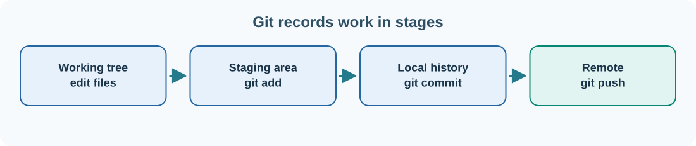

# 16. Git: remember and review your changes

When you edit a source-code file, you may want to know what changed, why it changed and how to return to an earlier working version. **Git** is a version-control system that records project history. It is used throughout Umicom development.

A **repository** is a project whose changes Git can track. A **commit** is a named snapshot of those changes. A **branch** is a movable reference to a line of commits. A **remote** refers to a repository located elsewhere, such as one hosted on GitHub.



## Create your first local repository

Check that Git is installed:

```powershell
git --version
```

Create a small practice repository that is separate from the real Umicom code:

```powershell
New-Item -ItemType Directory -Force -Path "$HOME\UmicomLearning\my-first-repo" | Out-Null
Set-Location "$HOME\UmicomLearning\my-first-repo"
git init -b main
```

Git creates a hidden `.git` directory holding repository history and configuration. Do not edit files inside `.git` manually.

Configure your commit identity once, using your own public display name and an email you are willing to associate with commits:

```powershell
git config --global user.name "YOUR_DISPLAY_NAME"
git config --global user.email "YOUR_GIT_EMAIL"
```

Write a file:

```powershell
Set-Content -Path ".\README.md" -Value "# My Umicom Practice Project"
git status
```

Git reports that `README.md` is **untracked**. It exists on disk but has not yet been added to Git history.

## Stage and commit

```powershell
git add README.md
git diff --cached
git diff --cached --check
git commit -m "docs: add project introduction"
```

`git add` moves a copy of the file's current changes into the **staging area**. `git diff --cached` shows what would be included in the next commit. `--check` detects certain whitespace problems. `git commit` records the staged snapshot with a message explaining its purpose.

Check the history:

```powershell
git log --oneline -5
git status
```

Your first commit should appear with a short identifier. If you have no uncommitted changes, Git reports a clean working tree.

## Make another change

```powershell
Add-Content -Path ".\README.md" -Value "Learning Git one change at a time."
git diff
git status
```

Now `git diff` shows changes that have **not** been staged. Stage and commit them if you want to preserve them:

```powershell
git add README.md
git diff --cached --check
git commit -m "docs: explain practice project purpose"
```

Try `git log --oneline -5` again. The two commits record the order of your work.

## Branches and remote repositories

An open-source contributor commonly works in a branch on a personal fork and asks the maintainers to review it. Create a local practice branch:

```powershell
git switch -c docs/expand-introduction
git branch --show-current
```

A remote repository does not automatically exist because you created a local Git repository. Later, when you **clone** an online repository, Git usually creates a remote named `origin` for you. `git push` sends committed work to a remote that you have permission to update; `git fetch` retrieves its published history. `git pull` combines retrieval with integration into your working branch.

Avoid using force-pushes, hard resets or file-cleaning commands while learning. They can overwrite work you intended to keep. Read `git status` and `git diff` before changing repository history.

## Publish your own practice repository

When you are ready to place a new project online, the GitHub CLI (`gh`) can create a repository from the local directory. Sign in through the browser first:

```powershell
gh auth login --hostname github.com --git-protocol https --web
```

Return to the `main` branch of your **practice repository** and check that the working tree is clean:

```powershell
git switch main
git status
```

From that directory, you can create a private remote repository and push your existing commits:

```powershell
gh repo create my-first-repo --private --source . --remote origin --push
```

A private repository is not visible to the general public, but you should still keep secrets and personal information out of its tracked files. If a repository with that name or an `origin` remote already exists, stop and inspect the existing configuration rather than overwriting it.

## What is GitHub?

Git and GitHub are not the same thing. Git works locally without an internet connection. **GitHub** is a hosting and collaboration service that stores Git repositories and provides issues, reviews, pull requests and automated checks. The next chapter uses both tools to submit a genuine contribution.

**Next:** [Fork a repository and open a pull request](17-first-pull-request.md).
