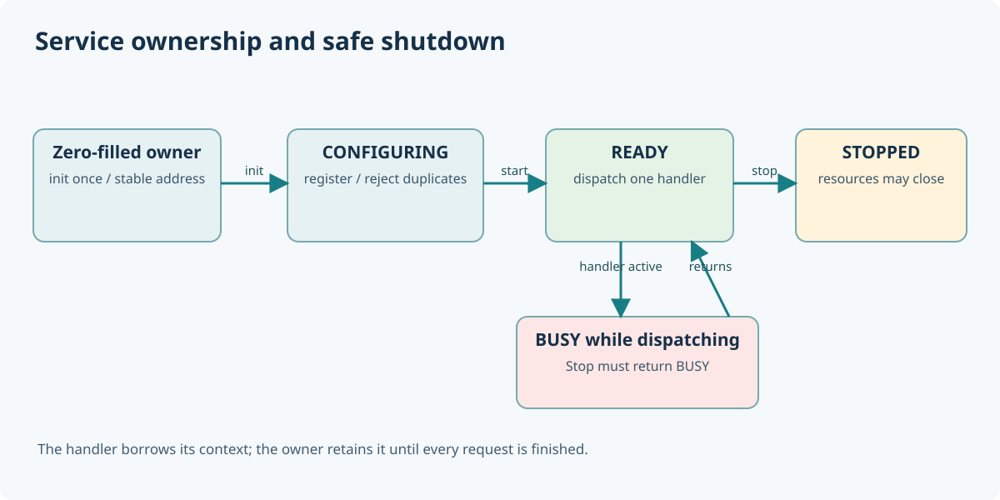

# 160. Start, use and stop a C23 web service safely

A routing table may contain pointers to application-owned data. If the application releases that data while the web server is calling a handler, the handler can read memory that no longer belongs to it.

To avoid this, a server needs a defined **lifetime**. The educational routing service separates configuration, active use and shutdown.



## 1. Understand the states

The routing owner starts as a zero-initialised structure. Its state changes as follows:

```text
UNINITIALISED
      |
      v
CONFIGURING -- Register routes --> CONFIGURING
      |
      | Start
      v
READY -- Dispatch one request --> READY
      |
      | Stop (only when no handler is active)
      v
STOPPED -- Start --> READY
```

A call to Register after Start is refused. Stop is refused while a handler is in progress. This laboratory uses one thread and one request at a time; it does not claim to be a thread-safe service registry.

## 2. Follow a handler's complete lifetime

`BtbRouteServiceDispatch()` first checks that the owner is READY and that no other dispatch is active. It locates a matching route, sets a busy marker, invokes its handler and clears that marker after the handler returns. A successful, fully formed response is copied out of the local candidate only after validation.

If a callback returns a refusal, the caller's response remains unchanged. That is a useful **failure-atomic output rule**: a refused operation should not leave behind an output that looks partly accepted.

## 3. Reproduce a refused stop

`test_routes.c` registers a handler called `TryStop`. While processing a request, that handler deliberately calls `BtbRouteServiceStop()` on its own service.

The expected result is `BTB_ROUTE_BUSY`. The handler then completes its response normally. Afterwards, the outer caller can stop the service successfully.

Run:

```powershell
Set-Location "C:\umicom\Umicom-Bits2Banking"
ctest --test-dir ".\output\learning-build\http-loopback-server" `
    -R "bits2banking.http.service_lifetime" --output-on-failure
```

This is a controlled teaching case, not a recommendation that production handlers should attempt shutdown.

## 4. Compare three server modes

The CLI retains the earlier behaviours:

```powershell
# Original fixed routes
& ".\output\learning-build\http-loopback-server\btb-http-server.exe" --port 8765

# Read-only website files
$Root = (Resolve-Path ".\labs\native\http-loopback-server\sample_site").Path
& ".\output\learning-build\http-loopback-server\btb-http-server.exe" --port 8765 --root $Root

# Registered application handlers plus the original file-serving fallback
& ".\output\learning-build\http-loopback-server\btb-http-server.exe" `
    --port 8765 --root $Root --routes
```

Stop each server with Ctrl+C before starting the next one. The command owns the optional `BtbRouteService` until the listener returns; only then does it close the service and static root.

## 5. Recognise what this example does not provide

It is a serial IPv4 loopback HTTP/1.1 demonstration. It has no authentication, TLS, concurrent handler execution, uploaded request bodies, database connection pool or public service manager. The service owner is a small C23 lifecycle example; other Umicom applications should use the vetted Framework services rather than copying this laboratory into production.

### Questions

1. Why does route registration stop when requests begin?
2. Why must a callback context outlive every request that uses it?
3. What is the difference between refusing Stop while busy and silently freeing the service anyway?

Next we will connect this small application to real Umicom architecture and learn where each responsibility belongs.
