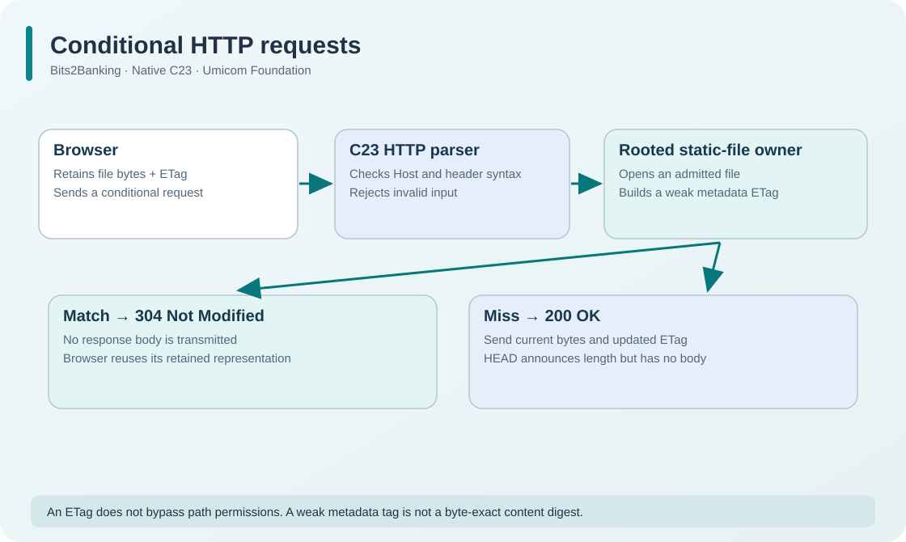

# 163. Add conditional GET and HEAD to a C23 server

In [Chapter 162](162-http-caching-and-revalidation.md), we observed a browser asking whether a cached page is still current. We can now follow that request through the native web-server source.

All source files in this chapter belong to `labs/native/http-loopback-server`. They extend the **same** HTTP server built in Updates 24–26; there is no competing listener or second file-service implementation.

## 1. Recognise an optional HTTP header

A network receive call provides **bytes and a byte count**. It does not guarantee a NUL-terminated C string, a complete HTTP request or a trusted pathname.

The existing parser in `http.c` first checks CRLF framing, rejects request bodies, validates the Host field, and then publishes a `BtbHttpRequest` only when the entire request passes validation.

The request structure now also contains:

```c
unsigned ifNoneMatchPresent;
char ifNoneMatch[BTB_CACHE_CONDITION_CAPACITY];
```

These fields are used for static-file requests. `ifNoneMatchPresent` distinguishes **no header was provided** from **a header with a value**. The fixed `/health` route and separately registered application handlers retain their previous behaviour.

The parser refuses a duplicate `If-None-Match` header, an empty validator and a value that does not fit the fixed buffer. It checks the syntax before opening a file. This prevents an incomplete or malformed network record from becoming a seemingly accepted request.

## 2. Parse a bounded list of entity tags

The helper in `cache_validator.c` accepts a single entity tag, the wildcard `*`, or a comma-separated list such as:

```http
If-None-Match: "older-version", W/"current-version"
```

The parser returns one of three results:

```c
typedef enum BtbCacheResult {
    BTB_CACHE_INVALID = 0,
    BTB_CACHE_MISS = 1,
    BTB_CACHE_MATCH = 2
} BtbCacheResult;
```

Notice that **invalid** and **not matching** are different. `MISS` means the request was syntactically acceptable but its validator does not describe the selected file. `INVALID` means the server cannot reliably interpret the header.

The comparison uses weak matching for GET/HEAD: an optional `W/` prefix does not prevent two identical opaque tag values from matching. The complete input is parsed before the function returns, even if an earlier entry matched; trailing garbage is never ignored.

**Try it:** Open `test_cache.c` and locate the invalid inputs. It tests trailing commas, missing quotes, duplicate request headers and malformed lists. The parser refuses these rather than guessing the caller's intent.

## 3. Read the validator from an opened file

`static_files.c` already owns the secure path traversal and the final native file handle. The new code observes the metadata of **that opened file** instead of checking a separate untrusted pathname.

```c
char tag[BTB_CACHE_TAG_CAPACITY];
if (!BtbCacheTagFromMetadata(length, changedStamp, tag)) {
    /* Close the opened native file before returning an error. */
}
```

On Windows, the modification timestamp comes from the opened handle's `FILETIME`. On Linux, it comes from `fstat` metadata. Both platforms keep the file under the existing read-only, rooted-handle policy. The tag describes metadata observations, so the server marks it weak.

The root owner, path guards, maximum file size and 8 KiB streaming buffer are **unchanged**. The validator does not grant any new filesystem access.

## 4. Select HTTP 200 or 304

When the parser accepts a request, the server opens the selected static file. It then compares an optional validator with the file's tag:

```c
if (opened == BTB_STATIC_OK && request.ifNoneMatchPresent != 0U &&
    BtbCacheCompareIfNoneMatch(request.ifNoneMatch, file.cacheTag) == BTB_CACHE_MATCH)
    code = 304U;
```

A missing file still returns `404 Not Found`. A refused path still returns `403 Forbidden`. A client cannot use a matching tag to bypass the root's file-access checks, because comparison happens **after** a permitted file is opened.

A successful `200` response includes `ETag`, `Cache-Control`, `Content-Length` and the existing content-type and security headers. A `304` response contains no body and deliberately omits `Content-Length`, avoiding confusion about whether the server is sending old file bytes.



## 5. Account for the bytes actually sent

The server's `response_progress.c` already distinguishes expected header bytes from expected body bytes. That component is reused here.

For an ordinary GET, the body budget is the complete file size. For HEAD and 304, the body budget is zero. The socket adapter counts only positive values returned by `send()`; a send attempt is not automatically a completed transfer.

This distinction remains important if a browser disconnects. An HTTP response is not complete merely because C prepared a correct header string in memory.

## 6. Build and inspect the tests

```powershell
Set-Location "C:\umicom\Umicom-Bits2Banking"
$env:Path = "C:\msys64\ucrt64\bin;$env:Path"
cmake -S ".\labs\native\http-loopback-server" `
  -B ".\output\learning-build\http-loopback-server" `
  -G Ninja -DCMAKE_C_COMPILER="C:\msys64\ucrt64\bin\gcc.exe" -DBUILD_TESTING=ON
cmake --build ".\output\learning-build\http-loopback-server" --parallel 2
ctest --test-dir ".\output\learning-build\http-loopback-server" `
  -R '^bits2banking\.http\.cache\.' -V
```

The two cache-specific tests cover header parsing and file-derived validators. The full HTTP suite checks that earlier fixed routes, streaming, path safety and service lifetimes still work.

## 7. Extend the model

As an optional exercise, add another malformed conditional-header test to `test_cache.c`. Predict whether it should be `INVALID`, `MISS` or `MATCH` before running CTest. Keep the output structure unchanged when parsing fails.

This laboratory intentionally omits Range requests, Last-Modified date parsing, compression negotiation and a persistent cache store. Those need separate lessons and tests; silently accepting unsupported request semantics would give learners the wrong model.

Next: [164. Bounded admission and backpressure](164-bounded-request-admission-and-backpressure.md).
