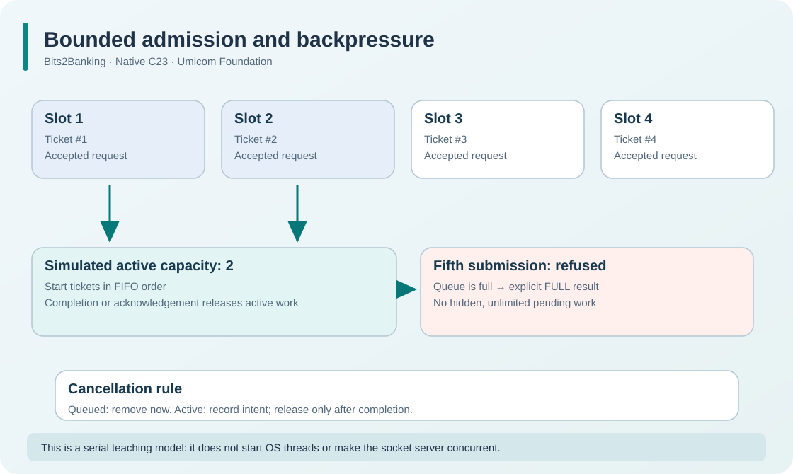

# 164. Keep a web service responsive with bounded admission

A server may receive more requests than it can finish immediately. If it accepts unlimited work, memory consumption and response time can grow without a clear limit. A safe service must decide how much work it can retain and what happens when it reaches capacity.

This chapter introduces **admission**, **backpressure** and **in-flight ownership** using a small C23 model. It does not assume that multiple threads are already running.

## 1. Three different things

Imagine four learners opening a local course page at nearly the same time.

A *queued* request has been accepted into a bounded work list but has not started its operation. An *active* request has been selected and now owns in-flight work. A *completed* request has reached a terminal result and can release its slot.

These states are not interchangeable:

```text
NEW -> QUEUED -> ACTIVE -> COMPLETE
           |        |
           |        +-- cancellation requested -> ACTIVE until completion
           +-- cancelled before work starts -> slot released
```

The difference matters when a request is already using a file handle, DMA buffer, database transaction or device. Cancelling such a request is not equivalent to safely reclaiming its resources.



## 2. Fix the capacity first

The new `admission_queue.h` declares a capacity of four records:

```c
#define BTB_ADMISSION_CAPACITY 4U
```

The owner can additionally choose how many of those requests are *simultaneously active* in the **model**:

```c
BtbAdmissionQueue queue = {0};
BtbAdmissionStatus result = BtbAdmissionInit(&queue, 2U);
```

Here `2U` means the model permits at most two active records. It does **not** create two worker threads; the demonstration runs on one serial C execution thread. We separate the policy (how much work may be admitted) from the operating-system mechanism (how workers would actually execute it).

After four requests have been retained, a fifth submit returns `BTB_ADMISSION_FULL`. The rejected request is not secretly queued somewhere else, and its output ticket is not overwritten.

## 3. Give each request a stable identity

Every admitted request receives a monotonically increasing ticket. Tickets are distinct from a requested operation's external ID.

```c
uint64_t ticket = 0U;
BtbAdmissionSubmit(&queue, 101U, &ticket);
```

That ticket identifies one admission lifetime. The implementation refuses invalid tokens and duplicate live request IDs. When a request leaves the queue, its ticket is not reused. This is how the example avoids an old completion accidentally finishing another request that later occupies the same array slot.

Tickets are not secrets or authentication credentials. A real network service would still need to derive its client identity and permissions from trusted connection state.

## 4. Cancel before or after work begins

**Queued cancellation** removes an operation that has not started and releases its slot. **Active cancellation** only records that cancellation was requested. The active owner must still finish or acknowledge the operation before releasing resources.

For example:

```c
BtbAdmissionCancel(&queue, ticket);   /* Request cancellation. */
BtbAdmissionComplete(&queue, ticket); /* Confirm active completion. */
```

The second call is necessary only when the ticket was already active. Repeating a completion on a retired ticket returns `BTB_ADMISSION_STALE` rather than changing a new request.

This mirrors a principle we encountered in [device I/O](124-cancel-quiesce-and-release-device-work.md): requesting cancellation does not prove that an external operation stopped.

## 5. Run the admission model

After building the HTTP laboratory, execute:

```powershell
Set-Location "C:\umicom\Umicom-Bits2Banking"
& ".\output\learning-build\http-loopback-server\btb-admission-demo.exe"
```

Expected output:

```text
Capacity: 4; maximum simulated in-flight: 2; queued: 2
Next admitted request: 3; active: 2
```

The important observations are the bounded capacity, FIFO choice of the next queued request and the absence of an automatic slot release after an active cancellation request.

Run the focused tests:

```powershell
ctest --test-dir ".\output\learning-build\http-loopback-server" `
  -R '^bits2banking\.http\.admission\.' --output-on-failure
```

`admission.mutations` performs 20,000 deterministic operations and checks the queue's invariant after each one. It is not random traffic on a public server.

## 6. Learn what this does not yet provide

The established `btb-http-server` still uses a **single-threaded, loopback-only socket accept/handle loop**. The admission queue in this update is a serial teaching model, not an integrated concurrent socket worker pool. It does not promise parallel request handling, lock-free operations, thread safety, TLS, Internet exposure or priority scheduling.

Adding real workers safely would first require deciding who owns route handlers, rooted file handles, shutdown state and shared counters across threads. The route service is currently a single-owner object with an explicit `busy` guard; calling it concurrently without a redesigned contract would be incorrect.

## 7. Apply the idea elsewhere

Imagine a banking dashboard requesting position updates. Would you rather let thousands of pending updates accumulate, or let a bounded service refuse additional work explicitly? What would happen to already accepted orders if a user presses Cancel?

Write down the difference between *not admitted*, *waiting*, *started*, *cancellation requested* and *completed*. Then compare that list with the C23 status values.

Next: [165. Verify real HTTP behaviour and C23 tests](165-test-conditional-http-and-admission.md).
