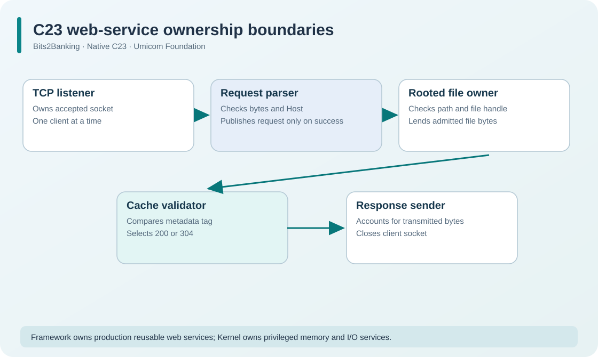

# 166. Relate HTTP revalidation and request ownership to Umicom

The C23 Bits2Banking web server is a teaching project. Its purpose is to reveal the ideas behind a service, not to replace the HTTP implementation in Umicom Framework or introduce a second production network stack.

We can deepen our understanding by following the same responsibilities in the real Umicom repositories.

## 1. Trace the request through the learning code

A browser sends a request to `127.0.0.1`. The learning server's `tcp_server.c` receives bytes. The `http.c` parser validates the request line, Host field and optional cache condition. When a static root is configured, `static_files.c` opens a checked file beneath that root. `cache_validator.c` compares the metadata tag and selects a `200` or `304` response.

The response progress owner records actual bytes accepted by the socket layer. The socket is then closed, even if a client disconnects before completion.

This is a sequence of **ownership boundaries**:



A failure at one boundary must not be silently converted into success at another. A parsed request does not mean a file was opened. An opened file does not mean a response was sent. A successful send does not prove the browser read or stored all bytes.

## 2. Find the corresponding Umicom Framework contracts

Open the public Umicom Framework sources in your browser:

- [Web server lifecycle and native connection API](https://github.com/umicom-foundation/umicom-framework/blob/main/include/umicom/web/server.h)
- [Read-only static-file service](https://github.com/umicom-foundation/umicom-framework/blob/main/include/umicom/web/static_files.h)
- [HTTP routing and service example](https://github.com/umicom-foundation/umicom-framework/blob/main/examples/web/local_service.c)
- [Native process service](https://github.com/umicom-foundation/umicom-framework/blob/main/include/umicom/platform/process.h)

The production-oriented Framework contracts emphasise a controlled listener lifetime, bounded requests, explicit file roots and ownership of server state. They may have different supported sizes, routing semantics and deployment prerequisites from our small learning server.

**Do not copy the Bits2Banking socket loop into Umicom Framework.** When developing a real Umicom application, first use the Framework's established services and their public interfaces. The standalone laboratory exists so learners can see the mechanism in a smaller programme.

## 3. Understand the operating-system boundary

A C23 programme calls `socket`, `bind`, `listen`, `accept`, `recv` and `send`. Those calls are provided by the host operating system's network stack. Their implementations and permissions are not supplied by the C language itself.

Likewise, reading a file through `ReadFile` or a POSIX file descriptor relies on operating-system services. The application is not entitled to read arbitrary addresses or physical disk sectors.

Umicom Kernel develops its own low-level services. Useful source references include:

- [Kernel VFS API](https://github.com/umicom-foundation/umicom-kernel/blob/main/include/umicom/kernel/vfs.h)
- [Process-owned file services](https://github.com/umicom-foundation/umicom-kernel/blob/main/docs/PROCESS_FILE_SERVICES.md)
- [Kernel IPC and resumable waits](https://github.com/umicom-foundation/umicom-kernel/blob/main/docs/BLOCKING_IPC.md)

The Kernel's bounded file, IPC and task-lifetime mechanisms explain why a user-space service cannot simply pass arbitrary pointers or assume that an unacknowledged operation has finished. Those Kernel capabilities do **not** imply that the original native Kernel currently provides a complete TCP/IP stack or can host our C23 web server unmodified.

## 4. Compare request ownership with a financial application

Consider a simulated treasury dashboard that requests a price chart and a position summary. The browser's HTTP request is not an order to trade. The server should separately check which data and services the caller is permitted to use. A cached chart must not bypass authorization, and a completed socket send does not establish that a position was booked in an accounting system.

In a real financial platform, networking, identity, service admission, data retrieval and business operations remain separate audited responsibilities.

## 5. Continue exploring

Locate these functions in the Bits2Banking source and explain their roles:

```text
BtbHttpParseForFiles         -> request grammar
BtbCacheCompareIfNoneMatch   -> validator decision
BtbStaticFileOpen            -> read-only rooted file selection
BtbResponseProgressAdvance   -> transmitted-byte accounting
BtbAdmissionSubmit           -> bounded pending-work model
```

Then find the corresponding responsibilities in Umicom Framework. Pay attention to naming, error states, caller-owned data, borrowing rules and cleanup. Compare the contracts rather than assuming the small laboratory implements every feature of the larger system.

**Practical extension:** Design a new learning endpoint that returns a **fictional** Notes summary without exposing an arbitrary file path. Specify its accepted method, maximum response size, authorization assumptions and failure behaviour on paper before writing code.

The next networking course will introduce nonblocking I/O, carefully bounded worker lifetimes and graceful shutdown without modifying the other Umicom repositories.
