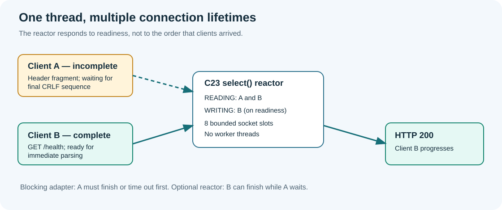

# 167. Why a slow connection should not stop everyone else

**Learning path:** Native file services and networking → HTTP caching → nonblocking I/O.  
**Practical source:** `labs/native/http-loopback-server/nonblocking_server.c`.  
**Prerequisites:** [TCP/IP and sockets](149-tcp-ip-and-native-c23-sockets.md), [safe HTTP parsing](150-parse-http11-request-bytes-safely.md), [response completion](159-handle-http-disconnects-and-response-completion.md) and [bounded admission](164-bounded-request-admission-and-backpressure.md).

## The problem to solve

Two contributors are reading the Bits2Banking course on the same development computer. One browser has sent the first half of an HTTP request but is waiting before sending the remainder. The second browser requests `/health`. Neither request needs expensive calculations. Why might the second browser still have to wait?

Our original `tcp_server.c` uses a blocking `recv()` while it serves one accepted client. A blocking read may wait for bytes, even when other clients are ready. The loop cannot return to `accept()` until the current client's response has finished or its timeout occurs. That is an understandable first implementation, but the slowest peer can decide the progress of every other peer.

**Nonblocking** does not mean that `recv()` sends data faster. It means that a socket call is permitted to return immediately when no data is available. The programme can then work on a different socket. Operating systems report which descriptors are likely to make progress through readiness interfaces such as `select()`, `poll()`, `epoll()` or IOCP. The optional Update 28 laboratory uses `select()` because its behaviour can be studied on Windows and POSIX systems without introducing another dependency.



## Readiness is not a guarantee

A call to `select()` with a socket in its readable set means an operation is *likely* to succeed without waiting. Another event can change the state before the subsequent call. For this reason the accepted sockets are also configured as nonblocking. If `recv()` returns `EAGAIN` or `EWOULDBLOCK` on POSIX, or `WSAEWOULDBLOCK` on Windows, the reactor retains the connection and waits for the next readiness signal. It does not interpret temporary unavailability as a closed connection.

Different results have different meanings:

| Result | Meaning | Owning response |
|---|---|---|
| Positive byte count | Real input arrived | Advance request buffer and monotonic progress time |
| Zero bytes from `recv` | The peer closed its sending side | Release the incomplete request |
| Would-block error | No input can be read just now | Keep the descriptor and ask for readiness again |
| Other error | Connection failed | Close the descriptor; do not claim success |
| `send` accepts fewer bytes than requested | Only part of the output was accepted by the OS | Retain the unsent suffix and retry on writable readiness |

A `send()` byte count reports data accepted into the local networking stack. It **does not** prove that the browser displayed the page, read every byte or persisted the content. The response-progress model from Update 26 remains responsible for local transmission accounting.

## Start the optional reactor

The historical blocking server remains the default. Select the new backend explicitly so a contributor can compare them:

```powershell
Set-Location "C:\umicom\Umicom-Bits2Banking"
$env:Path = "C:\msys64\ucrt64\bin;$env:Path"
cmake -S ".\labs\native\http-loopback-server" `
    -B ".\output\learning-build\http-loopback-server" `
    -G Ninja -DCMAKE_C_COMPILER="C:\msys64\ucrt64\bin\gcc.exe" `
    -DBUILD_TESTING=ON
cmake --build ".\output\learning-build\http-loopback-server" --parallel 2
& ".\output\learning-build\http-loopback-server\btb-http-server.exe" `
    --port 8765 --nonblocking
```

In another PowerShell window, run:

```powershell
curl.exe -i http://127.0.0.1:8765/health
```

Stop the server with **Ctrl+C**. A third-party Internet connection is neither used nor needed. The new loop is still bound **only** to `127.0.0.1`; it has no TLS, authentication or production hosting promises.

## A connection is not a worker thread

The implementation holds at most eight accepted connections. Each connection has its own fixed header buffer, response buffer, progress record, monotonic timestamps and optional static-file owner. **One thread** iterates over these slots. There is no shared cross-thread route-service state and no background file worker. This is genuine overlapping socket progress, not parallel CPU execution.

Update 27's four-record admission model is kept as an independent teaching contract. It is not silently treated as an eight-slot socket worker pool. The reactor's eight slots bound *real* accepted descriptors; the earlier four-slot model illustrates *logical* request admission. Their numbers and semantics differ intentionally.

## Where backpressure occurs

When all eight slots are occupied, the listener is not placed into `select()`'s readable set. The operating system may retain a small number of pending connects in its listen backlog, but our application does not allocate a ninth request buffer. When an active connection closes, the listener can admit another client. This is bounded service admission; it is not a guarantee of fairness across all waiting operating-system connections.

**Worked check:** Open one connection that sends only `GET /health HTTP/1.1\r\nHost: localhost\r\n`. The first connection is waiting for the final blank line. Send a complete request from a second connection. In the nonblocking mode, the second request can finish without waiting three seconds for the first. The automated socket integration test exercises precisely this case.

## What we have and have not built

We have built a small, read-only, single-process HTTP teaching server with bounded buffers and a finite connection budget. We have **not** implemented HTTP keep-alive, HTTP pipelining, request bodies, TLS, IPv6, threads, a production scheduler or distributed service delivery. Every connection still receives one closed HTTP response.

**Review questions:** What is the difference between readiness and completion? Why must accepted sockets be nonblocking even after `select()` returns? Why is an operating-system backlog not the same as an unbounded user-space queue? If eight clients are idle, who owns their request buffers?

**Exercise:** Draw one timeline for two clients under the blocking server and another under the reactor. Mark exactly when the second client's response can be sent. Then read [Chapter 168](168-build-a-c23-select-reactor.md) and compare your timeline with the implementation.
