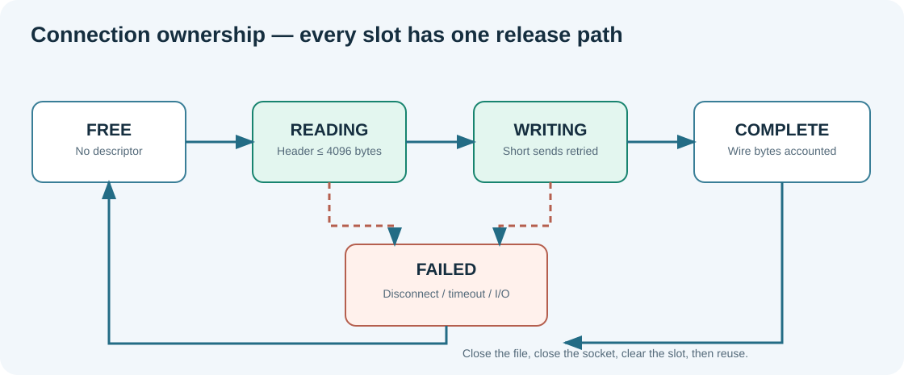

# 168. Build a bounded `select()` reactor in C23

**Learning objective:** Explain, line by line, how one service can read and write several connections without creating a worker thread.  
**Source:** `nonblocking_server.c`, `nonblocking_server.h`, `main.c`.  
**Starting point:** [Chapter 167](167-why-nonblocking-io-matters.md).

## Preserve the previous implementation

Software engineering begins by identifying the boundary that already works. In Update 28, `tcp_server.c` and its established public functions are left unchanged. `main.c` receives only an opt-in `--nonblocking` selector. The previous `--port`, `--root`, `--routes` and `--once` options retain their behaviour when that selector is absent.

This gives us a useful learning comparison: the old implementation demonstrates one blocking client owner; the new module demonstrates a bounded reactor. Both use the same length-delimited HTTP parser, route service, rooted file authority, cache-validator code and response-progress owner. We have not copied the parser or weakened the file-root rules merely to support another network strategy.

## The two operating-system operations

First create a listening socket and bind it to IPv4 loopback. `listen()` enables incoming TCP connections. Second, set both the listener and each accepted connection to nonblocking mode. The platform-specific change belongs in one private function:

```c
static int BtbNbSetNonblocking(BtbNbSocket socket)
{
#ifdef _WIN32
    u_long enabled = 1UL;
    return ioctlsocket(socket, FIONBIO, &enabled) == 0;
#else
    const int flags = fcntl(socket, F_GETFL, 0);
    return flags >= 0 && fcntl(socket, F_SETFL, flags | O_NONBLOCK) == 0;
#endif
}
```

Windows uses Winsock and `ioctlsocket`; Linux/POSIX uses descriptor flags through `fcntl`. Outside this function, the request-ownership rules are the same. Native socket types remain private to `nonblocking_server.c`, not part of the banking or Umicom Framework interfaces.

## One array owns all accepted connections

Our server uses exactly `BTB_NB_CONNECTION_LIMIT` slots, presently eight. Each slot holds an open socket handle or an invalid marker, input and output byte arrays, progress accounting, timestamp policy and an optional opened static file. The slot is stable while the connection is alive. It is **not** copied to another request or transferred to a detached task.

The state transitions are simple:



```text
FREE → READING → WRITING → COMPLETE → FREE
            ↘ FAILED ←───┘
```

A reader may receive several fragments. A writer may transmit one response in many fragments. On either failure path the same slot owner closes the file handle and socket, then clears the slot before permitting reuse. A ready socket is not necessarily a complete HTTP request; only `BtbHttpParse` or `BtbHttpParseForFiles` can decide that.

## Step 1 — build the readiness sets

At each turn, the programme clears a readable set and a writable set. A slot in `READING` adds its socket to the readable set. A slot in `WRITING` adds its socket to the writable set. The listener appears in the readable set **only** if the service is still accepting and a free slot exists.

```c
fd_set readers;
fd_set writers;
FD_ZERO(&readers);
FD_ZERO(&writers);
/* For each owned socket: FD_SET(peer, &readers) or FD_SET(peer, &writers). */
```

On POSIX, `select()` needs `largest_descriptor + 1`; on Windows its first argument is ignored. POSIX descriptors are checked against `FD_SETSIZE` before adding them. This is a real capacity constraint of `select()`, one reason production services may choose `poll`, `epoll` or a platform-specific completion API.

A 100-millisecond select timeout gives the programme regular opportunities to examine connection deadlines and a pending shutdown signal. It is not a 100-millisecond HTTP request timeout.

## Step 2 — parse only received bytes

`BtbNbRead` uses `recv()` on a socket that was reported readable. A successful result appends only the reported number of bytes to the bounded 4 KiB input buffer. The parser never guesses that a network buffer is a NUL-terminated C string. Its outcome can be *incomplete*, *accepted* or a specific refusal. If the header is incomplete, keep the slot in `READING` and continue serving other clients.

A complete request is dispatched according to the same precedence as the previous server: exact application route when enabled, otherwise the fixed `/health` endpoint or read-only static-file fallback. A wrong host/port and malformed requests use the established fixed-response function. Every response remains HEAD-aware.

## Step 3 — write only what the socket accepted

`send()` may accept 400 bytes even when 2,048 were offered. We advance the output offset by **400**, not by 2,048, and retain the remaining bytes. `BtbResponseProgressAdvance` separately records header and body bytes. Some `send()` calls cross the `\r\n\r\n` boundary; the code divides that actual accepted byte count into the two phases before accounting.

A large static resource is never loaded completely into memory. After sending its headers, the backend requests one 8 KiB file chunk using the existing `BtbStaticFileRead` function. It can deliver that chunk across several readiness cycles. File ownership is released only after a completed response or an explicit failure, timeout or shutdown.

**Important accounting distinction:** `Content-Length` describes the representation's length on a GET, but a HEAD response sends no body bytes. A `304 Not Modified` likewise carries no body. The progress owner therefore accounts for *wire bytes*, not the notional representation length.

## Step 4 — release the right owner

Every accepted socket belongs to one slot. Every opened static file belongs to that slot. The route service and static root have larger, caller-owned lifetimes established by `main.c`; the reactor *borrows* them and must never stop or free them. During shutdown it releases all connection slots before returning to `main.c`, which can then stop the route service and close the root.

This ordering is a concrete example of scoped resource ownership: a borrowed pointer may not outlive the owner. The user interface must not receive an exposed socket or the address of a stack-owned response buffer.

## Run the three inherited compositions

In one PowerShell window, after building the project:

```powershell
Set-Location "C:\umicom\Umicom-Bits2Banking"
$Root = (Resolve-Path ".\labs\native\http-loopback-server\sample_site").Path
& ".\output\learning-build\http-loopback-server\btb-http-server.exe" `
    --port 8765 --root $Root --routes --nonblocking
```

In another:

```powershell
curl.exe -i http://127.0.0.1:8765/health
curl.exe -i http://127.0.0.1:8765/api/courses
curl.exe -i http://127.0.0.1:8765/index.html
curl.exe -I http://127.0.0.1:8765/index.html
```

The first checks the fixed route, the second the registered handler, the third static files and the fourth HEAD framing. These are different owners sharing one event loop, not three listeners.

**Inspection task:** Find `BtbNbPrepare`, `BtbNbRead`, `BtbNbTrackSend`, `BtbNbWrite` and `BtbNbRelease`. For each function, write its inputs, outputs, states it may change and the exact resources it is allowed to close. Continue with [Chapter 169](169-monotonic-timeouts-and-graceful-shutdown.md).
