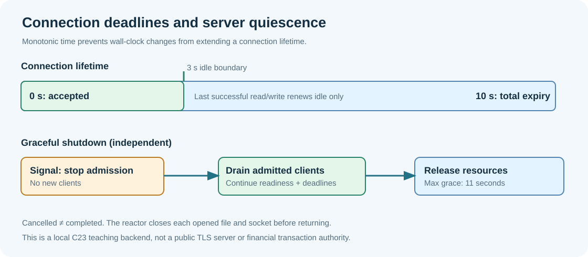

# 169. Connection deadlines and graceful server shutdown

**Purpose:** Bound elapsed service time, distinguish cancellation from completion and release network resources in a verifiable order.  
**Source:** `nonblocking_policy.h`, `nonblocking_policy.c`, `nonblocking_server.c`.  
**Prerequisite:** [Chapter 168](168-build-a-c23-select-reactor.md).

## A service needs more than one deadline

A server can be responsive under normal traffic and still retain a descriptor forever if one peer never finishes its request. There are two distinct limits:

- **Idle limit:** three seconds without useful input or output progress (`BTB_NB_IDLE_TIMEOUT_MS`). This stops a client from holding a connection while doing nothing.
- **Total limit:** ten seconds since that connection was accepted (`BTB_NB_TOTAL_TIMEOUT_MS`). This stops a peer from keeping its connection alive indefinitely by sending one character periodically.

The event loop periodically evaluates both limits. Both are measured using a **monotonic** clock: `clock_gettime(CLOCK_MONOTONIC)` on POSIX and `GetTickCount64()` on Windows. A wall-clock correction, daylight-saving change or time-zone adjustment must not grant another three seconds to an expired socket. The teaching contract rejects a regressed timestamp rather than silently increasing its budget.



## Why we subtract timestamps rather than add deadlines

Unsigned 64-bit arithmetic is broad but not infinite. A naïve expression `openedAt + timeout <= now` can overflow near the maximum representable timestamp. Our bounded comparison checks ordering first, then subtracts:

```c
if (nowMs < lifetime->openedAtMs || nowMs < lifetime->lastProgressMs)
    return 1;
return nowMs - lifetime->openedAtMs >= totalMs ||
       nowMs - lifetime->lastProgressMs >= idleMs;
```

At the exact boundary the budget has expired. On a successful read or write we update `lastProgressMs` **only after** the socket reports positive byte progress. A would-block result is not progress, and waking up because `select()` timed out is not progress. A request can therefore be sent in several chunks without resetting the overall ten-second limit.

**Worked example:** A browser connected at 1,000 ms, supplied bytes at 2,000 ms and then paused. At 4,999 ms its idle age is 2,999 ms, so it is still inside the three-second idle budget. At 5,000 ms it has been idle for exactly 3,000 ms, so its slot expires. If it supplies a byte every two seconds, the total budget still expires at 11,000 ms.

## Cancellation is not acknowledgement

A Ctrl+C request changes *intent*, not completed work. The signal handler does not call `close()`, `free()` or a logging function. It sets a `volatile sig_atomic_t` flag, and the event loop performs shutdown on its next iteration. This avoids unsafe operations inside a signal handler and keeps descriptor lifetime under the reactor's sole owner.

The shutdown sequence is:

1. Stop admitting new socket connections, and close the listener.
2. Continue giving accepted connections read/write opportunities.
3. Apply normal idle and total deadlines to those accepted connections.
4. Enforce an outer shutdown grace of eleven seconds; the grace is longer than the ten-second per-connection budget.
5. Close any remaining connection/file owners, restore the original signal dispositions and release Winsock state if applicable.

An already accepted connection might still be writing a static HTML page when Ctrl+C is pressed. The service can finish that response without accepting another browser. If an accepted connection never progresses, its three-second idle budget releases it; it cannot hold shutdown forever.

The return from `BtbHttpServeNonblocking()` is the local acknowledgement that the reactor's descriptors have been released. It is **not** an acknowledgement from the browser, a bank, a payment processor or another remote component.

## Response failure is a real state

The response-progress model from Update 26 distinguishes complete, failed and still-in-progress output. The new backend preserves that model. A client disconnect or stalled writer marks an incomplete response failed before releasing the slot. It does not advance the output offset to the expected end simply because the programme is shutting down.

An opened static file can have bytes read ahead into the 8 KiB output buffer. Reading those bytes from disk is not equivalent to sending them on the socket. `fileRemaining` tracks un-read bytes; `BtbResponseProgress` tracks bytes accepted by `send()`. Different counters represent different facts. Mixing them would generate misleading test evidence or a false success record.

## Contrast the three limit domains

| Domain | Limit | Controlled resource |
|---|---:|---|
| Request header | 4,096 bytes | Untrusted input retained per connection |
| Accepted connections | 8 slots | Open descriptors and per-connection buffers |
| Static-file chunk | 8,192 bytes | Bounded in-memory output staging |
| Idle/total connection time | 3 s / 10 s | Descriptor lifetime and stalled clients |
| Shutdown grace | 11 s | Time allowed for admitted work to finish |

The pre-existing 64 MiB static-file size policy remains enforced by the rooted-file service. Eight concurrent connections do not imply eight 64 MiB memory allocations. Each file is streamed in bounded blocks. There is still no support for HTTP message bodies, persistent connections, TLS or Internet-facing binding.

## Check the policy with deterministic tests

```powershell
Set-Location "C:\umicom\Umicom-Bits2Banking"
ctest --test-dir ".\output\learning-build\http-loopback-server" `
    -R "nonblocking" --output-on-failure
```

`test_nonblocking.c` tests the boundary `now - lastProgress == idleMs`, the total budget, monotonic-time regression, terminal-state refusal, invalid state transitions, timestamp values close to `UINT64_MAX` and a 30,000-operation seeded test. These tests do not sleep; a real clock cannot make them unreliable.

The integration test separately uses actual TCP sockets and waits for a real three-second idle expiry. It is optional when Python 3 is unavailable; a build with only native C23 tools still runs the deterministic policy tests. Windows console Ctrl+C acceptance is manual, because Windows signal delivery depends on the terminal and process-group configuration.

**Review questions:** Why does a successful `select()` wake-up not renew the idle budget? Why is the total budget separate? What is wrong with closing a socket inside a signal handler? Which component may safely stop a borrowed route service? Why does a fully sent buffer not guarantee a received page?

**Exercise:** Replace the hypothetical timestamps 1,000 and 2,000 above with 90,000 and 92,500. Calculate the exact first idle-expiry timestamp and the total-expiry timestamp. Verify your calculation against the two policy functions. Next complete [Chapter 170](170-test-and-diagnose-the-nonblocking-server.md).
