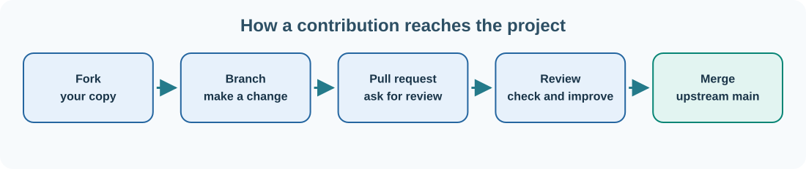

# 17. Your first Umicom contribution: fork, change, review, merge

You do not need to be an expert programmer to improve an open-source project. A clearer explanation, a corrected link, a reproducible bug report or a focused test can make the project easier for everyone else to use.

We will use the public **Bits2Banking** repository for a documentation contribution. This keeps the first exercise separate from critical framework or kernel code.



## Step 1 — choose the repository and your change

Open [Bits2Banking on GitHub](https://github.com/umicom-foundation/Bits2Banking). Read its `README.md`, then open `BEGINNERS.md`. Decide on **one small improvement** that you can explain clearly, such as correcting an outdated reference or making an ambiguous instruction more precise.

Before editing, check the actual files in the repository. A link that appears in an older guide may no longer point to an existing folder. Do not invent a replacement path; verify it using the repository's file browser.

## Step 2 — create a fork

Select **Fork** on GitHub. A **fork** is your own GitHub copy of someone else's repository. The original Umicom repository is called the **upstream** project. You can edit and push to your fork without having permission to change the upstream `main` branch directly.

When the fork has been created, note its address. It will look similar to:

```text
https://github.com/YOUR_USERNAME/Bits2Banking
```

## Step 3 — clone the fork to your computer

Open PowerShell and enter:

```powershell
New-Item -ItemType Directory -Force -Path "$HOME\UmicomLearning" | Out-Null
Set-Location "$HOME\UmicomLearning"

git clone "https://github.com/YOUR_USERNAME/Bits2Banking.git"
Set-Location ".\Bits2Banking"

git remote add upstream "https://github.com/umicom-foundation/Bits2Banking.git"
git remote -v
```

Replace `YOUR_USERNAME` with your own GitHub username. The `origin` remote points to your fork; `upstream` points to the original project. If you already cloned this repository, enter the existing folder rather than cloning it on top of itself.

## Step 4 — create a branch for the contribution

```powershell
git switch -c docs/clarify-getting-started
```

This branch separates the documentation change from your copy of `main`. For project maintainers, a repository may use a different internal integration policy; external contributors use reviewable pull requests so their changes can be examined before they enter the shared project.

## Step 5 — edit and check the file

Open `BEGINNERS.md` in an editor. Change only the paragraph or link you chose. Keep the rest of the document intact. Save the file, then inspect what actually changed:

```powershell
git status
git diff -- BEGINNERS.md
```

Read the displayed lines. If there are unrelated deletions or changes to the project's credits, stop and correct them before staging. Git makes it easier to review the change; it cannot decide for you whether the edit is appropriate.

For a small documentation edit, you can inspect the result directly on GitHub or preview the Markdown in your editor. Code compilation is not required merely to fix prose.

## Step 6 — stage, check and commit

```powershell
git add BEGINNERS.md
git diff --cached --check
git diff --cached
git commit -m "docs: clarify the beginner starting point"
```

The commit message describes the change. If Git asks you to configure your name or email, return to the Git lesson and supply your own values.

## Step 7 — push your branch

```powershell
git push --set-upstream origin docs/clarify-getting-started
```

Git may ask you to authenticate through a browser or a credential manager. Do not put your password into a repository file. After the push succeeds, open your fork in a browser.

## Step 8 — open a pull request

GitHub will often display a **Compare & pull request** button. Select it. If the button does not appear, open the **Pull requests** area and choose **New pull request**.

Check that the **base** is `umicom-foundation/Bits2Banking:main` and the **compare** branch is `YOUR_USERNAME:docs/clarify-getting-started`.

Give the request a concise title. In the description, explain the original problem, the change you made and how you checked it. For example:

> The beginner guide referred to a directory that is no longer present. I updated the navigation to point to files that exist in the current repository. I checked the link in GitHub's file browser; no executable source changed.

Select **Create pull request**. The upstream maintainers can now review the change.

## Step 9 — respond to review and merge

A reviewer may ask you to clarify a sentence or adjust the destination. Make the edit on **the same branch**, then run:

```powershell
git add BEGINNERS.md
git diff --cached --check
git commit -m "docs: refine beginner navigation after review"
git push origin docs/clarify-getting-started
```

The pull request updates automatically when you push another commit to its source branch. Once reviews and required checks are complete, an authorised maintainer can select the repository's permitted **Merge** option. Contributors without merge rights do not merge their own change into the upstream repository.

## Step 10 — update your fork for future work

After a successful merge, you can synchronise your local `main` with upstream:

```powershell
git switch main
git fetch upstream
git merge --ff-only upstream/main
git push origin main
```

The fast-forward option refuses to create an unexpected merge commit if histories have diverged. In that case, inspect the repository history before proceeding rather than forcing anything.

**Next:** [Understand how source code is built and tested](18-build-and-tests.md).
