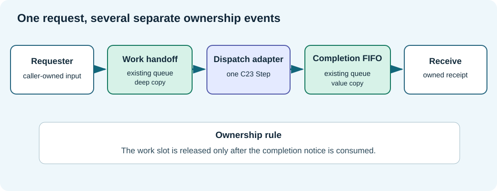

# Chapter 178 — Compose existing C23 libraries instead of duplicating them

**Bits to Banking · Engineering track · Umicom Foundation**  
**Language:** ISO C23 · **Lab:** `labs/native/work-dispatch` · **Prerequisite:** Chapter 177.

## Reuse is an architectural decision

Umicom Framework is intended to provide reusable building blocks. A team can still create technical debt if it places similar work queues in Studio, Trader, Open TMS and OS simply because each application wants a different screen. The correct question is: **which component owns the general mechanism, and which component merely composes that mechanism for a particular task?**

The new laboratory demonstrates this distinction without changing Framework: it compiles the unmodified source of two **existing educational** libraries and supplies only the missing adaptation between their public contracts. It does not claim that these teaching modules are the production Framework APIs.



## Inspect the library boundary

The dependencies are:

| Component | Existing location | Contract |
|---|---|---|
| Work handoff | `labs/native/work-handoff/handoff.h` | Copied request, slot generation, FIFO acquisition, completion/cancellation, explicit release. |
| Completion FIFO | `labs/native/completion-queue/queue.h` | Four fixed result entries, owned value copies, refuse full queue, pop one notice. |
| New dispatch adapter | `labs/native/work-dispatch/dispatch.h` | Correlate requests to results, enforce downstream capacity, release slots after delivery. |

Open the `CMakeLists.txt` in the new lab. The first library target compiles `../work-handoff/handoff.c` and `../completion-queue/queue.c`; neither file has been copied into the update ZIP or altered. The dispatch target links that existing implementation and exports only `dispatch.h` to its consumers. The tests and demo link the dispatch library.

This is **source-level reuse in the classroom**, not installation into the Umicom Framework. Shared production behaviour would require reviewing the current Framework scheduler, event bus, ownership model and build target graph. Only then would we decide which functionality is genuinely missing.

## The adapter has a reason to exist

`BtbCompletion` contains a `uint32_t requestId`, a count and a terminal result. `BtbWorkToken` identifies a work slot using `slot + generation`. They were designed for different earlier lessons. Neither type should be silently extended just to satisfy a new tutorial.

The adapter stores a short side record keyed by the existing work slot. That record associates request ID, connection ID, generation and diagnostic digest with the eventual completion. It rejects a mismatched token even when the slot index is valid. `BtbDispatchReceipt` is a **value copy**, so its caller never needs access to a borrowed queue pointer.

```c
/* An identity represents the accepted operation, not an array position alone. */
typedef struct BtbDispatchIdentity {
    uint32_t requestId;
    BtbWorkToken token;
} BtbDispatchIdentity;
```

A response for `ACCOUNT-A` must not be confused with a later request for `ACCOUNT-B` merely because both used slot zero. The generation gives the slot a lifetime. The monotonic request ID gives the teaching trace a public correlation key. Request IDs refuse exhaustion rather than wrap and reuse a previous ID.

## Error ownership and state preservation

Each operation must return a result with a defined meaning. In `BtbDispatchSubmit`, invalid pointers or oversize input return `BTB_DISPATCH_INVALID`. Capacity exhaustion returns `BTB_DISPATCH_FULL`. Quiescence returns `BTB_DISPATCH_QUIESCING`. `BtbDispatchStep` returns `BTB_DISPATCH_BACKPRESSURE` when the downstream queue cannot hold another notice. No truncation, implicit allocation or fallback network path is introduced.

Check whether rejected requests affect caller-owned output. The tests pass a sentinel identity and verify that it does **not** change on `FULL` or `INVALID`. This is *failure atomicity* as observed by the caller. The queue state is similarly unchanged on documented backpressure outcomes.

## Read the implementation in a useful order

1. `dispatch.h`: read status values, ownership comments and preconditions.
2. `CMakeLists.txt`: identify exactly where the two reused source files come from.
3. `dispatch.c`: follow `BtbDispatchSubmit` to the existing `BtbWorkSubmit`.
4. `dispatch.c`: follow `BtbDispatchStep` to `BtbWorkAcquire`, `BtbWorkComplete`, and `BtbCompletionQueuePush`.
5. `dispatch.c`: follow `BtbDispatchReceive` to `BtbCompletionQueuePop` and `BtbWorkRelease`.
6. `test_dispatch.c`: find tests showing that a cancelled request produces a terminal notice without corrupting surviving FIFO work.

## Practical assignment: add a new request type *without* a new queue

Imagine that Umicom Studio asks for a source-index preview, while Umicom Bank asks for a cash-position preview. Both should submit *owned request values* through the same scheduling contract. A product-specific controller may provide its own request formatter and outcome renderer. It should not implement another ring buffer or bypass identity checks.

Write a one-page design explaining the requester, processing service, authoritative data source, completion consumer and cancellation policy for each application. Explain why neither client UI should own the underlying dispatcher implementation.

## Limits and safety

The lab has no locks, atomics, worker threads, IO completion port, epoll/kqueue or framework module registration. Do not call `BtbDispatchSubmit` from another thread while `BtbDispatchStep` is running. CMake compiling reused source does not establish production maturity. No Framework source is modified by this teaching update.

**Next:** [Downstream backpressure](179-downstream-capacity-and-fair-scheduling.md).
