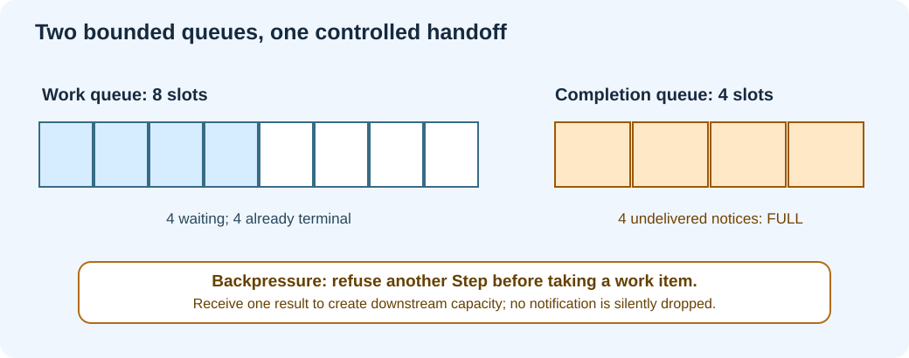

# Chapter 179 — Downstream capacity, backpressure and bounded scheduling

**Bits to Banking · Engineering track · Umicom Foundation**  
**Language:** ISO C23 · **Lab:** `labs/native/work-dispatch` · **Prerequisite:** Chapter 178.

## Why a fast producer can make a system less reliable

Suppose a bank's dashboard requests eight reports in quick succession. Its service can queue eight requests, but a separate notification path can hold only four undelivered completion records. The producer may appear fast, yet the application eventually needs an explicit answer to this question: **what happens when the destination has no capacity?**



Backpressure is the refusal or deliberate delay of new work so a slower consumer does not cause unbounded memory growth. The safe action here is to stop processing additional queued requests until the requester consumes at least one result. The dispatcher does **not** allocate an expanding overflow list. It does not drop completed results. It does not claim that a request finished when its terminal notice could not be recorded.

## Capacity is observable, not a magic constant

Read the existing `BTB_WORK_CAPACITY` (eight) and `BTB_COMPLETION_CAPACITY` (four). Their difference is intentional. It forces the test to exercise a slow completion consumer instead of passing only when all parts of the system happen to move at the same speed.

In `BtbDispatchStep`, the work queue is **not acquired** if the completion queue is full. This check occurs before the borrowed pointer exists or the work state is changed:

```c
if (BtbCompletionQueueCount(&dispatcher->notifications) ==
    BTB_COMPLETION_CAPACITY)
    return BTB_DISPATCH_BACKPRESSURE;
```

`BtbDispatchRun` has a budget from one to eight operations. It executes one request at a time and stops when it reaches the budget, runs out of work or meets backpressure. This keeps the amount of synchronous work predictable. **It is not CPU pre-emption**: one `Step` finishes before the next starts. A future thread pool must introduce additional ownership and scheduling contracts.

## Reproduce the full-queue case

Run the capacity test:

```powershell
ctest --test-dir ".\output\learning-build\work-dispatch" -R "dispatch.capacity" --output-on-failure
```

The test uses this sequence:

| Operation | Work awaiting processing | Completion notices | Interpretation |
|---|---:|---:|---|
| Submit eight | 8 | 0 | All eight records accepted. |
| Run up to eight | 4 | 4 | Exactly four can be completed. |
| Run one more | 4 | 4 | `BACKPRESSURE`, **no work removed**. |
| Try cancelling queued request | 4 | 4 | Refused until a cancellation notice can fit. |
| Receive one result | 4 | 3 | One notice and associated work slot released. |
| Cancel a queued request | 3 | 4 | Cancellation itself is a terminal notice. |

Cancellation is not an escape hatch that silently erases work. The cancellation notice consumes downstream capacity too. That is why `BtbDispatchCancel` refuses to change the queued state if the results queue is already full. Once that notice is delivered, the remaining queued requests may continue.

## FIFO is not the same as completion order

The existing work queue grants processing turns in FIFO order among surviving queued items. However, a cancellation is produced by the control path and can be delivered before earlier work completes. In the test, request two is cancelled first, so its cancellation notification appears before request one's success notification. This does not violate FIFO acquisition: cancellation and processing are different transitions.

A real service must document which ordering it promises: submission, execution start, execution finish, or consumer receipt. Promising all four would be incorrect for a concurrent system. The exercise promises FIFO **work acquisition** and FIFO **notification consumption**; it does not promise that notifications appear in original submission order.

## Diagnose an overloaded service

When a user reports that the UI is showing a spinning indicator, inspect whether the request was accepted, whether work is queued, how many completions await delivery, whether cancellation was requested and whether the receiver is still observing the right request generation. A queue-length metric alone cannot distinguish a saturated worker from a blocked receiver.

The completed dispatcher has explicit `accepted`, `succeeded`, `cancelled` and `delivered` counts. The lesson's core equations are:

```text
accepted = delivered + currently-owned work records
succeeded + cancelled = delivered + pending terminal notices
```

These equations become invariants in `BtbDispatchInvariants`, checked after every operation in the deterministic mutation test. They do **not** prove correct financial calculations, but they detect many lifetime and accounting mistakes.

## Exercise

Predict each result without running the program: (1) submit a ninth item; (2) fill all four completion slots, then call `Step`; (3) consume one result, then call `Step`; (4) cancel a queued item when the notice queue is full; (5) cancel it again after the first cancellation succeeds. Run `dispatch.capacity` and `dispatch.cancel` to check your answers.

**Next:** [Cancellation and exact completion ownership](180-cancellation-identity-and-graceful-drain.md).
