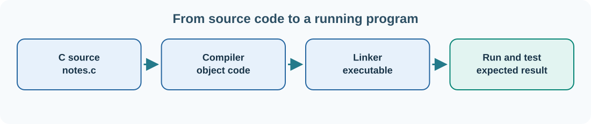

# 18. Compilers, CMake, Ninja and automated tests

When you run a Python script, the Python interpreter handles its execution. With a C or C++ application, a compiler translates source code into object files, and a linker joins the required pieces into a program. On a large project, managing every compiler command by hand would be difficult.

**CMake** describes the project and its build targets. **Ninja** is a build tool that follows the generated dependency instructions and rebuilds only what needs updating. **CTest** is a test runner commonly used with CMake.



## Build a small C project

Create a new directory named `task-count`. Inside it, save **`main.c`**:

```c
#include <stdio.h>

static int CalculateRemaining(int total, int completed)
{
    return total - completed;
}

int main(void)
{
    printf("Remaining tasks: %d\n", CalculateRemaining(12, 5));
    return 0;
}
```

Create **`CMakeLists.txt`** alongside it:

```cmake
cmake_minimum_required(VERSION 3.24)
project(UmicomTaskCount LANGUAGES C)

set(CMAKE_C_STANDARD 23)
set(CMAKE_C_STANDARD_REQUIRED ON)

add_executable(task-count main.c)

enable_testing()
add_test(NAME task-count-output COMMAND task-count)
set_tests_properties(task-count-output PROPERTIES
    PASS_REGULAR_EXPRESSION "Remaining tasks: 7")
```

`add_executable` creates a program target. `add_test` registers a test that runs that program. `PASS_REGULAR_EXPRESSION` checks that the expected text appears in the program's output.

## Configure, build, test

Open a terminal where CMake, Ninja and a suitable C compiler are installed, then run from the `task-count` directory:

```powershell
cmake -S . -B build -G Ninja -DCMAKE_BUILD_TYPE=Debug
cmake --build build
ctest --test-dir build --output-on-failure
```

The first command **configures** the project and writes generated build files into the `build` directory. The second compiles and links the program. The third runs the registered test. You should see a passing test for `task-count-output`.

If CMake cannot locate a compiler or Ninja, confirm that both are installed and available in your terminal. On Windows, the Umicom UCRT64 toolchain later provides explicit compiler and Ninja paths. Do not assume that CMake automatically chooses the right compiler when several toolchains are installed.

## Change the source and re-test

Change the `12` in `main.c` to `13`. Rebuild and run the tests again:

```powershell
cmake --build build
ctest --test-dir build --output-on-failure
```

The program now reports 8 remaining tasks, so the test should fail: its expected result still says 7. This is a useful failure because the test detected a behaviour change. Decide whether the new behaviour is correct and then update the test accordingly.

## Why we preserve tests

A **unit test** checks a small component. An **integration test** checks how components work together. A **regression test** protects behaviour that should continue to work after future changes. A **smoke test** quickly checks that an important application path starts and responds.

Large systems need all these levels. In Umicom Framework, public contracts should be tested independently of a complete Studio or Trader session wherever possible. A successful compile is not proof that a banking event was recorded correctly or that a saved task can be restored.

## Debugging and diagnostics

Read the **first meaningful error** in a failed compile rather than just the final line saying the build stopped. The error usually identifies a file path, line number and complaint. Warnings are also valuable: they may identify unsafe conversions, unused variables or suspicious memory operations.

A debugger can pause a running program, inspect its variables and step through code. Umicom Studio aims to provide these features inside a reusable development environment, but the concepts apply to any toolchain.

**Next:** [Store structured data in a database](19-databases.md).
