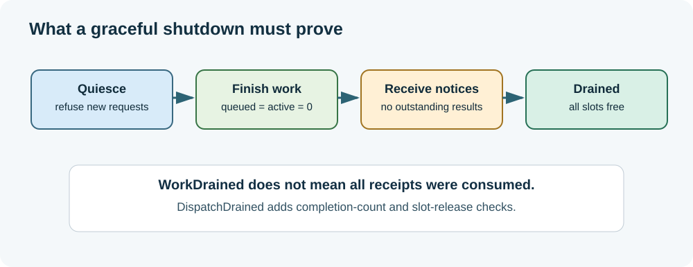

# Chapter 180 — Cancellation, request identity and graceful drain

**Bits to Banking · Engineering track · Umicom Foundation**  
**Language:** ISO C23 · **Lab:** `labs/native/work-dispatch` · **Prerequisites:** Chapters 174, 175 and 179.

## A cancellation request is not a vanished operation

Imagine a treasury analyst opens a liquidity view and then immediately changes the reporting date. The first request is no longer useful to that view. It is tempting to erase the first request as though it had never existed. Doing so loses evidence about accepted work and can create a worse error when an old result arrives after a newer one.

The Update 30 teaching adapter keeps two important distinctions: **queued versus terminal**, and **cancellation versus completion delivery**. A queued request can be cancelled with an explicit terminal record. A processed request cannot be retroactively declared never to have run. A completion already produced must still be drained, even if its UI consumer is no longer interested in rendering it.



## Identity means more than a slot number

Each accepted request has `requestId`, `token.slot`, and `token.generation`. The slot locates a fixed queue entry. The generation distinguishes successive uses of that slot. The request ID correlates with the completion FIFO's legacy format.

After `BtbDispatchReceive` consumes the terminal notice, the underlying handoff slot becomes `BTB_WORK_FREE`. A future request can use the same slot with a different generation. `BtbDispatchCancel` compares all identity parts. A late cancellation carrying an old token returns `BTB_DISPATCH_STALE` rather than cancelling the new occupant.

```c
BtbDispatchIdentity older, newer;
/* Submit, Step, Receive the older request here. */
/* Submit a newer request that may reuse the same slot. */
/* Cancel(older) must return BTB_DISPATCH_STALE. */
```

Inspect the complete implementation and test in `test_dispatch.c` rather than treating the abbreviated sequence above as a standalone program. The `stale` CTest case proves slot reuse, generation increase and refusal of the previous identity.

## State transitions are explicit

| Current work state | Requested action | Result |
|---|---|---|
| Queued | Cancel, notice space available | `BTB_DISPATCH_OK`; terminal cancellation published. |
| Queued | Cancel, results full | `BTB_DISPATCH_BACKPRESSURE`; remains queued. |
| Completed, notice outstanding | Cancel | `BTB_DISPATCH_FINAL`; no state change. |
| Cancelled, notice outstanding | Cancel again | `BTB_DISPATCH_FINAL`; no second notice. |
| Released and slot reused | Cancel previous identity | `BTB_DISPATCH_STALE`. |
| Any state after quiescence | Submit new work | `BTB_DISPATCH_QUIESCING`. |

The adapter does not expose asynchronously running work because `Step` executes synchronously under one owner. It therefore does not claim that a worker can be interrupted midway. This is a conscious limit, not an omitted feature hidden from the reader.

## Graceful shutdown has multiple gates

`BtbDispatchQuiesce` invokes the existing handoff queue's quiescence control. It refuses future admission while allowing previously accepted records to finish or be cancelled and delivered. The shutdown gate is complete only when:

1. No new requests can be admitted.
2. No queued or active requests remain.
3. Every terminal notification has been consumed.
4. Every original work slot has been released.

The existing `BtbWorkDrained` checks queue execution state, but it is not the complete lifecycle check for the new composition. `BtbDispatchDrained` additionally insists that the result queue is empty and all work slots are free. One request can be **finished but not drained**; `dispatch.quiesce` tests precisely this distinction.

## Practical examination

Build the lab (Chapter 177), then run:

```powershell
ctest --test-dir ".\output\learning-build\work-dispatch" -R "dispatch.(stale|quiesce|cancel)" --output-on-failure
```

In a debugger, stop immediately after `BtbDispatchQuiesce`; inspect `work.quiescing`, `work.queued`, `notifications.count` and `BtbDispatchDrained`. Step once, inspect again, then receive the result. Why must the drain predicate remain false between processing and receipt?

## Applying this to Umicom services

A Studio editor may discard a stale search result because its document version changed. A Trader chart may discard an outdated candle-range calculation. A TMS operator may cancel a report request, but already committed business events are not undone merely because a UI callback was cancelled. Distinguish the **control-plane request to stop** from the **domain action that has actually happened**, and use the domain's authoritative service and audit controls for irreversible actions.

**Next:** [Test the composed service and define the Framework boundary](181-verify-and-integrate-umicom-services.md).
